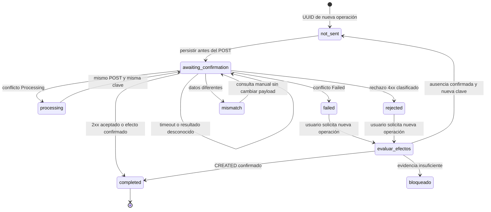
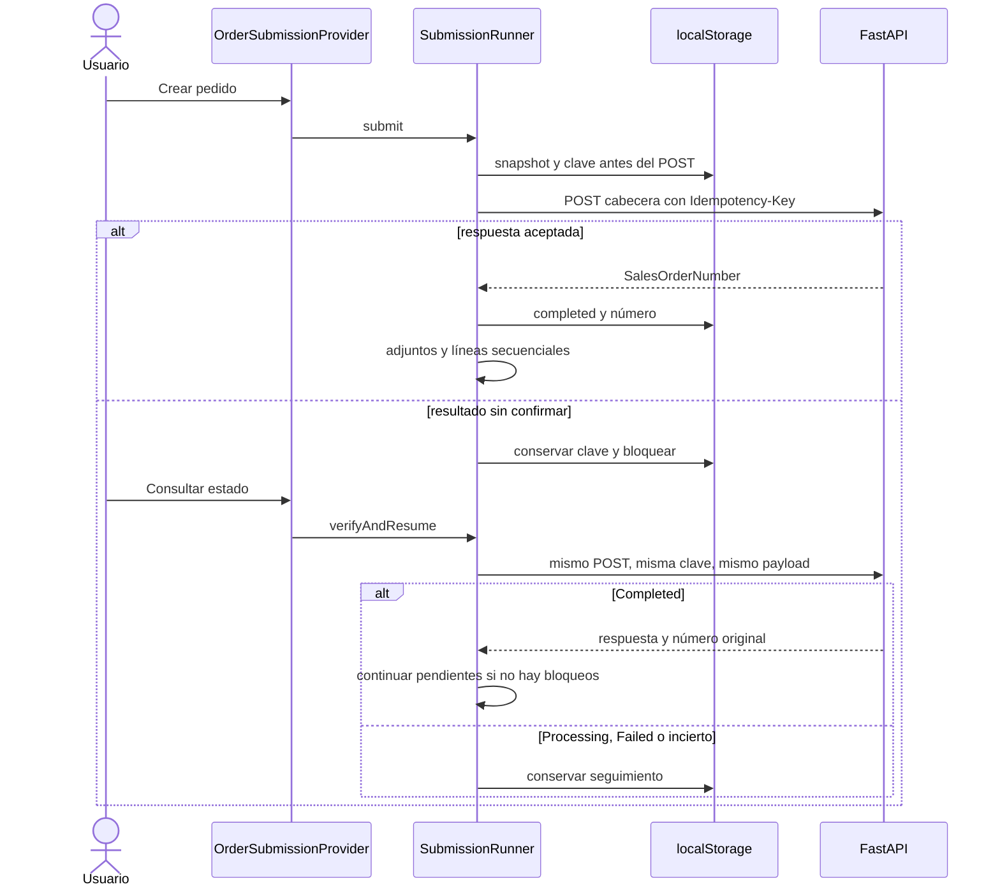
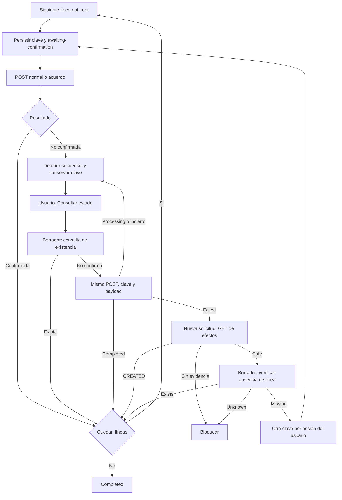

# Idempotencia y recuperación de pedidos — Sales4App Web

> Revisión documental: 2026-10-13. Estado contrastado con el Frontend local, incluidos cambios sin confirmar. No se modificó código, Backend ni Mobile. No se ejecutaron operaciones reales contra Dynamics.
>
> Una clave permite ejecutar una operación una sola vez. «Consultar estado» utiliza el mismo POST, la misma Idempotency-Key y el mismo payload. Un GET complementario **sí está implementado**, exclusivamente para verificar efectos y autorizar una nueva solicitud con otra clave.

## 1. Objetivo y alcance

Evitar duplicar cabeceras y líneas cuando se pierde la respuesta, se recarga la página o se recupera un pedido parcial. Aplica a `/crear-pedido/*` y alta de líneas sobre pedidos existentes. Adjuntos, soporte y mantenimiento tienen controles separados sin estas claves.

El Frontend conserva identidad y snapshot; la unicidad, registro Processing, replay Completed y no ejecución de Failed son garantías **requeridas del Backend**, no implementadas por React. Web y Mobile consumen el mismo FastAPI según el contexto del proyecto. No hay evidencia de pruebas reales Mobile en esta revisión.

## 2. Archivos y responsabilidades

| Archivo | Papel |
|---|---|
| `src/features/orders/submissionRunner.ts` | Orquestador del envío (encabezado → adjuntos → líneas) |
| `src/features/orders/OrderSubmissionProvider.tsx` | Contexto que ejecuta, reanuda y recupera el envío |
| `src/features/orders/orderSubmissionService.ts` | Gateway HTTP de creación y verificación |
| `src/features/orders/orderSubmissionMapper.ts` | Payloads de encabezado/línea; `sameLine`, `isDraftLineAlreadyCreated` |
| `src/features/orders/idempotency.ts` | Contrato de `Idempotency-Key` y clasificación de errores |
| `src/features/orders/mutationOutcome.ts` | Clasificación de resultados ambiguos (otras mutaciones) |
| `src/features/orders/submissionStorage.ts` | Persistencia de la ejecución en `localStorage` |
| `src/features/orders/types.ts` | Modelo `OrderSubmission` / `SubmissionLine` |
| `src/features/orderDraft/*` | Borrador (`OrderDraftProvider`, `storage`, `validation`, `domain`) |
| `src/components/pages/OrderDraftReviewPage.tsx` | UI de revisión, envío y recuperación |
| `src/components/pages/AddExistingOrderLinePage.tsx` | Alta de líneas sobre un pedido existente (también usa claves) |
| `src/core/api/apiClient.ts`, `src/core/api/errors.ts` | Timeouts (60 s en creaciones), clasificación HTTP, reintento por 401 |
| `src/app/providers/SessionProvider.tsx`, `src/App.tsx` | Cambio de compañía, `DraftEditableRoute` |

| Archivo adicional | Papel actual |
|---|---|
| `src/features/orders/operationTracking.ts` | Predicados de seguimiento y `assessNewRequest`: evidencia safe/created/blocked |
| `src/features/orders/orderSubmissionService.ts` | Incluye GET complementario y parser estricto `mapIdempotencyStatus` |

Las referencias a otro checkout Backend en el documento anterior son evidencia histórica de su autor. No se inspeccionó ni se supone desplegado `C:\repos\Sale4app_proxy\fa-sales4app-proxy`. Este documento describe las llamadas y reglas comprobables en el Frontend actual. La verificación del Backend desplegado queda pendiente.

## 3. Reglas de negocio y estados

### 3.1 Estados remotos y comportamiento

| Estado | Comportamiento contractual | Acción Web |
|---|---|---|
| No existe | Registrar Processing y ejecutar una sola vez | Persistir clave antes del primer POST |
| Processing | Informar que sigue pendiente | Conservar clave, detener secuencia y permitir consulta manual |
| Completed | Recuperar respuesta y referencia original | Confirmar cabecera/línea y continuar con pendientes cuando sea seguro |
| Failed | Informar fallo sin ejecutar otra vez | Evaluar efectos; no renovar clave al consultar |
| Resultado incierto | No se puede afirmar éxito ni fallo sin efectos | Bloquear nuevas creaciones hasta aclararlo |

Un Failed o rechazo 4xx no demuestra por sí solo ausencia de efectos. `canRetryWithNewKey` e `isRetryableTracking` clasifican candidatos para evaluación; **no constituyen autorización suficiente**. La decisión efectiva requiere `assessNewRequest`.

### 3.2 Clasificación HTTP local

`classifyCreationError` reconoce 409 de tipo backend y 500 cuyo detail comienza por 409. Interpreta «en procesamiento», «procesada previamente y fall…» y «petición diferente». Los demás 409 y 5xx son unknown. Otros 4xx de tipo backend/forbidden/authentication, salvo 408/429, son rejected; 401 puede ser rejected tras el tratamiento de autenticación. Timeout, red y errores no tipados son unknown. Un texto nuevo o respuesta inválida nunca autoriza otra clave.

| Seguimiento local | Significado | Nueva clave |
|---|---|---|
| not-sent | Operación aún no enviada | Ya tiene su UUID |
| awaiting-confirmation | POST enviado sin resultado confirmado | Bloqueada |
| processing | Processing remoto reconocido | Bloqueada |
| completed | Efecto confirmado/replay o existencia verificada | No crear otra operación |
| failed | Failed remoto reconocido | Solo tras evidencia complementaria y acción del usuario |
| rejected | Rechazo HTTP clasificado | Solo tras evidencia complementaria y acción del usuario |
| mismatch | Clave asociada a datos distintos | Bloqueada; revisión manual |

`OrderSubmission.status` describe el envío completo; `headerTracking` y `SubmissionLine.tracking` describen cada operación. `failed` global puede acompañar cabecera incierta; no debe confundirse con Failed remoto.

## 4. Ciclo de vida de claves

### 4.1 Generación y persistencia

`initial(draft)` genera un UUID para cabecera y cada línea. La página de pedido existente lo genera al añadir a su cola. No se generan dentro del servicio HTTP ni al consultar. Antes de cada POST se persiste clave y seguimiento incierto: `publish(state,true)` en runner; `commit()` síncrono en la página existente.

Claves se conservan ante Processing, timeout, error de red, 5xx y F5. Un snapshot reconstruye el payload original; modificar ese payload con la misma clave viola el contrato y puede causar mismatch. Un servicio nunca reemplaza la clave que recibe.

### 4.2 Nueva solicitud

`assessNewRequest(gateway,companyId,key)` lee GET complementario. Solo autoriza:
- status=Failed, dynamicsEffect=NONE y newRequestAllowed=true;
- o 404 específico que confirme que nunca existió una operación registrada.

CREATED recupera el efecto existente. UNKNOWN, Processing, campos ausentes, consulta fallida y 404 genérico bloquean. La nueva clave pertenece a una operación lógica nueva iniciada por el usuario, no a una consulta. En líneas del borrador se exige también comprobar que no existen.



## 5. Flujo de cabecera

### 5.1 Primera ejecución

Validar borrador, idioma y personnelnumber; comprobar adjuntos locales de pago cuando corresponda. Persistir headerTracking=awaiting-confirmation y UUID antes de POST /d365/sales. La respuesta debe ser un arreglo cuyo primer elemento contenga SalesOrderNumber no vacío. Guardar número y completed; continuar con adjuntos y líneas.

Ante cualquier error se conserva seguimiento incluso para 4xx. Unknown/processing/mismatch mantienen headerAmbiguous=true. Un envío recuperado con operación sin resolver no envía automáticamente.

### 5.2 Consulta y recuperación de efectos

«Consultar estado» del provider llama `verifyAndResume`. Para cabecera pendiente usa createHeader con mapHeaderRequest del snapshot y la clave persistida. Completed recupera el mismo número; no crea cabecera con otra clave. Processing/Failed/unknown detienen el flujo. Si todo queda confirmado y sin errores pendientes continúa con adjuntos/líneas no enviados.

Cuando el usuario solicita una nueva cabecera tras failed/rejected, `assessHeaderRetry` consulta GET complementario. CREATED con salesOrderNumber recupera la cabecera, incluso si el Backend informa Failed parcial. CREATED sin número bloquea revisión manual. Solo evidencia safe permite eliminar la recuperación anterior e iniciar otro envío con claves nuevas desde el borrador vigente. Confirmar manualmente «Mis pedidos» **no sustituye** esta evidencia.



## 6. Flujo de líneas

### 6.1 Líneas del borrador

Cada línea conserva localId, draftLine, clave, tracking, attempts y backendLineNumber. La cabecera confirmada aporta SalesOrderNumber. `createLines` omite completed, envía not-sent secuencialmente y se detiene en el primer resultado no confirmado; no existe segundo intento automático. La bonificación ligada no avanza tras fallar su línea precedente.

En consulta, `verify` comprueba primero `lineExists` mediante **POST de lectura** /d365/sales/line/query (primera página, perpage=1000). Si la coincidencia es suficiente la marca creada; si no, consulta el POST original con la misma clave/payload. `verifyAndResume` continúa solo si no quedan operaciones inciertas, fallidas ni error de adjuntos.

`prepareRetry` para failed/rejected exige GET complementario. CREATED marca creada. Blocked conserva clave y motivo. Safe verifica además existencia heurística: exists confirma; unknown bloquea; missing genera otra clave y persiste not-sent antes de enviar.

### 6.2 Líneas sobre pedido existente

`AddExistingOrderLinePage` conserva PendingLine en sessionStorage con estados pending/submitting/failed/ambiguous. Restaurar submitting produce ambiguous, sin envío automático. El modo verify usa el mismo POST/clave/payload para ambiguous y nunca renueva claves. Si solo quedan pending, continúa con primeras ejecuciones; un error detiene el modo send.

En failed, una nueva acción send consulta assessNewRequest: CREATED retira la línea de la cola; blocked conserva y detiene; safe genera otra clave. **No hace la comprobación heurística adicional del runner antes de renovar**: depende de evidencia del GET. El modo send exige comprobante de pago cuando corresponde y luego invalida consultas del pedido.



## 7. Timeout, respuestas tardías y F5

ApiClient usa 60 segundos para creaciones. Abort termina la espera del navegador; el Frontend no puede concluir que el Backend canceló o que Dynamics no creó. Unknown conserva UUID y bloquea nuevas creaciones. Una respuesta tardía no es un push recibido por el navegador: se recupera mediante otra consulta POST/replay o verificación de efecto.

Tras F5, loadSubmission normaliza creating-header sin número a failed + headerAmbiguous + awaiting-confirmation; líneas creating pasan a unconfirmed. Otros estados activos pasan a awaiting-confirmation o partial-failure. Adjuntos interrumpidos pasan a partial-failure sin retry automático. No se ejecuta ningún POST por cargar storage.

ApiClient permite una repetición tras renovar token ante 401; conserva método/body/headers, incluida Idempotency-Key. Esto es una excepción de transporte de autenticación a «sin retries automáticos del runner», no una clave nueva. No se verificó aquí en vivo dónde el Backend rechaza 401.

```mermaid
sequenceDiagram
  participant W as Web
  participant S as Storage
  participant B as FastAPI
  participant D as Dynamics
  W->>S: persistir clave y snapshot
  W->>B: POST operación
  B->>D: ejecución según contrato remoto
  W->>W: timeout o recarga, resultado incierto
  Note over B,D: Puede haberse aplicado; Web no confirma cancelación
  W->>S: recuperar misma clave y snapshot
  W->>B: consulta manual con mismo POST
  alt Completed
    B-->>W: respuesta original
    W->>S: guardar referencia
  else Processing o incierto
    B-->>W: pendiente o error
    W->>W: mantener bloqueo
  else Failed
    B-->>W: fallo sin nueva ejecución
    W->>W: esperar evaluación de efectos y acción del usuario
  end
```

## 8. Persistencia y prevención de duplicados

| Dato | Ubicación | Aislamiento y duración |
|---|---|---|
| Ejecución, snapshot, UUID, tracking, número | localStorage: sales4app.orderSubmission.v1.<cuenta>.<compañía> | Segmentos codificados con encodeURIComponent; cuenta/compañía validadas; sin TTL |
| Borrador | localStorage: sales4app.orderDraft.v1 | Cuenta/compañía; TTL 7 días |
| Cola de pedido existente | sessionStorage: sales4app.existingOrderPendingLines.v1:<cuenta>:<compañía>:<pedido> | F5/navegación; cierre de pestaña elimina |
| Adjuntos File | Memoria | No sobreviven F5 |

El borrador se limpia también en logout, cambio de compañía y reset; no únicamente al completar. Recovery del envío se conserva al logout, salvo descarte/nueva operación autorizada. No se almacenan tokens en el registro transaccional. Claves existentes nunca se reemplazan en normalize. Legacy sin clave recibe UUID solo para línea; si ya fue intentada queda incierta y puede requerir conciliación manual.

Doble clic se controla en provider/runner y página de pedido existente. Completed se omite. Los locks son por instancia; **no hay exclusión multi-tab**. La garantía definitiva de unicidad requiere Backend. Cambiar compañía conserva recovery y filtra por cuenta/compañía; los controles de cambio consultan estado persistido, por lo que no equivalen a coordinación global de pestañas.

## 9. Contratos HTTP

### 9.1 Encabezados y creaciones

Todas las llamadas heredan Accept/Content-Type application/json y Authorization Bearer del ApiClient.

| Método/ruta | Payload real | Respuesta aceptada por Web | Errores |
|---|---|---|---|
| POST /d365/sales | SalesHeaderRequest: mapHeaderRequest(snapshot) | Arreglo, primer SalesOrderNumber obligatorio | classifyCreationError; ausencia de número mantiene incertidumbre |
| POST /d365/sales/line | SalesLineRequest: compañía, pedido, artículo, dimensiones, precio, cantidad, sitio, almacén, promoción opcional, FABonification | Arreglo o @odata → ExistingSalesLine[] | Igual; conflicto puede estar envuelto en 500 |
| POST /d365/sales/line/agreement | Normal + MatchingAgreementLine y ChangeShippingWarehouseId vacío | Igual | Igual |
| POST /d365/sales/line/query | filters.dataAreaId y SalesOrderNumber en arreglos, cross_company=true, page=1, perpage=1000 | Arreglo o @odata → ExistingSalesLine[] | Consulta fallida produce unknown de existencia |

Los tres POST de creación agregan Idempotency-Key UUID. La lectura /query no es una consulta de estado por clave. Fuente: `src/features/orders/orderSubmissionService.ts`, tipos en `types.ts` y mappers en `orderSubmissionMapper.ts`. Campos completos de cabecera incluyen cliente facturación/pedido, moneda, idioma, personnelnumber y dirección; opcionales: entrega, fechas, acuerdo, vendedor, NIF, origen, observaciones y referencia cliente. No se incluyen descuentos almacenados como campos adicionales de creación de línea.

### 9.2 GET complementario de efectos

GET /d365/idempotency/{key}?dataAreaId=<compañía>, sin body, key/query codificadas. No agrega Idempotency-Key. Respuesta **validada por el Frontend**:

| Campo | Valores admitidos |
|---|---|
| status | Processing, Completed, Failed |
| dynamicsEffect | CREATED, NONE, UNKNOWN |
| newRequestAllowed | boolean obligatorio |
| salesOrderNumber | texto no vacío o null |
| lineReference | texto no vacío o null |

No es una respuesta real capturada. `mapIdempotencyStatus` rechaza los tres campos obligatorios ausentes/inválidos. Solo un ApiError 404 con detail que coincida con «no existe una operación registrada» se convierte a null/safe; 404 de endpoint ausente conserva bloqueo. Tiempo por defecto: 20 s.

### 9.3 Separación de mecanismos

- **Consultar resultado existente:** POST original + misma clave + mismo payload.
- **Verificar existencia de líneas:** POST /line/query, heurístico.
- **Autorizar otra clave o recuperar efectos parciales:** GET complementario al solicitar nueva operación tras failed/rejected.

La propuesta previa de sustituir «Consultar estado» por GET no forma parte de la implementación. Contratos estructurados de error, conciliación remota e idempotencia de adjuntos son recomendaciones, no capacidades nuevas del Frontend.

## 10. Pruebas y calidad

### 10.1 Resultado actual

2026-10-13: `npm run test` ejecutó **179 pruebas: 170 aprobadas / 9 fallidas**, 26 archivos aprobados / 6 fallidos y 2 rechazos no controlados. `npx tsc --noEmit` y `npm run lint` terminaron sin errores. El intento inicial Vitest falló por spawn EPERM del sandbox; se completó la ejecución local con permiso de proceso. No se ejecutó build, E2E ni cobertura.

Los 165 aprobados / 9 fallidos de 174 pruebas son históricos. Fallos actuales y causas observadas en §16 del manual: orderManagement (3), OrderDetailPage (2), OrderAttachmentsPage (1 y 2 rechazos), SupportPage (1), address (1), catalogService (1).

### 10.2 Escenarios

Archivos de creación/idempotencia aprobados en la suite: idempotency.test.ts (8), submissionRunner.test.ts (32), submissionStorage.test.ts (5), orderSubmissionService.test.ts (3), OrderDraftReviewPage.test.tsx (6): **54 pruebas**.

Se conserva la siguiente matriz de escenarios de la documentación anterior; sus nombres históricos abreviados orientan la búsqueda, no sustituyen los nombres actuales del archivo:

| # | Escenario | Referencia histórica de prueba (ver nombres actuales en fuente) |
|---|---|---|
| 1 | Cabecera creada correctamente | `1. crea el encabezado y las líneas una sola vez cada uno` |
| 2 | Cabecera InProgress | `2. un encabezado Processing no se reenvía…` |
| 3 | Cabecera Completed | `3. … recupera su número de pedido con la misma clave` |
| 4 | Cabecera Failed | `4. … solo se reintenta con una clave nueva tras la confirmación` |
| 5 | Timeout en cabecera | `5. un timeout del encabezado conserva la clave…` |
| 6 | Línea creada | `6. crea cada línea con su propia clave persistida` |
| 7 | Línea InProgress | `7. una línea Processing no se reenvía y detiene las siguientes` |
| 8 | Línea Completed | `8. … se confirma sin crearla de nuevo…` |
| 9 | Línea Failed | `9. … clave nueva tras confirmar que no existe` |
| 10 | Timeout en línea | `10. un timeout de línea no se trata como fallo…` |
| 11 | Doble clic | `11. el doble clic no produce dos solicitudes` (+ `busy` en la UI) |
| 12 | Recarga con operación pendiente | `12. una línea en curso al recargar…` + pruebas de `submissionStorage` |
| 13 | Pedido parcial | `13. recupera un pedido parcial…` |
| 14 | Cambio de compañía | `14. la recuperación de una compañía no se ofrece en otra` |
| 15 | Respuesta tardía | `15. una respuesta tardía del Backend se incorpora al consultar de nuevo` |
| 16 | Estado desconocido | `16. un estado no reconocido por el Backend se mantiene pendiente` |
| 17 | Reintento bloqueado | `17. …bloqueado mientras exista una operación sin confirmar` (+ UI) |
| 18 | Reintento autorizado | `18. el reintento autorizado por el Backend usa una clave nueva una sola vez` |


Además se verifican cabecera Failed sin evidencia, efectos parciales CREATED, CREATED sin número, estado/efecto desconocido, clave nunca registrada y rechazo 4xx con seguimiento conservado. Las pruebas usan gateways/mocks, sin Dynamics real. Falta prueba dedicada del parser de GET y sus 404, y del flujo completo de alta sobre pedido existente. No hay porcentaje de cobertura medido.

### 10.3 Validación pendiente

Smoke autorizado en entorno de prueba: replay recupera pedido original, timeout/F5 no generan duplicados, Processing bloquea, Completed continúa pendientes y Failed parcial recupera efectos. No hacer estas verificaciones contra Dynamics productivo ni afirmar validación Mobile sin evidencia.

## 11. Riesgos y limitaciones

| Riesgo | Control actual | Pendiente |
|---|---|---|
| Consulta POST cuya primera petición nunca llegó | Misma clave estable; puede ser primera ejecución | Confirmar unicidad del Backend desplegado |
| Failed parcial indistinguible por POST | GET de efectos antes de nueva clave; CREATED recupera | Validar contrato GET publicado y referencias |
| GET ausente, 404 genérico o evidencia incompleta | Bloqueo conservador | Alineación Backend/despliegue |
| Processing prolongado | Consulta manual; nunca cambia clave para eludirlo | Conciliación remota, no verificada |
| Conflictos por texto y 500 envueltos | Texto desconocido mantiene incertidumbre | Códigos estructurados |
| Existencia heurística de líneas | sameLine y descuento de coincidencias ya confirmadas | Correlación por clave/referencia; más de 1000 líneas |
| 2xx de línea vacío | mapExistingLines puede producir []; runner marca completed por éxito HTTP | Validar respuesta y efectos en contrato Backend |
| Adjuntos sin idempotencia | Confirmación por nombre/descripción; bloqueo incierto | Primera página de 20 y archivos perdidos tras F5 |
| Descartar recovery incierto | Confirmación UI advierte pérdida de seguimiento | No cancela efecto remoto; riesgo de duplicar con otro envío |
| Pendientes de pedido existente en sessionStorage | Conserva F5 | Cierre de pestaña pierde seguimiento |
| Locks por pestaña y storage mutable | UUID y aislamiento local | Sin coordinación multi-tab ni cifrado |
| Claves antiguas ausentes | Recuperación conservadora | No identifica el intento original |
| Snapshot/payload reconstruido | Snapshot persistido | Cambios de mapper entre versiones pueden alterar payload |
| Suite incompleta | Resultados reales documentados | Corregir nueve fallos fuera del alcance documental |

## 12. Anexo histórico de la revisión anterior

Se conserva el análisis válido de problemas y cambios anteriores para trazabilidad. **No describe acciones ejecutadas en esta tarea documental ni la regla vigente de autorización de nuevas claves.** Las menciones a verificación manual de cabecera, nueva clave tras Failed sin evidencia GET, métodos anteriores y estados del Backend externo corresponden a esas revisiones. Prevalecen §§3–11, contrastadas con el código actual.

### 12.1 Problemas detectados en revisiones anteriores

| # | Severidad | Problema | Evidencia (antes) |
|---|---|---|---|
| P1 | Crítica | **Segundo POST automático de una línea** tras un error: el runner verificaba y, si no veía la línea, la reenviaba (hasta 2 intentos) sin confirmación del Backend | `SubmissionRunner.submit` (bloque `if (operational.attempts >= 2)` / `create()` repetido) |
| P2 | Crítica | **Un 500 de línea se trataba como fallo confirmado** y renovaba la clave (`canRenewIdempotencyKey` incluía `status === 500`), contradiciendo `isAmbiguousError` (5xx = ambiguo). Como el router de líneas convierte todo error en 500, un fallo de infraestructura posterior al INSERT en D365 producía **reenvío con clave nueva → posible línea duplicada** | `idempotency.ts`, `submissionRunner.ts`, `AddExistingOrderLinePage.tsx` |
| P3 | Alta | Tras una línea sin resultado, el runner **continuaba con las siguientes** (incluida la bonificación ligada a esa línea) | Bucle de líneas con `continue` |
| P4 | Alta | "Verificar con la misma operación" del encabezado ejecutaba **el envío completo** (encabezado, adjuntos y líneas) en una sola acción | `retryPending` → `run(submission)` |
| P5 | Alta | Al recargar con una línea en curso (`status: 'creating'`), la recuperación la trataba como no creada y **la reenviaba en bloque**; el estado `creating-lines` persistido quedaba "activo" indefinidamente | `submissionStorage.normalize` sin tratamiento de líneas |
| P6 | Media | La verificación sin POST (`getExistingLines`) solo leía **25 líneas** | `orderSubmissionService.getExistingLines` (`perpage: 25`) |
| P7 | Media | Alta de líneas sobre pedido existente: líneas restauradas en `submitting` se reenviaban; líneas ambiguas quedaban bloqueadas sin forma de consultar su estado | `AddExistingOrderLinePage.restorePendingLines`, `sendPendingLines` |
| P8 | Media | Al reanudar un pedido ya creado, la validación exigía de nuevo el comprobante de pago local (ya subido y retirado de memoria) e impedía continuar | `SubmissionRunner.submit` (validación de adjuntos) |
| P9 | Baja | Pruebas que codificaban el reintento automático; 2 pruebas de creación fallaban (contrato GET obsoleto, mock sin `attachments`) | `submissionRunner.test.ts`, `orderSubmissionService.test.ts`, `OrderDraftReviewPage.test.tsx` |
| P10 | Alta (Backend) | Sin endpoint de consulta de estado; estados solo distinguibles por texto de `detail`; 500 en líneas oculta el estado real; `Processing` permanente si falla `complete_request`; `Failed` puede coexistir con un documento creado si la excepción ocurre después del INSERT | Ver §1 Backend |

---

### 12.2 Cambios reportados anteriormente

| Archivo | Cambio |
|---|---|
| `src/features/orders/idempotency.ts` | Nuevo `classifyCreationError` (`processing`, `failed`, `mismatch`, `rejected`, `unknown`) basado en el contrato real del Backend (409 en encabezado, 500 con `detail "409: …"` en líneas). `canRetryWithNewKey` solo para `failed`/`rejected`. `creationOutcomeMessage`. Eliminados `canRenewIdempotencyKey` (500 renovable) e `isIdempotencyConflict` |
| `src/features/orders/operationTracking.ts` (nuevo) | Predicados `isUnresolvedTracking`, `isRetryableTracking`, `trackingFromOutcome`, `hasUnresolvedOperation`, `hasRetryableLine` |
| `src/features/orders/types.ts` | `OperationTracking`; `SubmissionLine.tracking`; `OrderSubmission.headerTracking`; estados `awaiting-confirmation` (envío) y `unconfirmed` (línea) |
| `src/features/orders/submissionRunner.ts` | Reescrito: un único POST por operación y ejecución; sin reintentos automáticos; seguimiento persistido **antes** de cada POST; detención en la primera línea no creada; `verifyPending` (consulta manual con la misma clave y body, sin continuar); `prepareRetry` (clave nueva solo tras `Failed`/rechazo confirmado y, en líneas, tras comprobar que no existen); recuperación con operaciones sin resolver no envía nada; comprobante local exigido solo antes de crear el encabezado |
| `src/features/orders/submissionStorage.ts` | Normalización conservadora: POST interrumpido → `awaiting-confirmation`; registros antiguos sin `tracking` derivados sin suponer éxito; estados en curso persistidos → `awaiting-confirmation`/`partial-failure`; nunca reemplaza una clave existente |
| `src/features/orders/orderSubmissionService.ts` | `getExistingLines` con `perpage: 1000` (igual que el detalle) |
| `src/features/orders/OrderSubmissionProvider.tsx` | Comandos exclusivos (`busy`), `verifyPending`, `retryPending` bloqueado si hay operaciones sin resolver, `unresolved`; el borrador solo se elimina al completar |
| `src/components/pages/OrderDraftReviewPage.tsx` | Etiquetas de estado y de seguimiento por operación, aviso "Esperando confirmación", botón **Consultar estado** (encabezado y líneas), reintento solo cuando está permitido, botones deshabilitados durante comandos y con operaciones pendientes |
| `src/components/pages/AddExistingOrderLinePage.tsx` | Clasificador compartido; persistencia síncrona antes de cada POST; restaurar `submitting` → pendiente de confirmación; detención secuencial; envío bloqueado con líneas sin confirmar; botón **Consultar estado** (misma clave y body) |
| Pruebas | `idempotency.test.ts` (nuevo), `submissionRunner.test.ts` (reescrito), `submissionStorage.test.ts`, `orderSubmissionService.test.ts`, `OrderDraftReviewPage.test.tsx` |

No se modificó: MSAL/Entra ID, el Backend, los endpoints consumidos, `ApiClient` ni funcionalidades ajenas a la creación de pedidos.

#### 12.2.1 Revisión 2 — alineación con el contrato definitivo

| Tipo | Archivo | Detalle |
|---|---|---|
| Conservado | Todos los anteriores | Clasificador, seguimiento persistido antes del POST, recuperación tras F5, aislamiento por cuenta/compañía, bloqueo de doble clic, sin reintentos automáticos, borrador conservado con operaciones pendientes, consulta con el mismo POST |
| Corregido | `src/components/pages/AddExistingOrderLinePage.tsx` | La consulta (`verify`) **generaba una clave nueva** al detectar `Failed`. Ahora la clave se conserva siempre al fallar y solo se genera otra cuando el usuario envía una nueva solicitud de una línea `failed` |
| Corregido | `src/features/orders/submissionRunner.ts` | Nuevo `verifyAndResume`: si la consulta confirma `Completed` (cabecera o línea) y no queda nada sin confirmar ni fallido, **continúa** con las operaciones pendientes (primeras ejecuciones). `verifyPending` se conserva (solo consulta) |
| Corregido | `src/features/orders/OrderSubmissionProvider.tsx` | "Consultar estado" usa `verifyAndResume` |
| Corregido | `src/components/pages/AddExistingOrderLinePage.tsx` | Tras una consulta que deja solo líneas no enviadas, continúa enviándolas |
| Añadido | `src/components/pages/OrderDraftReviewPage.tsx` | Antes de una nueva solicitud de cabecera tras `Failed` confirmado, pide verificar *Mis pedidos* (un `Failed` parcial es indistinguible por POST) |
| Ajustado | `src/features/orders/idempotency.ts` | Comentario del contrato: la consulta por POST es el contrato acordado |
| Revertido | — | Nada: no se encontró lógica previa incompatible con el contrato definitivo |

---


### 12.3 Actualización respecto al historial

El código actual añadió getIdempotencyStatus/mapIdempotencyStatus y assessNewRequest. Cabecera conserva seguimiento ante 4xx; retry requiere evidencia remota. Cabecera CREATED parcial recupera número. Líneas existentes requieren GET antes de otra clave. Consultar estado sigue usando POST y no genera claves. Estas correcciones sustituyen las reglas antiguas del anexo; no se modificó código en esta revisión.
