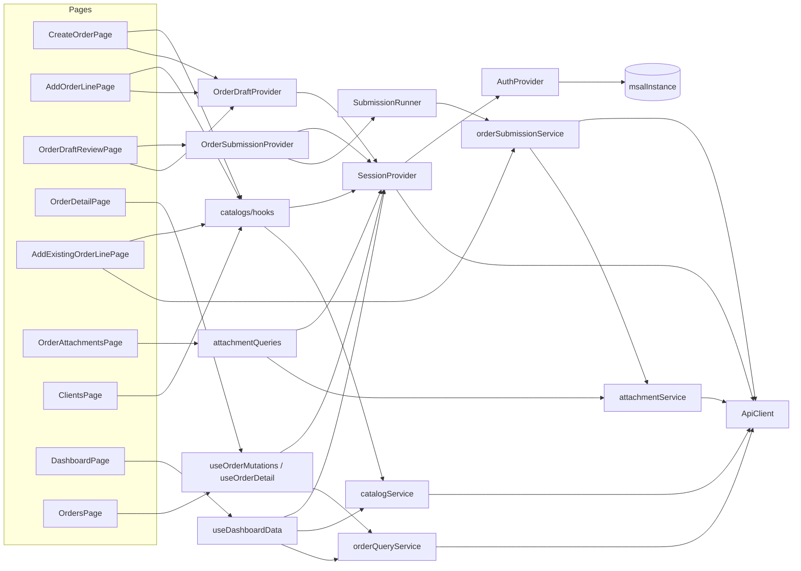

# Inventario de componentes — Sales4App Web

> Complemento de [`MANUAL_TECNICO_SALES4APP_WEB.md`](./MANUAL_TECNICO_SALES4APP_WEB.md). Fecha: 2026-10-13.
> Rutas relativas a `src/`. "Usado por" indica los consumidores reales encontrados en el código.

## 1. Páginas (24)

| Componente | Archivo | Ruta | Hooks / contextos | Servicios (indirectos) | Navega a |
|---|---|---|---|---|---|
| `LoginPage` | `features/auth/LoginPage.tsx` | `/login` | `useAuth` | MSAL | `/home` |
| `CompanySelectPage` | `components/pages/CompanySelectPage.tsx` | `/company` | `useSession` | `sessionService.getCompanies` | `/vendor` |
| `VendorSelectPage` | `components/pages/VendorSelectPage.tsx` | `/vendor` | `useSession` | `sessionService.getVendors`; `getUser` y `getPermissions` (vía `completeVendorSelection`) | `/home`, `/company` |
| `DashboardPage` | `components/pages/DashboardPage.tsx` | `/home` | `useSession`, `useDashboardData` | `orderQueryService.list`, `catalogService.customers` | `/crear-pedido`, `/pedidos`, `/pedidos/:n`, `/clientes`, acciones rápidas |
| `OrdersPage` | `components/pages/OrdersPage.tsx` | `/pedidos` | `useSession`, `useOrders`, `peekSubmission` | `orderQueryService.list` | `/pedidos/:n`, `/crear-pedido` |
| `OrderDetailPage` | `components/pages/OrderDetailPage.tsx` | `/pedidos/:salesOrderNumber` | `useSession`, `useOrderDetail`, `useOrderMutations`, `useOrderAttachments`, `useCustomerByAccount`, `useInfiniteInventoryLocations` | `orderQueryService.*`, `attachmentService.list`, `catalogService.customers/inventoryLocations` | `/pedidos`, `…/adjuntos`, `…/lineas/nueva` |
| `AddExistingOrderLinePage` | `components/pages/AddExistingOrderLinePage.tsx` | `/pedidos/:n/lineas/nueva` | `useSession`, `useOrderDetail`, `useOrderAttachments`, `useInfiniteProducts`, `useVariants`, `useInventory`, `useReferenceCatalogs`, `useQuery(getPrice)`, `useDebouncedValue` | `orderSubmissionService.createNormalLine/createAgreementLine/getExistingLines`, `catalogService.getPrice` | `/pedidos/:n`, `…/adjuntos` |
| `OrderAttachmentsPage` | `components/pages/OrderAttachmentsPage.tsx` | `/pedidos/:n/adjuntos` | `useOrderAttachments`, `useAttachmentUploader` | `attachmentService.list/upload` | `/pedidos/:n` |
| `CreateOrderPage` | `components/pages/CreateOrderPage.tsx` | `/crear-pedido` | `useSession`, `useOrderDraft`, `useInfiniteCustomers`, `useReferenceCatalogs`, `useDebouncedValue` | `catalogService.customers/deliveryModes/salesOrigins/agreements` | `/crear-pedido/linea` |
| `AddOrderLinePage` | `components/pages/AddOrderLinePage.tsx` | `/crear-pedido/linea` | `useSession`, `useOrderDraft`, `useInfiniteProducts`, `useVariants`, `useInventory`, `useReferenceCatalogs`, `useQuery(partialAgreementLines, getPrice)` | `catalogService.*` | `/crear-pedido`, `/crear-pedido/revision` |
| `OrderDraftReviewPage` | `components/pages/OrderDraftReviewPage.tsx` | `/crear-pedido/revision` | `useOrderDraft`, `useOrderSubmission` | `SubmissionRunner` → `orderSubmissionService` | `/pedidos/:n`, `…/adjuntos`, `/crear-pedido`, `/home`, `/pedidos` |
| `ClientsPage` (+ `CustomerDetail` interno) | `components/pages/ClientsPage.tsx` | `/clientes` | `useSession`, `useCustomers`, `useCustomerAddresses`, `useQueryClient`, `useDebouncedValue` | `catalogService.customers/customerAddresses` | `/estado-cuenta?customer=` (prop `onEstadoCuenta`) |
| `CustomerAddressesPage` | `components/pages/CustomerAddressesPage.tsx` | `/clientes/:account/direcciones` | `useCustomerAddresses` | `catalogService.customerAddresses` | `…/nueva` |
| `NewCustomerAddressPage` | `components/pages/NewCustomerAddressPage.tsx` | `/clientes/:account/direcciones/nueva` | — (usa `NewAddressForm`) | `addressService.create` | `…/direcciones` |
| `InventoryPage` | `components/pages/InventoryPage.tsx` | `/inventario` | `useInfiniteProducts(…, true)`, `useVariants`, `useInventory`, `useDebouncedValue` | `catalogService.products/variants/inventory/variantInventory` | — |
| `ProductsPage` | `components/pages/ProductsPage.tsx` | `/productos` (sin menú) | `useProducts`, `useVariants`, `useDebouncedValue` | `catalogService.products/variants` | — |
| `CatalogsPage` | `components/pages/CatalogsPage.tsx` | `/catalogos` (sin menú) | `useSession`, `useReferenceCatalogs`, `useQuery(vatNumbers)` | `catalogService.*` | — |
| `InvoicesPage` | `components/pages/InvoicesPage.tsx` | `/facturas` | `useInvoices`, `useReportService` | `billingService.invoices/pdf` | — |
| `AccountStatementPage` | `components/pages/AccountStatementPage.tsx` | `/estado-cuenta` | `useStatement`, `useAgingReport` | `billingService.statement/agingPdf` | `/estado-cuenta/aging`, `/estado-cuenta/documento/:id` |
| `AgingPage` | `components/pages/AgingPage.tsx` | `/estado-cuenta/aging` | `useStatement` | `billingService.statement` | documento, estado de cuenta |
| `FinancialDocumentPage` | `components/pages/FinancialDocumentPage.tsx` | `/estado-cuenta/documento/:id` | `useStatement`, `useReportService` | `billingService.statement/pdf` | aging o estado de cuenta |
| `ProductionPage` | `components/pages/ProductionPage.tsx` | `/produccion` (flag) | `useProduction` | `productionService.list` | — |
| `ForecastPage` | `components/pages/ForecastPage.tsx` | `/forecast` (flag) | `useForecast` | `forecastService.list` | — |
| `SupportPage` | `components/pages/SupportPage.tsx` | `/soporte` | `useAuth`, `useSession`, `useSendSupport` | `supportService.send` | `/home` |

## 2. Layout y enrutamiento

| Componente | Archivo | Responsabilidad | Usa | Usado por |
|---|---|---|---|---|
| `App` (+ `ExistingPrototypeRoutes`, `DraftEditableRoute`) | `App.tsx` | Tabla de rutas, guards, lazy loading y protección del borrador | `guards`, `ProtectedLayout`, `OrderDraftProvider`, `OrderSubmissionProvider`, `useOrderSubmission`, `appConfig` | `main.tsx` |
| `RequireAuthentication` | `app/router/guards.tsx` | Exige sesión | `useAuth` | `App` |
| `RequireCompany` | `app/router/guards.tsx` | Exige compañía | `useSession` | `App` (`/vendor`) |
| `RequireCompleteContext` | `app/router/guards.tsx` | Exige compañía, vendedor y usuario | `useSession` | `App` |
| `ProtectedLayout` | `app/router/ProtectedLayout.tsx` | Compone `AppLayout`, títulos, FAB y aviso `context.warning` | `useAuth`, `useSession`, `useNavigate` | `App` |
| `AppLayout` | `components/layout/AppLayout.tsx` | Sidebar, TopBar, navegación inferior móvil y FAB | `Sidebar`, `TopBar`, `Icon` | `ProtectedLayout` |
| `Sidebar` | `components/layout/Sidebar.tsx` | Menú lateral, cambio de compañía y cierre de sesión | `useSession` (`changeCompany`, `logout`), `appConfig` (flags) | `AppLayout` |
| `TopBar` | `components/layout/TopBar.tsx` | Empresa, usuario y vendedor activos; atrás/menú en móvil | `useSession` | `AppLayout` |
| `GlobalErrorBoundary` | `app/errors/GlobalErrorBoundary.tsx` | Captura errores de render | — | `main.tsx` |
| `destinationFor` | `app/router/routePolicy.ts` | Política pura de destino | — | Solo pruebas |

## 3. Componentes de dominio

| Componente | Archivo | Responsabilidad | Usa | Usado por |
|---|---|---|---|---|
| `CustomerAddressSelector` | `components/orders/CustomerAddressSelector.tsx` | Buscador local (debounce 1 s) de direcciones del cliente | `useCustomerAddresses`, `useDebouncedValue` | `CreateOrderPage` |
| `NewAddressForm` | `components/orders/NewAddressForm.tsx` | Alta de dirección con geografía en cascada | `useAddressGeography`, `useCreateAddress` | `CreateOrderPage`, `ClientsPage`, `NewCustomerAddressPage` |
| `VatSelector` | `components/orders/VatSelector.tsx` | Búsqueda y alta de NIF/VAT | `useSession`, `useVatNumbers`, `useVatDocumentTypes`, `useCreateVat`, `useDebouncedValue` | `CreateOrderPage`, `ClientsPage` |
| `DraftAttachments` | `components/orders/DraftAttachments.tsx` | Adjuntos locales del borrador (con *auto*-descripción `pago` para contado) | `useOrderDraft`, `attachmentValidation` | `CreateOrderPage`, `OrderDraftReviewPage` |
| `GeographySelector` | `features/catalogs/GeographySelector.tsx` | País → estado → municipio → ciudad → código postal | `useSession`, `catalogService`, `catalogKeys.geography`, `geography.ts` | `CatalogsPage` |
| `DashboardHero` | `features/dashboard/components/DashboardHero.tsx` | Saludo y accesos | `Card`, `Icon`, icono MUI | `DashboardPage` |
| `DashboardMetricCard` | `features/dashboard/components/DashboardMetricCard.tsx` | Indicador numérico | `Card`, `Icon` | `DashboardPage` |
| `DashboardHighlightCard` | `features/dashboard/components/DashboardHighlightCard.tsx` | Clientes asignados | `Card`, `Icon` | `DashboardPage` |
| `RecentActivityCard` | `features/dashboard/components/RecentActivityCard.tsx` | Últimos pedidos | `statusLabel`, `Card`, `Icon` | `DashboardPage` |
| `QuickActionsCard` | `features/dashboard/components/QuickActionsCard.tsx` | Accesos rápidos | `Icon` | `DashboardPage` |

## 4. Componentes UI base

`components/ui/index.tsx`: `Icon` (Material Symbols), `Badge`, `Button` (variantes, `loading`, `icon`), `FAB`, `Card`, `Input`, `Select`, `Toggle`, `BottomSheet`, `MobileHeader`, `InfoRow`, `SectionTitle`, `EmptyState`.
`components/ui/PageState.tsx`: `LoadingState`, `ErrorState`.
Los usan prácticamente todas las páginas y componentes de dominio.

## 5. Providers y contextos

| Provider | Archivo | Hook | Estado | Expone | Depende de | Consumidores |
|---|---|---|---|---|---|---|
| `AuthProvider` | `app/providers/AuthProvider.tsx` | `useAuth` | `status`, `account`, `error` | `mode`, `login`, `logout`, `getAccessToken`, `canRefreshToken`, `unauthorized` | `msalInstance`, `devToken`, `appConfig` | `SessionProvider`, `RequireAuthentication`, `LoginPage`, `ProtectedLayout`, `SupportPage` |
| `SessionProvider` | `app/providers/SessionProvider.tsx` | `useSession` | `context`, `operationError` | `api`, `selectCompany`, `completeVendorSelection`, `changeCompany`, `logout`, `clearOperationError` | `useAuth`, `useNavigate`, `queryClient`, `sessionService`, `core/session/*` | Todos los hooks de features, guards, layout y páginas |
| `OrderDraftProvider` | `features/orderDraft/OrderDraftProvider.tsx` | `useOrderDraft` | `draft`, `attachments` | `update`, `addLines`, `updateLine`, `removeLine`, `setAttachments`, `clearAttachments`, `reset` | `useSession`, `domain`, `storage` | `CreateOrderPage`, `AddOrderLinePage`, `OrderDraftReviewPage`, `DraftAttachments`, `OrderSubmissionProvider` |
| `OrderSubmissionProvider` | `features/orders/OrderSubmissionProvider.tsx` | `useOrderSubmission` | `submission` | `active`, `busy`, `unresolved`, `submit`, `verifyPending`, `retryPending`, `discardRecovery`, `createAnother` | `useSession`, `useOrderDraft`, `SubmissionRunner`, `submissionStorage` | `OrderDraftReviewPage`, `DraftEditableRoute` |
| `QueryClientProvider` | `app/providers/queryClient.ts` | `useQueryClient` | Caché | — | — | Hooks, `SessionProvider`, `ClientsPage`, `AddExistingOrderLinePage` |

## 6. Hooks (34 propios)

| Hook | Archivo | Endpoint(s) / función | Clave de caché | Usado por |
|---|---|---|---|---|
| `useAuth` | `app/providers/AuthProvider.tsx` | — | — | ver §5 |
| `useSession` | `app/providers/SessionProvider.tsx` | — | — | ver §5 |
| `useOrderDraft` | `features/orderDraft/OrderDraftProvider.tsx` | — | — | ver §5 |
| `useOrderSubmission` | `features/orders/OrderSubmissionProvider.tsx` | — | — | ver §5 |
| `useDebouncedValue` | `core/hooks/useDebouncedValue.ts` | — | — | `ClientsPage`, `CreateOrderPage`, `AddOrderLinePage`, `AddExistingOrderLinePage`, `InventoryPage`, `ProductsPage`, `CustomerAddressSelector`, `VatSelector` |
| `useCustomers` | `features/catalogs/hooks.ts` | `/customer/data` | `['customers', c, v, search, page]` | `ClientsPage` |
| `useInfiniteCustomers` | idem | `/customer/data` | `['customers', c, v, 'infinite', search]` | `CreateOrderPage` |
| `useCustomerByAccount` | idem | `/customer/data` | `['customer', c, v, account]` | `OrderDetailPage` |
| `useCustomerAddresses` | idem | `/customer/address` | `['customer-addresses', c, account]` | `ClientsPage`, `CustomerAddressesPage`, `CustomerAddressSelector` |
| `useProducts` | idem | `/company/products` | `['products', c, search, page]` | `ProductsPage` |
| `useInfiniteProducts` | idem | `/company/products` | `['products', c, 'infinite', search, force]` | `InventoryPage`, `AddOrderLinePage`, `AddExistingOrderLinePage` |
| `useVariants` | idem | `/company/products/variants` | `['variants', c, item, force, region]` | `ProductsPage`, `InventoryPage`, `AddOrderLinePage`, `AddExistingOrderLinePage` |
| `useInventory` | idem | `/inventory` o `/inventory/variant` | `['inventory', c, v, item, variant, page]` | `InventoryPage`, `AddOrderLinePage`, `AddExistingOrderLinePage` |
| `useInfiniteInventoryLocations` | idem | `/inventory/locations_by_sales_group_and_company` | `['inventory-locations', c, salesGroup]` | `OrderDetailPage` |
| `useReferenceCatalogs` | idem | `/delivery/mode`, `/company/sales_origin`, `/suppItemGroup`, `/customer/agreement`, `/d365/vat_num/document_type/query` | `['catalog', nombre, c, …]` | `CreateOrderPage`, `AddOrderLinePage`, `AddExistingOrderLinePage`, `CatalogsPage` |
| `useVatNumbers` | `features/catalogs/vatHooks.ts` | `/d365/vat_num/query` | `['vat', c, country, search]` | `VatSelector` |
| `useVatDocumentTypes` | idem | `/d365/vat_num/document_type/query` | `['vat-document-types', c, country]` | `VatSelector` |
| `useCreateVat` | idem | `POST /d365/vat_num` | mutación | `VatSelector` |
| `useAddressGeography` | `features/addresses/addressHooks.ts` | `/d365/address/*` | `['address', nivel, …]` | `NewAddressForm` |
| `useCreateAddress` | idem | `POST /d365/address` | mutación | `NewAddressForm` |
| `useOrders` | `features/orders/orderQueries.ts` | `/sales` | `['orders', c, 'list', v, filters]` | `OrdersPage` |
| `useOrderDetail` | idem | `/sales` + `/d365/sales/line/query` | `['orders', c, 'detail', n]`, `['order-lines', c, n]` | `OrderDetailPage`, `AddExistingOrderLinePage` |
| `useOrderMutations` | idem | PATCH/DELETE `/d365/sales/line`, cancelar, confirmar, `addLine` (sin uso) | invalida `orderKeys.*` | `OrderDetailPage` |
| `useOfficialOrderLine` | idem | `/d365/sales/line/query` | `['orders', c, 'official-line', n, lineNumber]` | **Sin uso** |
| `useOrderAttachments` | `features/attachments/attachmentQueries.ts` | adjuntos `/query` | `['order-attachments', c, n]` | `OrderAttachmentsPage`, `OrderDetailPage`, `AddExistingOrderLinePage` |
| `useAttachmentUploader` | idem | adjuntos (alta) | invalida la clave anterior | `OrderAttachmentsPage` |
| `useInvoices` | `features/billing/billingQueries.ts` | `/custumer/invoice` | `['invoices', c, v, …filtros]` | `InvoicesPage` |
| `useStatement` | idem | `/customer/statement` | `['customer-statement', c, account, multi]` | `AccountStatementPage`, `AgingPage`, `FinancialDocumentPage` |
| `useReportService` | idem | `get_ssrs_report_pdf` | — | `InvoicesPage`, `FinancialDocumentPage` |
| `useAgingReport` | idem | `get_cust_aging_ssrs_report_pdf` | mutación | `AccountStatementPage` |
| `useDashboardData` | `features/dashboard/dashboardQueries.ts` | `/sales` ×3, `/customer/data` | `['dashboard', …]` | `DashboardPage` |
| `useProduction` | `features/production/productionQueries.ts` | `/production`, `/production/daily` | `['production', c, v, …]` | `ProductionPage` |
| `useForecast` | `features/forecast/forecastQueries.ts` | `/forecastSales` | `['forecast', c, v, …]` | `ForecastPage` |
| `useSendSupport` | `features/support/supportMutation.ts` | `/support/send_email` | mutación | `SupportPage` |

## 7. Servicios y lógica de dominio

| Elemento | Archivo | Tipo | Funciones / métodos | Usado por |
|---|---|---|---|---|
| `ApiClient` | `core/api/apiClient.ts` | Clase | `get`, `post`, `patch`, `delete`, `request` (privado), `refreshToken` (privado) | `SessionProvider` (instancia), todos los servicios |
| `ApiError`, `userErrorMessage` | `core/api/errors.ts` | Error tipado / utilidad | — | Servicios, páginas, `queryClient` |
| `msalInstance`, `loginRequest` | `core/auth/msal.ts` | Configuración | — | `main.tsx`, `AuthProvider` |
| `redirectBridge` | `core/auth/redirectBridge.ts` | Entrada de `auth/redirect.html` | `broadcastResponseToMainFrame` | Popup / iframe MSAL |
| `devToken` | `core/auth/devToken.ts` | Utilidad | `devAccountId`, `createDevTokenProvider`, `DevTokenConfigurationError` | `AuthProvider` |
| `session/storage` | `core/session/storage.ts` | Persistencia | `emptyOperationalContext`, `loadOperationalContext`, `saveOperationalContext`, `clearOperationalContext` | `SessionProvider` |
| `session/transitions` | `core/session/transitions.ts` | Puro | `withSelectedCompany`, `withoutCompany` | `SessionProvider` |
| `session/mappers` | `core/session/mappers.ts` | Mapeo | `mapCompany`, `mapVendor`, `mapUser`, `mapPermission` | `sessionService` |
| `sessionService` | `features/session/sessionService.ts` | Servicio | `getCompanies`, `getVendors`, `getUser`, `getPermissions` | `CompanySelectPage`, `VendorSelectPage`, `SessionProvider` |
| `catalogService` | `features/catalogs/catalogService.ts` | Servicio | `customers`, `customerAddresses`, `products`, `variants`, `inventory`, `variantInventory`, `inventoryLocations`, `getPrice`, `deliveryModes`, `salesOrigins`, `agreements`, `agreementDetails` (sin uso), `partialAgreementLines`, `promotions`, `countries`, `states`, `counties`, `cities`, `zipCodes`, `vatNumbers`, `documentTypes` | Hooks de catálogo, `dashboardQueries`, `GeographySelector`, `CatalogsPage`, páginas de líneas |
| `catalogs/mappers` | `features/catalogs/mappers.ts` | Mapeo | `pagination`, `customer`, `customerAddress`, `product`, `variant`, `inventory`, `price`, `agreement`, `agreementLine`, `promotion`, `country`, `state`, `county`, `city`, `zip`, `vat`, `documentTypes`, `pageResult`, `list` | `catalogService` |
| `catalogKeys` | `features/catalogs/queryKeys.ts` | Claves | — | Hooks y páginas |
| `customerRules` | `features/catalogs/customerRules.ts` | Regla | `isFullyBlockedCustomer` | `CreateOrderPage` |
| `geography` | `features/catalogs/geography.ts` | Puro | `emptyGeography`, `selectCountry`, `selectState`, `selectCounty`, `selectCity` | `GeographySelector`, `CatalogsPage` |
| `vatService` | `features/catalogs/vatService.ts` | Servicio | `query`, `documentTypes`, `create` | `vatHooks` |
| `addressService` | `features/addresses/addressService.ts` | Servicio | `create`, `geography`; `mapCreateAddress`, `geographyMappers` | `addressHooks` |
| `orderDraft/domain` | `features/orderDraft/domain.ts` | Puro | `createOrderDraft`, `bonusQuantity`, `buildDraftLines`, `removeDraftLine`, `draftTotal`, `touch` | `OrderDraftProvider`, `AddOrderLinePage`, `AddExistingOrderLinePage`, `OrderDraftReviewPage` |
| `orderDraft/validation` | `features/orderDraft/validation.ts` | Puro | `validateDraftLine`, `validateOrderDraft` | Páginas de pedido, `SubmissionRunner` |
| `orderDraft/storage` | `features/orderDraft/storage.ts` | Persistencia | `saveDraft`, `loadDraft`, `clearDraftStorage` | `OrderDraftProvider`, `SessionProvider`, `OrderSubmissionProvider` |
| `orderQueryService` | `features/orders/orderQueryService.ts` | Servicio | `list`, `header`, `lines`, `officialLine`, `updateLine`, `cancelLine`, `deleteLine`, `confirm` | `orderQueries`, `dashboardQueries` |
| `orderSubmissionService` | `features/orders/orderSubmissionService.ts` | Gateway | `createHeader`, `createNormalLine`, `createAgreementLine`, `getExistingLines`, `getIdempotencyStatus`, `uploadAttachment`, `listAttachments`; `mapIdempotencyStatus` | `OrderSubmissionProvider` (→ `SubmissionRunner`), `AddExistingOrderLinePage`, `useOrderMutations.addLine` |
| `orderSubmissionMapper` | `features/orders/orderSubmissionMapper.ts` | Mapeo | `mapHeaderRequest`, `mapNormalLineRequest`, `mapAgreementLineRequest`, `lineEndpoint` (sin uso), `mapHeaderResponse`, `mapExistingLine(s)`, `sameLine`, `isDraftLineAlreadyCreated` | `SubmissionRunner`, `orderSubmissionService`, `AddExistingOrderLinePage` |
| `orderMappers` | `features/orders/orderMappers.ts` | Mapeo | `mapOrder(s)`, `mapOrderLines` (sin uso), `mapOfficialOrderLines`, `mapConfirmation`, `mapCancel`, `statusLabel` | `orderQueryService`, páginas |
| `orderRules` | `features/orders/orderRules.ts` | Reglas | `isOrderOpen`, `canModifyOrder`, `canAddOrderLine`, `canEditPersistedLine`, `canCancelPersistedLine`, `canDeletePersistedLine`, `persistedLineDisabledReason`, `canConfirmOrder`, `canEditPrice`, `canEditPersistedLinePrice`, … | `OrderDetailPage`, `AddOrderLinePage`, `AddExistingOrderLinePage` |
| `idempotency` | `features/orders/idempotency.ts` | Utilidad | `IDEMPOTENCY_HEADER`, `newIdempotencyKey`, `idempotencyHeaders`, `classifyCreationError`, `canRetryWithNewKey`, `creationOutcomeMessage` | `SubmissionRunner`, `orderSubmissionService`, `submissionStorage`, `AddExistingOrderLinePage` |
| `mutationOutcome` | `features/orders/mutationOutcome.ts` | Utilidad | `isAmbiguousError`, `mutationErrorMessage` | `SubmissionRunner`, `OrderDetailPage`, `AddExistingOrderLinePage` |
| `SubmissionRunner` | `features/orders/submissionRunner.ts` | Orquestador | `submit`, `verifyPending`, `verifyAndResume`, `assessHeaderRetry`, `prepareRetry`; `verify`, `publish`, `lineExists` (privados) | `OrderSubmissionProvider` |
| `submissionStorage` | `features/orders/submissionStorage.ts` | Persistencia | `saveSubmission`, `clearSubmission`, `peekSubmission`, `loadSubmission` | `SubmissionRunner`, `OrderSubmissionProvider`, `SessionProvider`, `OrdersPage` |
| `attachmentService` | `features/attachments/attachmentService.ts` | Servicio | `list`, `upload`; `fileToBase64`, `openAttachment`, `safeDownloadName` | `attachmentQueries`, `orderSubmissionService`, `supportService`, `OrderAttachmentsPage` |
| `attachmentValidation` | `features/attachments/attachmentValidation.ts` | Reglas | `validateAttachment`, `extensionOf`, `requiresPaymentAttachment`, `isPaymentImage`, `hasValidPaymentAttachment`, `hasValidLocalPaymentAttachment` | Páginas de pedido, `DraftAttachments`, `SubmissionRunner` |
| `billingService` | `features/billing/billingService.ts` | Servicio | `invoices`, `periods` (sin uso), `statement`, `pdf`, `agingPdf`; `openPdfReport` | `billingQueries`, páginas financieras |
| `billingMappers` | `features/billing/billingMappers.ts` | Mapeo | `mapInvoice(s)`, `mapStatementDocument`, `agingSeverity`, `buildStatementSummary`, `mapPdf` | `billingService` |
| `productionService` | `features/production/productionService.ts` | Servicio | `list`; `mapSalesProduction`, `mapDailyProduction` | `productionQueries` |
| `forecastService` | `features/forecast/forecastService.ts` | Servicio | `list`; `mapForecast` | `forecastQueries` |
| `supportService` | `features/support/supportService.ts` | Servicio | `send`; `validateSupport` | `supportMutation`, `SupportPage` |
| `queryClient` | `app/providers/queryClient.ts` | Configuración | — | `main.tsx`, `SessionProvider` |
| `appConfig`, `getConfigurationErrors` | `app/config/env.ts` | Configuración | — | `main.tsx`, `AuthProvider`, `SessionProvider`, `msal.ts`, `LoginPage`, `Sidebar`, `App` |

| `operationTracking` | `features/orders/operationTracking.ts` | Seguimiento / evidencia | `assessNewRequest`, `isUnresolvedTracking`, `isRetryableTracking`, `trackingFromOutcome`, `hasUnresolvedOperation`, `hasRetryableLine`; tipo `NewRequestDecision` | Runner, provider, storage, revisión y alta de línea existente |

## 8. Relaciones principales

## 9. Elementos sin uso detectados

| Elemento | Archivo |
|---|---|
| `useOfficialOrderLine` | `features/orders/orderQueries.ts` |
| `useOrderMutations().addLine` y `BonusLineFailure` | `features/orders/orderQueries.ts` |
| `catalogService.agreementDetails` | `features/catalogs/catalogService.ts` |
| `billingService.periods` (`GET /custumer/invoice/time_period`) | `features/billing/billingService.ts` |
| `mapOrderLines` | `features/orders/orderMappers.ts` |
| `lineEndpoint` | `features/orders/orderSubmissionMapper.ts` |
| `geographyBrowserCompatible` | `features/addresses/addressService.ts` |
| `destinationFor` (solo pruebas) | `app/router/routePolicy.ts` |
| Tipos heredados excepto `User` | `types/index.ts` |
| `@azure/msal-react` (dependencia no importada) | `package.json` |

## 10. Tipos y modelos principales

| Archivo | Modelos |
|---|---|
| `core/session/types.ts` | `CompanyDto`, `Company`, `VendorDto`, `Vendor`, `UserDataDto`, `OperationalUser`, `MenuPermissionDto`, `MenuPermission`, `OperationalContext` |
| `core/api/errors.ts` | `ApiErrorKind`, `ApiError` |
| `core/api/apiClient.ts` | `ApiClientOptions` |
| `app/config/env.ts` | `AppConfig` |
| `features/catalogs/types.ts` | `Pagination`, `Customer`, `CustomerDto`, `CustomerSearchResponseDto`, `CustomerAddress`, `Product`, `ProductVariant`, `InventoryItem`, `InventoryLocation`, `Price`, `DeliveryMode`, `SalesOrigin`, `Agreement`, `AgreementLine`, `PromotionGroup`, `Country`, `State`, `County`, `City`, `ZipCode`, `VatNumber`, `DocumentTypes`, `PageResult<T>` |
| `features/catalogs/geography.ts` | `GeographySelection` |
| `features/catalogs/vatService.ts` | `CreateVatInput` |
| `features/addresses/addressService.ts` | `AddressForm` |
| `features/orderDraft/types.ts` | `DraftDimensions`, `DraftAgreement`, `OrderDraftLine`, `OrderDraft`, `NewLineSelection` |
| `features/orderDraft/validation.ts` | `DraftError` |
| `features/orders/types.ts` | `SalesHeaderRequest`, `SalesHeaderResponse`, `SalesLineRequest`, `AgreementLineRequest`, `ExistingSalesLine`, `OperationTracking`, `IdempotencyStatusView`, `SubmissionStatus`, `SubmissionLineStatus`, `SubmissionLine`, `OrderSubmission`, `SubmissionAttachmentInput`, `SubmissionResult`, `OrderSubmissionGateway` |
| `features/orders/orderTypes.ts` | `SalesOrderStatus`, `OrderFilters`, `ExistingOrder`, `ExistingOrderLine`, `OfficialSalesOrderLine`, `OrdersResult`, `ConfirmationResult`, `CancelResult`, `UpdateLineInput` |
| `features/attachments/attachmentTypes.ts` | `AttachmentStatus`, `OrderAttachment`, `PendingAttachment`, `AttachmentUploadRequest`, `AttachmentDto` |
| `features/billing/billingTypes.ts` | `Pagination`, `InvoiceFilters`, `Invoice`, `InvoiceResult`, `StatementDocument`, `AgingBucket`, `StatementSummary`, `PdfReport` |
| `features/production/productionTypes.ts` | `ProductionMode`, `ProductionFilters`, `Pagination`, `SalesProduction`, `DailyProduction` |
| `features/forecast/forecastTypes.ts` | `ForecastView`, `ForecastFilters`, `ForecastRow` |
| `features/support/supportTypes.ts` | `SupportAttachment`, `SupportRequest`, `SupportResponse` |
| `types/index.ts` (heredado) | `User` (en uso); `NavItem`, `StatCard`, `ActivityItem`, `QuickAction`, `Order`, `OrderDetail`, `Client`, `Invoice`, etc. (sin uso) |

### 10.1 Seguimiento de operaciones añadido

`features/orders/types.ts`: OperationTracking, IdempotencyStatusView, SubmissionLine, OrderSubmission, OrderSubmissionGateway y SubmissionResult. `features/orders/idempotency.ts`: CreationOutcome. `features/orders/operationTracking.ts`: NewRequestDecision (safe/created/blocked). Los valores Failed/rejected solo habilitan evaluación; GET complementario debe autorizar otra clave.

## 11. Endpoints declarados y consumidos

### 11.1 Inventario deduplicado

48 combinaciones únicas método + ruta; 46 tienen consumidores del flujo Web, incluyendo módulos detrás de flags. Dos no tienen consumo UI: POST /customer/agreement/details y GET /custumer/invoice/time_period. Las rutas son relativas a VITE_API_BASE_URL. Archivos relativos a src/; la tabla indica un consumidor principal y deduplica servicios que comparten la ruta.

| Método | Ruta | Archivo consumidor principal |
|---|---|---|
| POST | `/company/companies` | `features/session/sessionService.ts` |
| POST | `/company/salesGroupByUser` | `features/session/sessionService.ts` |
| POST | `/user/data` | `features/session/sessionService.ts` |
| POST | `/company/accessMenuByUser` | `features/session/sessionService.ts` |
| POST | `/customer/data` | `features/catalogs/catalogService.ts` |
| POST | `/customer/address` | `features/catalogs/catalogService.ts` |
| POST | `/company/products` | `features/catalogs/catalogService.ts` |
| POST | `/company/products/variants` | `features/catalogs/catalogService.ts` |
| POST | `/inventory` | `features/catalogs/catalogService.ts` |
| POST | `/inventory/variant` | `features/catalogs/catalogService.ts` |
| POST | `/inventory/locations_by_sales_group_and_company` | `features/catalogs/catalogService.ts` |
| POST | `/d365_services/get_price` | `features/catalogs/catalogService.ts` |
| POST | `/delivery/mode` | `features/catalogs/catalogService.ts` |
| POST | `/company/sales_origin` | `features/catalogs/catalogService.ts` |
| POST | `/customer/agreement` | `features/catalogs/catalogService.ts` |
| POST | `/customer/agreement/details` | `features/catalogs/catalogService.ts` |
| POST | `/customer/agreement/parcial_lines` | `features/catalogs/catalogService.ts` |
| POST | `/suppItemGroup` | `features/catalogs/catalogService.ts` |
| POST | `/d365/address/country_regions` | `features/catalogs/catalogService.ts` |
| POST | `/d365/address/states` | `features/catalogs/catalogService.ts` |
| POST | `/d365/address/counties` | `features/catalogs/catalogService.ts` |
| POST | `/d365/address/cities` | `features/catalogs/catalogService.ts` |
| POST | `/d365/address/zip_codes` | `features/catalogs/catalogService.ts` |
| POST | `/d365/vat_num/query` | `features/catalogs/catalogService.ts` |
| POST | `/d365/vat_num/document_type/query` | `features/catalogs/catalogService.ts` |
| POST | `/d365/vat_num` | `features/catalogs/catalogService.ts` |
| POST | `/d365/address` | `features/addresses/addressService.ts` |
| POST | `/sales` | `features/orders/orderQueryService.ts` |
| POST | `/d365/sales/line/query` | `features/orders/orderQueryService.ts` |
| PATCH | `/d365/sales/line` | `features/orders/orderQueryService.ts` |
| POST | `/d365_services/post_cancle_sales_line` | `features/orders/orderQueryService.ts` |
| DELETE | `/d365/sales/line` | `features/orders/orderQueryService.ts` |
| POST | `/d365_services/confirm_sales_order` | `features/orders/orderQueryService.ts` |
| POST | `/d365/sales` | `features/orders/orderSubmissionService.ts` |
| POST | `/d365/sales/line` | `features/orders/orderSubmissionService.ts` |
| POST | `/d365/sales/line/agreement` | `features/orders/orderSubmissionService.ts` |
| GET | `/d365/idempotency/{key}` | `features/orders/orderSubmissionService.ts` |
| POST | `/d365/sales_header_documents_atachments/query` | `features/attachments/attachmentService.ts` |
| POST | `/d365/sales_header_documents_atachments` | `features/attachments/attachmentService.ts` |
| POST | `/custumer/invoice` | `features/billing/billingService.ts` |
| GET | `/custumer/invoice/time_period` | `features/billing/billingService.ts` |
| POST | `/customer/statement` | `features/billing/billingService.ts` |
| POST | `/d365_services/get_ssrs_report_pdf` | `features/billing/billingService.ts` |
| POST | `/d365_services/get_cust_aging_ssrs_report_pdf` | `features/billing/billingService.ts` |
| POST | `/production` | `features/production/productionService.ts` |
| POST | `/production/daily` | `features/production/productionService.ts` |
| POST | `/forecastSales` | `features/forecast/forecastService.ts` |
| POST | `/support/send_email` | `features/support/supportService.ts` |

### 11.2 Contratos y errores

El [manual, §7.7–7.8](./MANUAL_TECNICO_SALES4APP_WEB.md#77-inventario-de-endpoints) detalla función consumidora, parámetros/payload y respuesta aceptada para cada ruta, además de headers y manejo de errores comunes. Todas heredan Authorization Bearer, Accept/Content-Type JSON del ApiClient. Solo las tres creaciones de pedidos agregan Idempotency-Key. GET complementario lleva key en ruta y dataAreaId en query; no body.

Consulta de resultado de creación: mismo POST/clave/payload. GET complementario: evaluación de efectos antes de otra clave; **no sustituye Consultar estado**. POST /line/query: lectura heurística de líneas con primera página de 1000 registros.

## 12. Método de recuento y validación

24 páginas: 23 archivos no-test de components/pages/ más features/auth/LoginPage.tsx. 34 hooks propios: declaraciones exportadas cuyo nombre cumple use seguido de mayúscula; no incluir userErrorMessage, que es una utilidad. Cuatro providers propios/contextos más QueryClientProvider externo. Hay 32 archivos de prueba src/**/*.test.ts o .test.tsx y 2 smoke tests Playwright en e2e/session.smoke.spec.ts.

Revisión 2026-10-13: 179 pruebas, 170 aprobadas / 9 fallidas, 2 rechazos no controlados; TypeScript y ESLint sin errores. Detalle en §16 del manual. No hubo build, llamadas Dynamics ni pruebas reales Mobile. El inventario conserva páginas/componentes/hooks válidos y actualiza símbolos eliminados y operaciones de recuperación.
