# Manual técnico integral — Sales4App Web (Frontend)

> **Versión del documento:** 1.1 · **Fecha:** 2026-10-13
> **Base analizada:** rama `main` del repositorio `Sales_Web_App`, incluyendo los cambios locales de autenticación aún no confirmados (Redirect URI `/auth/redirect.html`).
> **Método:** análisis estático del código fuente real. Cada afirmación referencia el archivo y la función donde está implementada. Cuando algo **no** está implementado, o difiere de lo esperado, se indica explícitamente con la etiqueta **⚠ Observación**.
> **Exclusiones:** este manual no contiene secretos, tokens ni valores de credenciales. Las variables de entorno se citan por nombre.

---

## Tabla de contenido

1. [Introducción](#capítulo-1-introducción)
2. [Arquitectura del Frontend](#capítulo-2-arquitectura-del-frontend)
3. [Inicialización de Sales4App](#capítulo-3-inicialización-de-sales4app)
4. [Autenticación e identidad del usuario](#capítulo-4-autenticación-e-identidad-del-usuario)
5. [Contexto de compañías (y vendedor)](#capítulo-5-contexto-de-compañías-y-vendedor)
6. [Providers, contextos y hooks](#capítulo-6-providers-contextos-y-hooks)
7. [Comunicación con el backend](#capítulo-7-comunicación-con-el-backend)
8. [Documentación funcional por módulos](#capítulo-8-documentación-funcional-por-módulos)
9. [Persistencia y recuperación del estado](#capítulo-9-persistencia-y-recuperación-del-estado)
10. [Rutas y navegación](#capítulo-10-rutas-y-navegación)
11. [Seguridad](#capítulo-11-seguridad)
12. [Manejo de errores y diagnóstico](#capítulo-12-manejo-de-errores-y-diagnóstico)
13. [Guía de mantenimiento](#capítulo-13-guía-de-mantenimiento)
14. [Anexos técnicos](#capítulo-14-anexos-técnicos)

15. [Idempotencia](#capítulo-15-idempotencia)
16. [Pruebas y calidad](#capítulo-16-pruebas-y-calidad)
17. [Configuración y ejecución local](#capítulo-17-configuración-y-ejecución-local)
18. [Consideraciones de despliegue](#capítulo-18-consideraciones-de-despliegue)
19. [Limitaciones conocidas](#capítulo-19-limitaciones-conocidas)
20. [Trazabilidad de la revisión](#capítulo-20-trazabilidad-de-la-revisión)

Se conserva la organización de los 14 capítulos existentes. Objetivos, alcance y tecnologías: §1; integración y contratos REST: §7; pedidos: §8; persistencia: §9; seguridad: §11; errores: §12.

Documentos complementarios: [Inventario](./INVENTARIO_COMPONENTES_SALES4APP.md) e [Idempotencia](./IDEMPOTENCIA_FRONTEND_SALES4APP.md). La revisión incluye los cambios locales de creación y recuperación aún no confirmados. No se probaron Mobile ni Dynamics reales.

---

## Capítulo 1. Introducción

### 1.1 Objetivo del manual

Permitir que un desarrollador que no conoce Sales4App Web pueda:

- localizar el código de cualquier funcionalidad (archivo y función exactos);
- entender cómo fluye la información desde el inicio de sesión con Microsoft Entra ID hasta cada operación sobre Dynamics 365 Finance & Operations (D365 F&O);
- mantener, depurar y extender la aplicación sin romper las garantías transaccionales (idempotencia, recuperación, aislamiento por compañía).

### 1.2 Alcance funcional

Sales4App Web es la versión navegador de la aplicación comercial Sales4App (existe también un cliente Mobile, al que el código hace referencia como fuente de paridad funcional). Permite a un vendedor:

| Área | Capacidades implementadas |
|---|---|
| Sesión | Login corporativo (MSAL), selección de compañía (entidad legal D365) y de vendedor (grupo de ventas), carga de usuario operativo y permisos de menú |
| Inicio | Dashboard con pedidos de hoy, pedidos abiertos, actividad reciente (30 días) y número de clientes asignados |
| Clientes | Búsqueda paginada, detalle (crédito, condiciones), direcciones, alta de dirección, selección/alta de NIF para cliente de contado |
| Productos / Inventario | Búsqueda de productos, variantes y existencias por almacén |
| Pedidos | Listado con filtros, detalle oficial desde D365, edición/cancelación/eliminación de líneas, confirmación del pedido |
| Creación de pedidos | Borrador local persistente, encabezado, líneas normales, bonificaciones (promoción o independiente), líneas de acuerdo comercial, adjuntos, envío transaccional idempotente y recuperable |
| Líneas sobre pedidos existentes | Alta de líneas a un pedido ya creado, con cola local de pendientes e idempotencia |
| Adjuntos | Consulta, carga y apertura de documentos del encabezado del pedido |
| Finanzas | Facturas, estado de cuenta, antigüedad de saldos (aging), detalle de documento y PDF (SSRS) |
| Producción / Forecast | Consultas implementadas, ocultas por *feature flag* |
| Soporte | Envío de correo a soporte técnico con capturas |
| Catálogos | Página técnica de catálogos de referencia (accesible solo por URL) |

### 1.3 Tecnologías utilizadas

Versiones instaladas verificadas en `node_modules`:

| Tecnología | Versión | Uso en el proyecto |
|---|---|---|
| React | 18.3.1 | UI declarativa, `React.StrictMode` |
| TypeScript | 5.9.3 | Tipado estricto (`tsconfig.json`: `strict: true`) |
| Vite | 8.0.16 | Servidor de desarrollo y empaquetado |
| React Router DOM | 7.18.2 | Enrutamiento (`BrowserRouter`, rutas anidadas, guards) |
| TanStack Query | 5.101.4 | Caché de servidor, consultas y mutaciones |
| @azure/msal-browser | 5.19.0 | Autenticación OAuth 2.0 / OIDC (PKCE) con Entra ID |
| @azure/msal-react | 5.6.0 | Declarado en `package.json`; **⚠ no se importa en el código** (el contexto de autenticación es propio) |
| MUI (`@mui/material`, `@mui/icons-material`) | 9.0.1 | Uso puntual: iconos y `Tooltip`/`IconButton` en `OrderDetailPage`, icono en `DashboardHero` |
| Tailwind CSS | 3.4.19 | Estilos utilitarios (`tailwind.config.ts`, `src/index.css`) |
| Vitest + Testing Library + jsdom | 4.1.x | Pruebas unitarias y de componentes |
| Playwright | 1.62.x | Smoke E2E con API simulada (`e2e/`) |

### 1.4 Dependencias principales y su papel

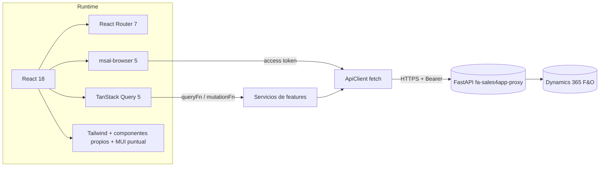

### 1.5 Organización general del proyecto

```
Sales_Web_App/
├── index.html                 # Entrada HTML de la SPA (monta /src/main.tsx)
├── auth/redirect.html         # Página de retorno MSAL (Redirect URI SPA) — solo redirect bridge
├── vite.config.ts             # Plugins, bloqueo de modos temporales en build, config de Vitest
├── playwright.config.ts       # E2E en modo `e2e` (puerto 4173)
├── e2e/                       # mockApi.ts + session.smoke.spec.ts
├── docs/                      # Documentación (este manual y documentos previos)
└── src/
    ├── main.tsx               # Arranque: MSAL + árbol de Providers
    ├── App.tsx                # Tabla de rutas y guards
    ├── app/                   # Capa de aplicación: config, providers, router, errores
    ├── core/                  # Infraestructura transversal: api, auth, session, hooks
    ├── features/              # Lógica de negocio por dominio (servicios, hooks, mappers, tipos)
    ├── components/            # Presentación: layout, pages, orders (formularios), ui
    ├── types/                 # Tipos heredados del prototipo (uso parcial)
    └── test/setup.ts          # Setup de Vitest
```

**⚠ Observación (documentación previa):** los archivos existentes en `docs/` (`architecture.md`, `production-readiness.md`, `backend-contract-issues.md`, etc.) fueron escritos en fases anteriores. Algunas afirmaciones ya no coinciden con el código (por ejemplo, indican que no existe idempotencia o que se consume `POST /customer`; el código actual envía `Idempotency-Key` y usa `POST /customer/data`). **Ante cualquier discrepancia, este manual y el código prevalecen.**

---

## Capítulo 2. Arquitectura del Frontend

### 2.1 Estilo arquitectónico

La aplicación sigue una arquitectura **por capas con organización por dominio (feature folders)**:

| Capa | Carpeta | Responsabilidad | Ejemplos |
|---|---|---|---|
| Presentación | `src/components/` | Pantallas, layout y componentes visuales. Gestionan estado de formulario local, invocan hooks y navegan | `pages/CreateOrderPage.tsx`, `layout/Sidebar.tsx`, `ui/index.tsx` |
| Aplicación | `src/app/` | Composición transversal: configuración, Providers globales (auth, sesión, Query), guards de ruta, error boundary | `providers/AuthProvider.tsx`, `router/guards.tsx` |
| Dominio / casos de uso | `src/features/<dominio>/` | Hooks de datos (TanStack Query), reglas de negocio, validaciones, orquestadores (p. ej. `SubmissionRunner`), Providers de dominio | `orders/submissionRunner.ts`, `orderDraft/domain.ts` |
| Integración | `src/features/*/…Service.ts` + `src/core/api/` | Contratos HTTP (rutas, payloads) y mapeo DTO → modelo; cliente HTTP autenticado | `catalogs/catalogService.ts`, `core/api/apiClient.ts` |
| Infraestructura transversal | `src/core/` | Auth (MSAL, dev token), sesión operativa (tipos, mapeo, almacenamiento), hooks genéricos | `core/auth/msal.ts`, `core/session/storage.ts` |

Regla de dependencia observada en el código: **presentación → hooks de feature → servicio → `ApiClient`**. Los servicios no conocen React; los hooks obtienen el `ApiClient` y el contexto operativo desde `useSession()`.

### 2.2 Diagrama de arquitectura general

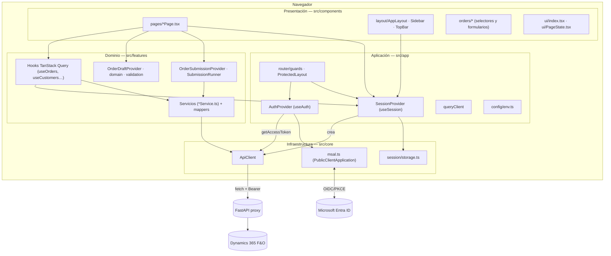

### 2.3 Organización por módulos (features)

| Carpeta `src/features/` | Dominio | Contenido principal |
|---|---|---|
| `auth/` | Login | `LoginPage.tsx` |
| `session/` | Sesión operativa | `sessionService.ts` (compañías, vendedores, usuario, permisos) |
| `catalogs/` | Catálogos comerciales | `catalogService.ts`, `hooks.ts`, `queryKeys.ts`, `mappers.ts`, `types.ts`, `vatService.ts`, `vatHooks.ts`, `geography.ts`, `GeographySelector.tsx`, `customerRules.ts` |
| `addresses/` | Direcciones de cliente | `addressService.ts`, `addressHooks.ts` |
| `orderDraft/` | Borrador de pedido | `OrderDraftProvider.tsx`, `domain.ts`, `validation.ts`, `storage.ts`, `types.ts` |
| `orders/` | Pedidos | consulta (`orderQueryService.ts`, `orderQueries.ts`), creación (`orderSubmissionService.ts`, `submissionRunner.ts`, `OrderSubmissionProvider.tsx`, `submissionStorage.ts`), reglas (`orderRules.ts`), idempotencia (`idempotency.ts`), resultado de mutaciones (`mutationOutcome.ts`), mappers y tipos |
| `attachments/` | Adjuntos de pedido | `attachmentService.ts`, `attachmentQueries.ts`, `attachmentValidation.ts`, mappers y tipos |
| `billing/` | Facturación y estado de cuenta | `billingService.ts`, `billingQueries.ts`, `billingMappers.ts`, `billingTypes.ts` |
| `dashboard/` | Inicio | `dashboardQueries.ts`, `components/*` |
| `production/` | Producción (oculto) | `productionService.ts`, `productionQueries.ts`, tipos |
| `forecast/` | Pronóstico (oculto) | `forecastService.ts`, `forecastQueries.ts`, tipos |
| `support/` | Soporte | `supportService.ts`, `supportMutation.ts`, tipos |

### 2.4 Flujo de datos

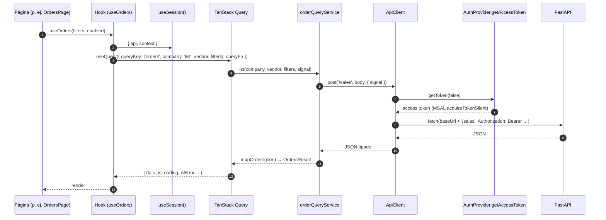

Puntos clave:

1. **El contexto operativo (compañía, vendedor) se inyecta en cada consulta desde `useSession().context`**, no desde props. Las claves de caché incluyen siempre la compañía (y el vendedor cuando aplica), lo que aísla los datos por contexto (ver §5.16).
2. **Los servicios mapean** el JSON del backend (nombres de campo D365/SQL en minúsculas o PascalCase) a modelos camelCase propios del Web (`mappers.ts`, `orderMappers.ts`, etc.).
3. **Las mutaciones peligrosas no se reintentan automáticamente** (`retry: false`) y su resultado se clasifica como confirmado o ambiguo (`mutationOutcome.ts`).

### 2.5 Manejo de estado

| Tipo de estado | Mecanismo | Dónde |
|---|---|---|
| Identidad Entra ID | MSAL (caché en `sessionStorage`) + estado React | `core/auth/msal.ts`, `AuthProvider` |
| Contexto operativo (compañía, vendedor, usuario, permisos) | Context API + `sessionStorage` | `SessionProvider`, `core/session/storage.ts` |
| Datos de servidor | TanStack Query (memoria) | `app/providers/queryClient.ts` + hooks de features |
| Borrador de pedido | Context API + `localStorage` (TTL 7 días) | `OrderDraftProvider`, `orderDraft/storage.ts` |
| Ejecución del envío de pedido | Context API + `localStorage` | `OrderSubmissionProvider`, `orders/submissionStorage.ts` |
| Líneas pendientes sobre pedido existente | Estado local + `sessionStorage` | `AddExistingOrderLinePage.tsx` |
| Filtros de listados | Query string de la URL | `OrdersPage`, `InvoicesPage`, `ClientsPage`, etc. |
| Formularios | `useState` local | Cada página |

### 2.6 Dependencias entre módulos

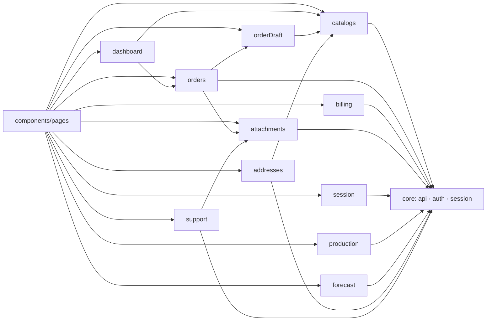

Dependencias relevantes y no obvias:

- `orders/orderSubmissionService.ts` depende de `attachments/attachmentService.ts` (el envío de pedido sube adjuntos).
- `support/supportService.ts` reutiliza `fileToBase64` de `attachments/attachmentService.ts`.
- `dashboard/dashboardQueries.ts` reutiliza `orderQueryService` y `catalogService` (no tiene servicio propio).
- `orderDraft/types.ts` se construye con tipos de `catalogs/types.ts` (cliente, dirección, producto, precio…).

### 2.7 Integración con FastAPI y Dynamics 365 F&O

El Web **nunca** llama a D365 directamente. Toda petición va al backend FastAPI (identificado en `orders/idempotency.ts` como `fa-sales4app-proxy`), configurado con `VITE_API_BASE_URL`. El backend:

- valida el token Bearer emitido para el scope `VITE_AZURE_SCOPE` (formato `api://<id-app-backend>/<permiso>`);
- traduce las peticiones a D365 F&O. Por el nombre y la forma de las rutas se distinguen tres familias:

| Familia de rutas | Forma de la respuesta | Ejemplos |
|---|---|---|
| Rutas de negocio propias del proxy | JSON con campos en minúsculas (vistas SQL/servicios) y `pagination` en PascalCase | `/sales`, `/customer/data`, `/inventory`, `/custumer/invoice` |
| `/d365/...` | Envoltura OData (`@odata`) o arreglo de entidades con nombres D365 en PascalCase | `/d365/sales`, `/d365/sales/line/query`, `/d365/address/*` |
| `/d365_services/...` | Servicios personalizados D365 con `Success`, `ErrorMessage`, `DebugMessage` | `/d365_services/get_price`, `/d365_services/confirm_sales_order` |

**Casi todas las consultas se hacen con `POST`** (incluidas las de lectura), porque el backend recibe filtros complejos en el cuerpo. El cliente HTTP admite declarar `GET` con cuerpo, pero fetch del navegador lo rechaza. `billingService.periods` declara un GET no utilizado por la UI. El GET `/d365/idempotency/{key}?dataAreaId=…` sí se consume para evaluar efectos antes de autorizar otra clave; no sustituye «Consultar estado» mediante POST.

---

## Capítulo 3. Inicialización de Sales4App

### 3.1 Qué ocurre cuando se abre la aplicación

1. El navegador solicita la URL (p. ej. `http://localhost:5173/pedidos`). Vite (desarrollo) o el hosting (producción) devuelve `index.html` para cualquier ruta de la SPA.
2. `index.html` contiene `<div id="root">` y carga el módulo `/src/main.tsx`.
3. `main.tsx` evalúa sus importaciones estáticas. **Efecto importante:** importar `src/core/auth/msal.ts` construye la instancia única `msalInstance = new PublicClientApplication({...})` (todavía sin inicializar).
4. Se ejecuta `start()` (asíncrona).

> La URL `/auth/redirect.html` **no** pasa por este flujo: es un HTML independiente que solo ejecuta el *redirect bridge* (ver §4.3).

### 3.2 Archivo que se ejecuta primero

`src/main.tsx`, función `start`:

```tsx
// src/main.tsx
const start = async () => {
  const fatal = getConfigurationErrors().find((error) =>
    error.includes('no está permitido en producción'),
  );
  if (fatal) throw new Error(fatal);
  if (appConfig.authMode === 'msal') {
    await msalInstance.initialize();
    const redirectResult = await msalInstance.handleRedirectPromise();
    if (redirectResult?.account) msalInstance.setActiveAccount(redirectResult.account);
  }
  ReactDOM.createRoot(document.getElementById('root')!).render(
    <React.StrictMode>
      <GlobalErrorBoundary>
        <QueryClientProvider client={queryClient}>
          <BrowserRouter>
            <AuthProvider instance={msalInstance}>
              <SessionProvider>
                <App />
              </SessionProvider>
            </AuthProvider>
          </BrowserRouter>
        </QueryClientProvider>
      </GlobalErrorBoundary>
    </React.StrictMode>,
  );
};
void start();
```

Paso a paso:

| # | Acción | Detalle |
|---|---|---|
| 1 | Validación fatal de configuración | `getConfigurationErrors()` (`src/app/config/env.ts`) devuelve variables faltantes. Solo se aborta el arranque si el error es *"VITE_AUTH_MODE=dev-token no está permitido en producción"*. Los demás errores (p. ej. falta `VITE_AZURE_CLIENT_ID`) **no** detienen el arranque: se muestran en `LoginPage` y deshabilitan el botón de login |
| 2 | Inicialización MSAL | Solo si `authMode === 'msal'`. `initialize()` es obligatorio en MSAL 5 antes de cualquier otra API |
| 3 | `handleRedirectPromise()` | Procesa una posible respuesta de flujo *redirect*. Como la aplicación usa `loginPopup()` y la respuesta llega a `/auth/redirect.html`, normalmente devuelve `null`. Se conserva por compatibilidad |
| 4 | Montaje de React | `createRoot(...).render(...)` con el árbol de Providers |

### 3.3 Configuración (`src/app/config/env.ts`)

`appConfig` se calcula una sola vez al importar el módulo:

| Propiedad | Variable | Regla |
|---|---|---|
| `apiBaseUrl` | `VITE_API_BASE_URL` | Se elimina la `/` final. En modo `e2e` se fuerza `http://127.0.0.1:4173/api` |
| `authMode` | `VITE_AUTH_MODE` | `'dev-token'` solo si el valor es literalmente `dev-token`; en modo `e2e` es `'e2e-mock'`; en cualquier otro caso `'msal'` |
| `devAccessToken` | `VITE_DEV_ACCESS_TOKEN` | Solo para `dev-token` |
| `tenantId`, `clientId`, `scope` | `VITE_AZURE_TENANT_ID`, `VITE_AZURE_CLIENT_ID`, `VITE_AZURE_SCOPE` | Obligatorias en `msal` |
| `featureProduction`, `featureForecast` | `VITE_FEATURE_PRODUCTION`, `VITE_FEATURE_FORECAST` | *Fail closed*: solo el texto exacto `true` habilita |

Además, `vite.config.ts` impide un `vite build` con `VITE_AUTH_MODE=dev-token` o modo `e2e`.

### 3.4 Diagrama de inicialización

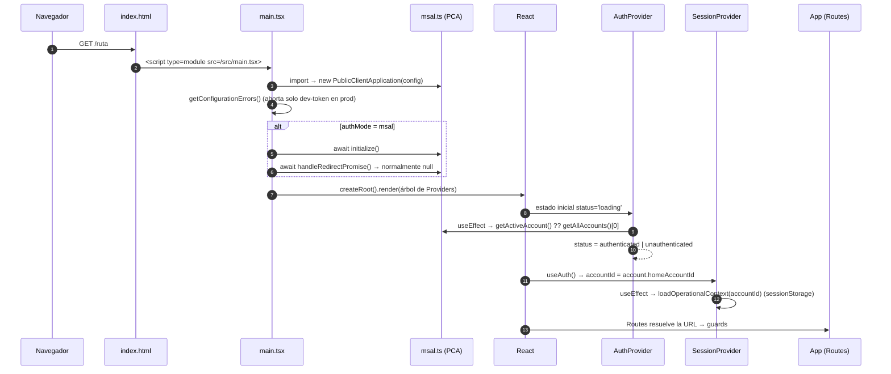

### 3.5 Orden de los Providers

| Nivel | Provider | Archivo | Motivo del orden |
|---|---|---|---|
| 1 | `React.StrictMode` | — | En desarrollo duplica efectos para detectar efectos impuros |
| 2 | `GlobalErrorBoundary` | `src/app/errors/GlobalErrorBoundary.tsx` | Captura cualquier error de render de todo el árbol |
| 3 | `QueryClientProvider` | `src/app/providers/queryClient.ts` | Lo necesitan `SessionProvider` (`queryClient.clear()`) y todos los hooks |
| 4 | `BrowserRouter` | react-router-dom | `SessionProvider` usa `useNavigate()` |
| 5 | `AuthProvider` | `src/app/providers/AuthProvider.tsx` | Expone identidad y token |
| 6 | `SessionProvider` | `src/app/providers/SessionProvider.tsx` | Depende de `useAuth()`; crea el `ApiClient` |
| 7 | `App` | `src/App.tsx` | Rutas |
| 7.a | `OrderDraftProvider` → `OrderSubmissionProvider` | `src/features/orderDraft/…`, `src/features/orders/…` | **Solo** dentro de la ruta `/crear-pedido/*` |

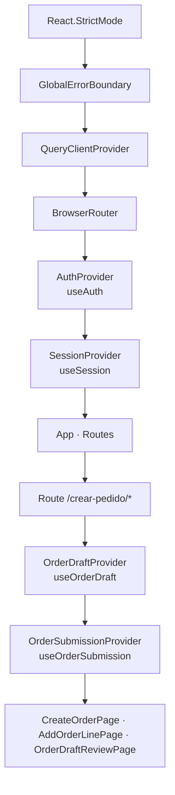

### 3.6 Inicialización de los contextos

**`AuthProvider`**

- Estado inicial: `status='loading'`, `account=null`, `error=null`.
- `useEffect` inicial según `appConfig.authMode`:
  - `e2e-mock` → cuenta ficticia `{ homeAccountId: 'e2e-mock-account' }`.
  - `dev-token` → `activateDevToken()` decodifica el JWT de `VITE_DEV_ACCESS_TOKEN` y usa `dev-token:<oid|sub>` como `homeAccountId` (`core/auth/devToken.ts → devAccountId`).
  - `msal` → `activateAccount(instance.getActiveAccount() ?? instance.getAllAccounts()[0] ?? null)`.
- `activateAccount(next)` llama a `instance.setActiveAccount(next)` (solo en `msal`), guarda `account` y fija `status` en `authenticated` o `unauthenticated`.

**`SessionProvider`**

- `accountId = auth.account?.homeAccountId ?? ''`.
- Estado inicial `context = emptyOperationalContext(accountId)`.
- `useEffect([accountId])`: `setContext(accountId ? loadOperationalContext(accountId) : emptyOperationalContext())`. El contexto guardado solo se restaura si pertenece a la misma cuenta.
- `useEffect([context])`: si `context.accountId` no está vacío, `saveOperationalContext(context)`.
- `api = useMemo(() => new ApiClient({...}), [auth.getAccessToken, auth.unauthorized, auth.canRefreshToken])`.

### 3.7 Cómo se determina la ruta inicial

No existe una redirección central. La ruta inicial se obtiene por **encadenamiento de guards** (`src/App.tsx`, `src/app/router/guards.tsx`):

| URL solicitada | Resultado |
|---|---|
| `/` o cualquier ruta desconocida | `<Navigate to="/home" replace />` |
| `/home` (o cualquier ruta protegida) sin autenticación | `RequireAuthentication` → `/login` (con `state.from`) |
| Autenticado, sin compañía | `RequireCompleteContext` → `/company` |
| Autenticado, con compañía, sin vendedor o sin usuario | `RequireCompleteContext` → `/vendor` |
| Contexto completo | Se muestra la ruta dentro de `ProtectedLayout` |
| `/login` estando autenticado | `LoginPage` → `<Navigate to="/home" replace />` (y de ahí la cadena anterior) |

**⚠ Observación:** `src/app/router/routePolicy.ts` (`destinationFor`) implementa la misma decisión de forma pura, pero **solo se usa en pruebas**; no participa en la navegación real. `RequireAuthentication` guarda `state.from`, pero **`LoginPage` no lo utiliza**: tras el login siempre se navega a `/home`.

### 3.8 Funcionamiento de los guards

```tsx
// src/app/router/guards.tsx
export const RequireAuthentication = () => {
  const auth = useAuth(); const location = useLocation();
  if (auth.status === 'loading') return <LoadingState message="Restaurando sesión..." />;
  if (auth.status !== 'authenticated')
    return <Navigate to="/login" replace state={{ from: location.pathname }} />;
  return <Outlet />;
};
export const RequireCompany = () => {
  const { context } = useSession();
  return context.company ? <Outlet /> : <Navigate to="/company" replace />;
};
export const RequireCompleteContext = () => {
  const { context } = useSession();
  if (!context.company) return <Navigate to="/company" replace />;
  if (!context.vendor || !context.user) return <Navigate to="/vendor" replace />;
  return <Outlet />;
};
```

### 3.9 Recuperación de una sesión existente (F5)

1. MSAL guarda cuentas y tokens en `sessionStorage` (`cacheLocation: BrowserCacheLocation.SessionStorage`). Una recarga en la misma pestaña los conserva.
2. `AuthProvider` recupera la cuenta con `getActiveAccount() ?? getAllAccounts()[0]` **sin pedir un token**. El token se solicita bajo demanda en la primera llamada HTTP (`acquireTokenSilent`).
3. `SessionProvider` restaura compañía, vendedor, usuario y permisos desde `sessionStorage` (`sales4app.operational-context.v1`) si el `accountId` coincide.
4. Los guards encuentran el contexto completo y muestran la ruta solicitada.
5. Dentro de `/crear-pedido/*`, `OrderDraftProvider` restaura el borrador desde `localStorage` y `OrderSubmissionProvider` una ejecución de envío pendiente.

Cerrar la pestaña elimina `sessionStorage`: se pierde la sesión MSAL y el contexto operativo, pero **se conservan** el borrador (hasta 7 días) y las recuperaciones de envío en `localStorage`.

---

## Capítulo 4. Autenticación e identidad del usuario

### 4.1 Componentes de autenticación

| Archivo | Elemento | Responsabilidad |
|---|---|---|
| `src/core/auth/msal.ts` | `msalInstance`, `loginRequest` | Instancia única de `PublicClientApplication` y scopes de login |
| `auth/redirect.html` | Página HTML | Redirect URI SPA registrada; solo carga el bridge |
| `src/core/auth/redirectBridge.ts` | `broadcastResponseToMainFrame()` | Reenvía la respuesta del popup/iframe a la ventana principal |
| `src/main.tsx` | `start()` | `initialize()` y `handleRedirectPromise()` |
| `src/app/providers/AuthProvider.tsx` | `AuthProvider`, `useAuth` | Estado de autenticación, login, logout, token |
| `src/features/auth/LoginPage.tsx` | `LoginPage` | Botón de inicio de sesión y errores |
| `src/core/auth/devToken.ts` | `devAccountId`, `createDevTokenProvider` | Modo temporal de desarrollo |
| `src/core/api/apiClient.ts` | `ApiClient.request`, `refreshToken` | Adjunta el Bearer, renueva en 401 |

### 4.2 Configuración MSAL

```ts
// src/core/auth/msal.ts
export const loginRequest = { scopes: [appConfig.scope].filter(Boolean) };
export const msalInstance = new PublicClientApplication({
  auth: {
    clientId: appConfig.clientId || '00000000-0000-0000-0000-000000000000',
    authority: `https://login.microsoftonline.com/${appConfig.tenantId || 'common'}`,
    redirectUri: `${window.location.origin}/auth/redirect.html`,
    postLogoutRedirectUri: `${window.location.origin}/auth/redirect.html`,
  },
  cache: { cacheLocation: BrowserCacheLocation.SessionStorage },
});
```

- **Authority** por tenant (cuentas de un solo directorio).
- **Scope único**: el del API backend (`VITE_AZURE_SCOPE`). MSAL añade automáticamente `openid`, `profile` y `offline_access`, por eso existen ID token, cuenta y refresh token.
- **Redirect URI** efectiva en desarrollo: `http://localhost:5173/auth/redirect.html`, registrada en Entra ID como **Single-page application**. Si se usa una URI no registrada como SPA, Entra ID rechaza el canje del código con `AADSTS9002326`.

### 4.3 Flujo completo de inicio de sesión

1. **El usuario presiona "Iniciar sesión con Microsoft"** (`LoginPage`, `onClick={() => void login()}`). El botón está deshabilitado si `getConfigurationErrors()` devuelve errores.
2. **`AuthProvider.login()`**: limpia `error`, fija `status='loading'` y, en modo `msal`, ejecuta `instance.loginPopup(loginRequest)`.
3. **MSAL abre un popup** hacia `https://login.microsoftonline.com/<tenant>/oauth2/v2.0/authorize` con PKCE, `redirect_uri=<origin>/auth/redirect.html` y un `state` que codifica `{ id, meta: { interactionType: 'popup' } }`. La ventana principal queda escuchando un `BroadcastChannel` con ese `id`.
4. **Entra ID autentica** al usuario (credenciales/MFA corporativas) y redirige el popup a `/auth/redirect.html#code=…&state=…`.
5. **Redirect bridge.** `auth/redirect.html` carga solo `src/core/auth/redirectBridge.ts`, que ejecuta `broadcastResponseToMainFrame()` (de `@azure/msal-browser/redirect-bridge`): lee el fragmento, limpia la URL, publica la respuesta en el `BroadcastChannel` y cierra el popup. No carga React, React Router ni `main.tsx`, y no canjea el código.
6. **MSAL (ventana principal) canjea el código** en el endpoint `/token` (petición *cross-origin* permitida porque la URI es SPA) y obtiene ID token, access token para el scope del API y refresh token. Los guarda en `sessionStorage`.
7. **`loginPopup` resuelve** con un `AuthenticationResult` que contiene `account` (`AccountInfo`).
8. **`activateAccount(result.account)`**: `instance.setActiveAccount(account)`, `setAccount(account)`, `status='authenticated'`.
9. **`SessionProvider` reacciona** al cambio de `account.homeAccountId`: restaura el contexto operativo de esa cuenta o crea uno vacío.
10. **Navegación:** `LoginPage` ve `status==='authenticated'` y redirige a `/home`; los guards llevan a `/company` (sin compañía) o directamente a `/home` si el contexto se restauró.
11. **Errores:** cualquier excepción se captura. Si es `AuthError`, se muestra su `errorCode` (`user_cancelled` → "Inicio de sesión cancelado."). El mensaje completo de MSAL no se muestra porque puede contener datos de la solicitud.

### 4.4 Diagrama de secuencia — autenticación MSAL

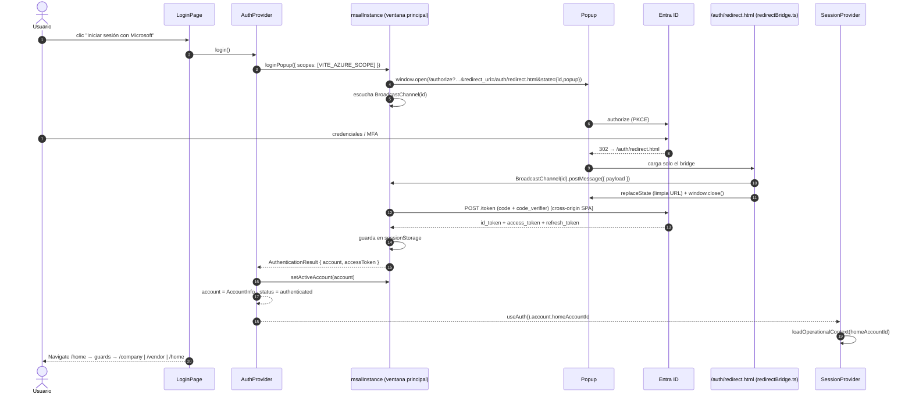

### 4.5 Obtención del usuario: Entra ID frente a usuario operativo D365

El código maneja **dos identidades distintas**:

| Aspecto | Identidad Microsoft Entra ID | Usuario operativo Dynamics 365 |
|---|---|---|
| Origen | MSAL `AccountInfo` (claims del ID token) | `POST /user/data` (backend → D365) |
| Tipo TS | `AuthAccount = Pick<AccountInfo,'homeAccountId'> & Partial<Pick<AccountInfo,'name'\|'username'>>` (`AuthProvider.tsx`) | `OperationalUser` (`core/session/types.ts`) |
| Campos usados | `homeAccountId`, `name`, `username` | `id`, `name`, `networkAlias`, `language`, `personnelnumber` |
| Dónde se guarda | Estado `account` de `AuthProvider` + caché MSAL (`sessionStorage`) | `context.user` de `SessionProvider` + `sessionStorage` |
| Cuándo se obtiene | Al iniciar sesión o restaurar cuenta | Al confirmar el vendedor (`completeVendorSelection`) |
| Para qué se usa | Clave de aislamiento de todo el estado local; nombre/correo en layout y soporte | Idioma y número de personal del pedido; nombre en TopBar/Dashboard |

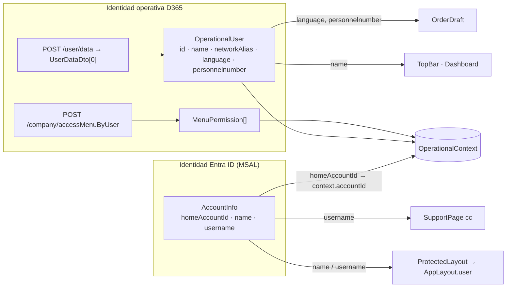

**Respuestas explícitas**

- **¿Dónde se obtiene el usuario autenticado?** En `AuthProvider`: tras `loginPopup` (`result.account`) o al arrancar (`instance.getActiveAccount() ?? instance.getAllAccounts()[0]`).
- **¿Qué información proporciona MSAL?** `AccountInfo`: `homeAccountId` (`<oid>.<tid>`), `localAccountId`, `tenantId`, `username` (UPN/correo), `name` e `idTokenClaims`. El Web solo usa `homeAccountId`, `name` y `username`.
- **¿Se usa `account.username`, `homeAccountId`, claims u otro campo?**
  - `homeAccountId`: clave de aislamiento del contexto operativo, del borrador, de la recuperación de envíos y de las líneas pendientes.
  - `username`: correo en copia del mensaje de soporte (`SupportPage`) y "rol" mostrado en `AppLayout` (`ProtectedLayout`).
  - `name`: nombre mostrado si no hay vendedor (`ProtectedLayout`).
  - **No se leen claims** del ID token. En modo `dev-token` se decodifican `oid`/`sub` del token de desarrollo (`devAccountId`). El backend identifica al usuario por el token y por eso `/user/data` no recibe parámetros.
- **¿Dónde se almacena el usuario?** Identidad Entra: estado React de `AuthProvider` + caché MSAL en `sessionStorage`. Usuario operativo: `context.user` en `SessionProvider`, persistido en `sessionStorage['sales4app.operational-context.v1']`.
- **¿Qué Provider administra su estado?** `AuthProvider` (identidad) y `SessionProvider` (usuario operativo, compañía, vendedor, permisos).
- **¿Qué componentes consumen ese contexto?**
  - `useAuth()`: `RequireAuthentication`, `LoginPage`, `ProtectedLayout` (`account.name`, `account.username`), `SupportPage` (`account.username`) y `SessionProvider`.
  - `useSession()`: todos los hooks de datos y la mayoría de las páginas (ver inventario).
- **¿Cómo se obtiene el access token?** `AuthProvider.getAccessToken(forceRefresh)` → `instance.acquireTokenSilent({ ...loginRequest, account, forceRefresh })`. La cuenta es `instance.getActiveAccount() ?? account`. Sin cuenta lanza `Error('No authenticated account')`.
- **¿Cómo se renueva?** MSAL devuelve el token de caché si es válido o lo renueva con el refresh token. Si MSAL lanza `InteractionRequiredAuthError` (refresh token caducado, MFA, consentimiento), se ejecuta `acquireTokenPopup` y se reactiva la cuenta. Además, `ApiClient` fuerza `getToken(true)` tras un 401.
- **¿Cómo se adjunta a las peticiones HTTP?** `ApiClient.request` llama a `getToken(false)` antes de cada `fetch` y añade `Authorization: Bearer <token>`. Este encabezado no puede sobrescribirse con `headers` adicionales.
- **¿Qué sucede si el token expira?**
  - Si expira antes de la llamada, `acquireTokenSilent` lo renueva de forma transparente.
  - Si el backend responde 401, `ApiClient` renueva una vez (`refreshToken()`, compartido entre peticiones concurrentes mediante `refreshPromise`) y repite la petición.
  - Si vuelve a recibir 401, ejecuta `onUnauthorized` (`auth.unauthorized` → `logout()`) y lanza `ApiError('authentication')`.
  - Las operaciones con `retryOnUnauthorized: false` (cancelar y eliminar líneas) no se repiten tras un 401.
- **¿Cómo se recupera la sesión después de F5?** Ver §3.9.
- **¿Cómo funciona el cierre de sesión?** Ver §4.7.

### 4.6 Tabla de archivos, funciones, entradas y salidas

| Archivo | Función | Entradas | Salidas / efectos |
|---|---|---|---|
| `core/auth/msal.ts` | `new PublicClientApplication` | `appConfig.clientId`, `tenantId` | `msalInstance` |
| `main.tsx` | `start` | `appConfig` | `initialize()`, `handleRedirectPromise()`, render |
| `core/auth/redirectBridge.ts` | (módulo) | URL del popup (`#code`, `state`) | Mensaje `BroadcastChannel`, cierre del popup; registra solo `errorCode` si falla |
| `AuthProvider.tsx` | `activateAccount` | `AuthAccount \| null` | `setActiveAccount`, `account`, `status` |
| `AuthProvider.tsx` | `login` | — | `loginPopup` → `activateAccount(result.account)` o `error` |
| `AuthProvider.tsx` | `getAccessToken` | `forceRefresh?: boolean` | `Promise<string>` (access token) |
| `AuthProvider.tsx` | `logout` | — | `activateAccount(null)`, `logoutPopup` |
| `AuthProvider.tsx` | `unauthorized` | — | `logout()` (msal) o mensaje de token rechazado (dev) |
| `core/auth/devToken.ts` | `devAccountId` | JWT | `dev-token:<oid\|sub>` o `DevTokenConfigurationError` |
| `core/auth/devToken.ts` | `createDevTokenProvider` | JWT | Función que devuelve el token fijo |
| `core/api/apiClient.ts` | `request` | ruta, init | `fetch` con Bearer; 401 → renovación |
| `core/api/apiClient.ts` | `refreshToken` | — | `getToken(true)` deduplicado |

### 4.7 Cierre de sesión

Se invoca desde `Sidebar` (opción "Cerrar Sesión") → `SessionProvider.logout()`:

```ts
// src/app/providers/SessionProvider.tsx
const logout = useCallback(async () => {
  queryClient.clear();            // 1. Vacía toda la caché de TanStack Query
  clearDraftStorage();            // 2. Elimina el borrador (localStorage)
  clearOperationalContext();      // 3. Elimina el contexto (sessionStorage)
  setContext(emptyOperationalContext());
  try { await auth.logout(); }    // 4. AuthProvider.logout
  finally { navigate('/login', { replace: true }); }
}, [auth, navigate]);
```

`AuthProvider.logout()` (modo `msal`):

1. Toma la cuenta actual, ejecuta `activateAccount(null)` (la UI pasa a `unauthenticated` de inmediato).
2. `instance.logoutPopup({ account })`: abre un popup al *end-session endpoint* de Entra ID. Al terminar, Entra redirige el popup a `postLogoutRedirectUri` (`/auth/redirect.html`), donde el bridge avisa a la ventana principal y lo cierra. MSAL elimina la cuenta de su caché.

**⚠ Observaciones:**

- Las recuperaciones de envío en `localStorage` (`sales4app.orderSubmission.v1.*`) **no** se eliminan al cerrar sesión. Es intencional: protege pedidos con resultado ambiguo.
- Cuando el cierre lo provoca un 401 persistente (`auth.unauthorized` → `AuthProvider.logout`), no pasa por `SessionProvider.logout`: no se limpia la caché de Query ni el borrador, y el contexto en `sessionStorage` se conserva. Al volver a iniciar sesión con la misma cuenta se restaura.
- Si Entra ID no acepta `postLogoutRedirectUri`, la sesión local ya está cerrada, pero el popup podría no cerrarse solo.

### 4.8 Modos de autenticación alternativos

| Modo | Activación | Comportamiento | Restricción |
|---|---|---|---|
| `msal` | Por defecto | Flujo descrito | Producción |
| `dev-token` | `VITE_AUTH_MODE=dev-token` | Token fijo `VITE_DEV_ACCESS_TOKEN`; sin renovación (`canRefreshToken=false`); un 401 muestra "El token de desarrollo fue rechazado…" | Bloqueado en build y abortado en runtime de producción |
| `e2e-mock` | `vite --mode e2e` | Cuenta ficticia y token `controlled-e2e-authorization`; API simulada por Playwright (`e2e/mockApi.ts`) | Solo pruebas |

---

## Capítulo 5. Contexto de compañías (y vendedor)

### 5.1 Conceptos del contexto operativo

`OperationalContext` (`src/core/session/types.ts`) reúne todo lo que define "con qué se está trabajando":

| Campo | Tipo | Significado | Origen |
|---|---|---|---|
| `accountId` | `string` | `homeAccountId` de Entra ID (o `dev-token:<oid>` / `e2e-mock-account`) | `AuthProvider` |
| `company` | `Company \| null` | Entidad legal D365 (`dataAreaId`/`legalentityid`) | `POST /company/companies` |
| `vendor` | `Vendor \| null` | Grupo de ventas/comisión (`groupid`) del usuario en la compañía | `POST /company/salesGroupByUser` |
| `user` | `OperationalUser \| null` | Usuario operativo D365 | `POST /user/data` |
| `permissions` | `MenuPermission[]` | Árbol de permisos de menú por compañía | `POST /company/accessMenuByUser` |
| `warning` | `string \| null` | Advertencia operativa (p. ej. no se obtuvo número de personal) | `completeVendorSelection` |

Diferencias clave:

- **Compañía seleccionada**: filtra todo (clientes, productos, pedidos, facturas). Se envía como `company`, `dataAreaId`, `DataAreaId` o `Company`, según el endpoint.
- **Vendedor**: es un grupo de ventas, no una persona. Se envía como `sales_group`/`salesgroup` y en el pedido como `CommissionSalesRepresentativeGroupId`.
- **Usuario operativo**: aporta `personnelnumber` (`OrderResponsiblePersonnelNumber`, obligatorio para crear pedidos) y `language` (`LanguageId`).
- **Permisos**: hoy solo se evalúa `Create Sales Orders → Price Sales Line = 'Editar'` (`orderRules.canEditPrice`).

### 5.2 Qué ocurre después de autenticar al usuario

Si no hay contexto guardado para la cuenta, `RequireCompleteContext` redirige a `/company`. La ruta `/company` está bajo `RequireAuthentication`, pero **fuera** de `ProtectedLayout` (sin barra lateral).

### 5.3 a 5.9 Solicitud, respuesta, visualización y selección

| Paso | Implementación |
|---|---|
| Componente que solicita | `CompanySelectPage` (`src/components/pages/CompanySelectPage.tsx`), en `load()` desde `useEffect` |
| Servicio | `sessionService(api).getCompanies()` (`src/features/session/sessionService.ts`) |
| Endpoint | `POST /company/companies` sin cuerpo. El backend filtra por el usuario del token |
| Envío del token | `ApiClient.request` → `Authorization: Bearer <token>` |
| Respuesta (DTO) | `CompanyDto[]`: `{ legalentityid, name, currencycode?, accountingcurrency?, reportingcurrency? }` |
| Transformación | `mapCompany` → `Company { id, name, defaultCurrency, availableCurrencies }`. `availableCurrencies` es el conjunto sin duplicados de las tres monedas. Lanza `Invalid company response` si falta `legalentityid` o `name` |
| Visualización | Lista de botones con nombre, `id` y moneda predeterminada; estados `LoadingState`, `ErrorState` (con reintento) y vacío |
| Selección | Estado local `selected` (inicializado con `context.company?.id`); botón "Continuar" |
| Función que procesa | `SessionProvider.selectCompany(company)`, después `navigate('/vendor')` |

No se usa TanStack Query aquí: la página usa `useState` y `useCallback`, así que cada visita a `/company` vuelve a consultar.

### 5.10 Actualización del contexto global (`selectCompany`)

```ts
// src/app/providers/SessionProvider.tsx (resumen)
const selectCompany = (company: Company) => {
  const submission = peekSubmission(accountId);
  // 1) Bloquea si hay un envío ACTIVO de otra compañía
  if (submission && submission.companyId !== company.id &&
      ['validating','creating-header','header-created','creating-lines','recovering'].includes(submission.status)) {
    window.alert('No puede cambiar de empresa mientras se crea un pedido.'); return;
  }
  // 2) Pide confirmación si hay una recuperación pendiente (pedido creado o encabezado ambiguo)
  if ((submission?.salesOrderNumber || submission?.headerAmbiguous) &&
      submission.status !== 'completed' && submission.companyId !== company.id &&
      !window.confirm('Existe una recuperación transaccional … ¿Cambiar de empresa?')) return;
  // 3) Cambio real de compañía → descarta el borrador
  if (context.company?.id && context.company.id !== company.id) clearDraftStorage();
  // 4) Nuevo contexto: compañía + dependientes vacíos
  setContext(withSelectedCompany(accountId, company));
};
```

`withSelectedCompany` (`core/session/transitions.ts`) devuelve `{ accountId, company, vendor: null, user: null, permissions: [], warning: null }`. **Elegir compañía siempre obliga a volver a elegir vendedor**, aunque sea la misma compañía.

### 5.11 Dónde se conserva la compañía seleccionada

En `context.company` (estado React) y, mediante el efecto de guardado, en `sessionStorage['sales4app.operational-context.v1']` como JSON del `OperationalContext` completo.

### 5.12 Recuperación al recargar

`loadOperationalContext(accountId)` (`core/session/storage.ts`) lee la clave y solo devuelve el contexto si `parsed.accountId === accountId`. Si el JSON está corrupto o pertenece a otra cuenta, devuelve un contexto vacío.

### 5.13 Selección de vendedor y carga de usuario/permisos

`VendorSelectPage` (`/vendor`, bajo `RequireCompany`):

1. `load()` → `sessionService(api).getVendors(context.company.id)` → `POST /company/salesGroupByUser { company }` → `VendorDto[] { company, groupid, name }` → `mapVendor` → `Vendor { companyId, id, name }`.
2. El usuario elige un vendedor y pulsa "Continuar" → `submit()` → `completeVendorSelection(vendor)`.
3. `completeVendorSelection` (`SessionProvider`):
   - `service.getUser()` → `POST /user/data` → toma el primer elemento → `mapUser`. **Si falla**, crea un usuario vacío (`language: 'SIN DATO'`, `personnelnumber: ''`) y fija `warning`: *"No se pudieron obtener idioma y número de personal. La creación de pedidos permanecerá bloqueada…"*. Esa advertencia se muestra fija en `ProtectedLayout`.
   - `service.getPermissions(company.id)` → `POST /company/accessMenuByUser { company: company.toUpperCase() }` → `mapPermission` (recursivo). **Si falla**, fija `operationError` y relanza el error: la selección no se completa.
   - Si todo va bien: `setContext(current => ({ ...current, vendor, user, permissions, warning }))`.
4. `navigate('/home', { replace: true })`.

### 5.13.1 Diagrama de secuencia — obtención y selección de compañías

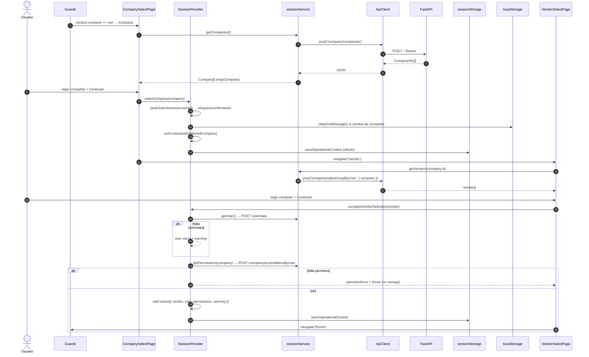

### 5.14 Qué sucede cuando el usuario cambia de compañía

El cambio se inicia desde `Sidebar` → "Cambiar Empresa" → `SessionProvider.changeCompany()`:

```ts
const changeCompany = () => {
  const submission = peekSubmission(accountId);
  if (submission && [...estados activos].includes(submission.status)) { alert(...); return; }
  if ((submission?.salesOrderNumber || submission?.headerAmbiguous) && submission.status !== 'completed'
      && !window.confirm('… tiene recuperación pendiente … ¿Continuar?')) return;
  queryClient.clear();          // elimina TODA la caché de servidor
  clearDraftStorage();          // elimina el borrador
  setContext(withoutCompany(accountId));
  navigate('/company');
};
```

`withoutCompany` deja `company`, `vendor`, `user` y `permissions` vacíos. El usuario repite compañía → vendedor → `/user/data` → permisos.

### 5.15 Componentes que se actualizan y peticiones que se repiten

- **Se actualizan** todos los consumidores de `useSession()`: `TopBar` (empresa/usuario/vendedor), `ProtectedLayout`, `Sidebar` y todos los hooks de datos. Sus claves de caché cambian porque incluyen `company`/`vendor`.
- **Se vuelven a ejecutar**: compañías (`/company`), vendedores, usuario y permisos, y luego cada consulta de la pantalla que se visite (dashboard, pedidos, clientes…), porque `queryClient.clear()` vació la caché.

### 5.16 Cómo se evita utilizar datos de una compañía anterior

| Mecanismo | Implementación |
|---|---|
| Claves de caché con compañía/vendedor | `catalogKeys.*`, `orderKeys.*`, `billingKeys.*`, `attachmentKeys.order`, `dashboardKeys.*`, `productionKey`, `forecastKey`, `vatKeys.*` |
| Consultas deshabilitadas sin contexto | `enabled: Boolean(company && vendor …)` en todos los hooks |
| Limpieza de caché al cambiar | `queryClient.clear()` en `changeCompany` y `logout` |
| Borrador ligado a cuenta + compañía | `loadDraft(accountId, companyId)` descarta el borrador si no coincide; `clearDraftStorage()` al cambiar |
| Envíos ligados a cuenta + compañía | Clave `sales4app.orderSubmission.v1.<cuenta>.<compañía>`; `loadSubmission` valida ambos |
| Bloqueo durante envío activo | `selectCompany`/`changeCompany` impiden el cambio |
| `OrderDraftProvider` exige contexto completo | Lanza `Error('OrderDraftProvider requires complete operational context')` |

**⚠ Observaciones:**

- `CompanySelectPage` → `selectCompany` **no** ejecuta `queryClient.clear()` (solo `changeCompany` lo hace). Si se llega a `/company` por URL o con el botón "Volver" de `VendorSelectPage`, la caché anterior permanece en memoria. No se mezclan datos porque las claves incluyen la compañía, pero la memoria no se libera.
- `geography` (`/d365/address/*` en `GeographySelector`/`addressKeys`) no incluye la compañía en la clave; son catálogos globales.

---

## Capítulo 6. Providers, contextos y hooks

### 6.1 `AuthProvider` / `useAuth`

| Campo | Descripción |
|---|---|
| Archivo | `src/app/providers/AuthProvider.tsx` |
| Responsabilidad | Estado de autenticación, estrategia (msal/dev-token/e2e-mock), login, logout y token |
| Props | `instance: PublicClientApplication`, `children` |
| Estado interno | `status: 'loading' \| 'authenticated' \| 'unauthenticated'`, `account: AuthAccount \| null`, `error: string \| null` |
| Valor expuesto (`AuthContextValue`) | `mode`, `status`, `account`, `error`, `login()`, `logout()`, `getAccessToken(forceRefresh?)`, `canRefreshToken` (`true` solo en msal), `unauthorized()` |
| Consumidores | `SessionProvider`, `RequireAuthentication`, `LoginPage`, `ProtectedLayout`, `SupportPage` |
| Dependencias | `msalInstance`, `loginRequest`, `devToken`, `appConfig`, `ApiError` |
| Inicialización | `useEffect` según modo (§3.6) |
| Actualización | `activateAccount` (login, `acquireTokenPopup`, logout) |
| Persistencia | Indirecta: caché MSAL en `sessionStorage` |
| Limpieza | `logout()` → `activateAccount(null)` + `logoutPopup` |
| Hook | `useAuth()` lanza `Error('useAuth must be used inside AuthProvider')` fuera del Provider |

### 6.2 `SessionProvider` / `useSession`

| Campo | Descripción |
|---|---|
| Archivo | `src/app/providers/SessionProvider.tsx` |
| Responsabilidad | Contexto operativo (cuenta, compañía, vendedor, usuario, permisos), cliente HTTP, cambio de compañía y logout global |
| Estado interno | `context: OperationalContext`, `operationError: string \| null` |
| Valor expuesto | `context`, `api: ApiClient`, `selectCompany(company)`, `completeVendorSelection(vendor)`, `changeCompany()`, `logout()`, `operationError`, `clearOperationError()` |
| Consumidores | Todos los hooks de `features/*` (`useCustomers`, `useOrders`, …), `OrderDraftProvider`, `OrderSubmissionProvider`, `guards`, `ProtectedLayout`, `Sidebar`, `TopBar` y la mayoría de páginas |
| Dependencias | `useAuth`, `useNavigate`, `queryClient`, `sessionService`, `core/session/*`, `orderDraft/storage`, `orders/submissionStorage` |
| Inicialización | `loadOperationalContext(accountId)` cuando cambia `accountId` |
| Persistencia | `saveOperationalContext` en cada cambio con `accountId` |
| Limpieza | `logout()` (Query, borrador, contexto, MSAL); `changeCompany()` (Query, borrador, compañía) |
| Construcción del `ApiClient` | `baseUrl: appConfig.apiBaseUrl`, `getToken: auth.getAccessToken`, `onUnauthorized: auth.unauthorized`, `refreshOnUnauthorized: auth.canRefreshToken` |

**Cómo lo usan los hooks.** Patrón repetido en todas las features:

```ts
export const useOrders = (filters: OrderFilters, enabled = true) => {
  const { api, context } = useSession();                 // 1. cliente + contexto
  const company = context.company?.id ?? '', vendor = context.vendor?.id ?? '';
  return useQuery({
    queryKey: orderKeys.list(company, vendor, filters),  // 2. aislamiento por contexto
    queryFn: ({ signal }) => orderQueryService(api).list(company, vendor, filters, signal),
    enabled: Boolean(enabled && company && vendor),      // 3. no consulta sin contexto
    placeholderData: keepPreviousData, staleTime: 30_000,
  });
};
```

### 6.3 `OrderDraftProvider` / `useOrderDraft`

| Campo | Descripción |
|---|---|
| Archivo | `src/features/orderDraft/OrderDraftProvider.tsx` |
| Ámbito | Solo la ruta `/crear-pedido/*` |
| Responsabilidad | Borrador local del pedido (encabezado + líneas) y adjuntos en memoria |
| Precondición | `context.company`, `context.vendor` y `context.user` presentes; si no, lanza error |
| Estado interno | `draft: OrderDraft`, `attachments: PendingAttachment[]` |
| Valor expuesto | `draft`, `update(patch)`, `addLines(selection)`, `updateLine(localId, patch)`, `removeLine(localId)`, `attachments`, `setAttachments`, `clearAttachments(localIds?)`, `reset()` |
| Consumidores | `CreateOrderPage`, `AddOrderLinePage`, `OrderDraftReviewPage`, `DraftAttachments`, `OrderSubmissionProvider` |
| Inicialización | `loadDraft(accountId, companyId)`; si existe, reemplaza `personnelnumber` por el del usuario actual. Si no, `createOrderDraft(accountId, company, vendor, user)` |
| Actualización | Cada operación pasa por `touch()` (actualiza `updatedAt`) |
| Persistencia | `saveDraft(draft)` en cada cambio → `localStorage['sales4app.orderDraft.v1']` con TTL de 7 días. **Los adjuntos no se persisten** (objetos `File`) |
| Limpieza | `reset()`; `clearDraftStorage()` desde `SessionProvider` (logout/cambio de compañía) y desde `OrderSubmissionProvider` al completar |

### 6.4 `OrderSubmissionProvider` / `useOrderSubmission`

| Campo | Descripción |
|---|---|
| Archivo | `src/features/orders/OrderSubmissionProvider.tsx` |
| Ámbito | Dentro de `OrderDraftProvider` en `/crear-pedido/*` |
| Responsabilidad | Ejecutar y recuperar el envío transaccional del borrador a D365 |
| Estado interno | `submission: OrderSubmission \| null` (inicial: `loadSubmission(accountId, companyId)`), `inFlight` (ref) |
| Valor expuesto | `submission`, `active`, `busy`, `unresolved`, `submit()`, `verifyPending()`, `retryPending()`, `discardRecovery()`, `createAnother()` |
| Consumidores | `OrderDraftReviewPage`, `DraftEditableRoute` (`App.tsx`) |
| Dependencias | `useSession` (api, context), `useOrderDraft`, `SubmissionRunner`, `orderSubmissionService`, `submissionStorage` |
| Efectos | Mientras `active`, registra `beforeunload` para advertir al cerrar la pestaña |
| Persistencia | La gestiona `SubmissionRunner.publish` → `saveSubmission` en `localStorage` |
| Limpieza | `discardRecovery()` y `createAnother()` → `clearSubmission`; al completar → `clearDraftStorage()` |

### 6.5 `QueryClientProvider` (TanStack Query)

`src/app/providers/queryClient.ts`:

- `staleTime: 60_000` por defecto (algunos hooks usan 15 s, 30 s o 5 min).
- `retry`: sin reintento si el error es `ApiError` con `status < 500`; si no, hasta 2 reintentos (`count < 2`).
- `refetchOnWindowFocus: false`.
- Mutaciones: sin política global; todas las críticas declaran `retry: false`.

### 6.6 Hooks personalizados

| Hook | Archivo | Uso |
|---|---|---|
| `useAuth` | `app/providers/AuthProvider.tsx` | Identidad, login/logout, token |
| `useSession` | `app/providers/SessionProvider.tsx` | `api`, `context` y comandos de sesión |
| `useOrderDraft` | `features/orderDraft/OrderDraftProvider.tsx` | Edición del borrador |
| `useOrderSubmission` | `features/orders/OrderSubmissionProvider.tsx` | Envío y recuperación |
| `useDebouncedValue(value, delay=1000)` | `core/hooks/useDebouncedValue.ts` | Retrasa búsquedas (clientes, productos, NIF, direcciones) |
| `useCustomers(search, page)` | `features/catalogs/hooks.ts` | `POST /customer/data`, 12 por página, requiere búsqueda de 1 o más caracteres |
| `useInfiniteCustomers(search)` | idem | Selector infinito, 25 por página; deduplica por `companyId:account` |
| `useCustomerByAccount(account)` | idem | Busca una cuenta exacta (detalle de pedido, `isCashAccount`) |
| `useCustomerAddresses(account)` | idem | `POST /customer/address`, `staleTime` 5 min |
| `useProducts(search, page)` | idem | Productos paginados (10) |
| `useInfiniteProducts(search, forceRegistry)` | idem | Productos infinitos, deduplicados por `itemId` |
| `useVariants(product, { forceRegistry, regionId })` | idem | Variantes si `requiresVariant` |
| `useInventory(product, variantNumber, page)` | idem | `/inventory` o `/inventory/variant` |
| `useInfiniteInventoryLocations(company, salesGroup, enabled)` | idem | Almacenes del grupo de ventas |
| `useReferenceCatalogs(customer, country, enabled)` | idem | Modos de entrega, orígenes, promociones, acuerdos y tipos de documento |
| `useVatNumbers`, `useVatDocumentTypes`, `useCreateVat` | `features/catalogs/vatHooks.ts` | NIF/VAT |
| `useAddressGeography`, `useCreateAddress` | `features/addresses/addressHooks.ts` | Geografía en cascada y alta de dirección |
| `useOrders`, `useOrderDetail`, `useOrderMutations`, `useOfficialOrderLine` | `features/orders/orderQueries.ts` | Pedidos (`useOfficialOrderLine` **no se usa**) |
| `useOrderAttachments`, `useAttachmentUploader` | `features/attachments/attachmentQueries.ts` | Adjuntos |
| `useInvoices`, `useStatement`, `useReportService`, `useAgingReport` | `features/billing/billingQueries.ts` | Finanzas |
| `useDashboardData` | `features/dashboard/dashboardQueries.ts` | Métricas de inicio |
| `useProduction` | `features/production/productionQueries.ts` | Producción |
| `useForecast` | `features/forecast/forecastQueries.ts` | Pronóstico |
| `useSendSupport` | `features/support/supportMutation.ts` | Soporte |

### 6.7 Dependencias entre Providers

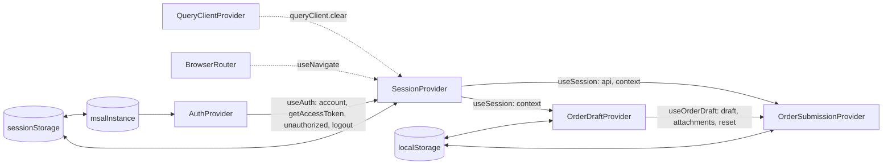

---

## Capítulo 7. Comunicación con el backend

### 7.1 Cliente HTTP — `ApiClient` (`src/core/api/apiClient.ts`)

| Aspecto | Comportamiento implementado |
|---|---|
| URL base | `options.baseUrl` = `appConfig.apiBaseUrl` (`VITE_API_BASE_URL`, sin `/` final). URL final: `` `${baseUrl}${path}` `` |
| Instancia | Una por `SessionProvider` (`useMemo`); se recrea si cambian `getAccessToken`, `unauthorized` o `canRefreshToken` (es decir, al cambiar la cuenta) |
| Métodos | `get<T>(path, { body?, signal?, timeoutMs? })`, `post<T>(path, body?, { signal?, timeoutMs?, retryOnUnauthorized?, headers? })`, `patch<T>(path, body?, { timeoutMs? })`, `delete<T>(path, body?, { timeoutMs?, retryOnUnauthorized? })` |
| Serialización | `JSON.stringify(body)` si existe |
| Encabezados | `Accept: application/json`, `Content-Type: application/json`, encabezados extra de la operación (p. ej. `Idempotency-Key`) y, al final, `Authorization: Bearer <token>`, que no puede sobrescribirse |
| Token | `getToken(false)` antes de cada petición. Si falla: relanza `ApiError` o crea `ApiError('configuration', mensaje)`; **nunca** se clasifica como error de red |
| Timeout | `AbortController` + `setTimeout`, 20 000 ms por defecto. Los valores por operación se indican en §7.4 |
| Cancelación externa | La `signal` de TanStack Query se encadena al `AbortController` interno |
| 401 | Si `retryOnUnauthorized === false` → `ApiError('authentication', 'La sesión fue rechazada; la operación no se repitió automáticamente.', 401)`. Si `refreshOnUnauthorized === false` (dev-token) → `onUnauthorized()` + `ApiError`. Si ya se reintentó → `onUnauthorized()` + `ApiError('authentication', 'No fue posible renovar la sesión…')`. En otro caso → `refreshToken()` y un solo reintento |
| 403 | `ApiError('forbidden', 'Forbidden', 403)`; sin cierre de sesión |
| Otros no-2xx | `ApiError('backend', 'Backend request failed', status, cuerpoJSON?)` (`safeBody`) |
| 204 | Devuelve `undefined` |
| JSON inválido | `ApiError('invalid-response', …)` |
| Excepciones | `AbortError` → `timeout`; `TypeError` (fallo de red/CORS) → `network`; resto → `unknown` |
| Concurrencia de renovación | `refreshPromise` compartido: varias peticiones con 401 simultáneo provocan una sola renovación |
| `fetch` | `globalThis.fetch.bind(globalThis)` (evita "Illegal invocation") |

### 7.2 Diagrama — flujo de una solicitud HTTP

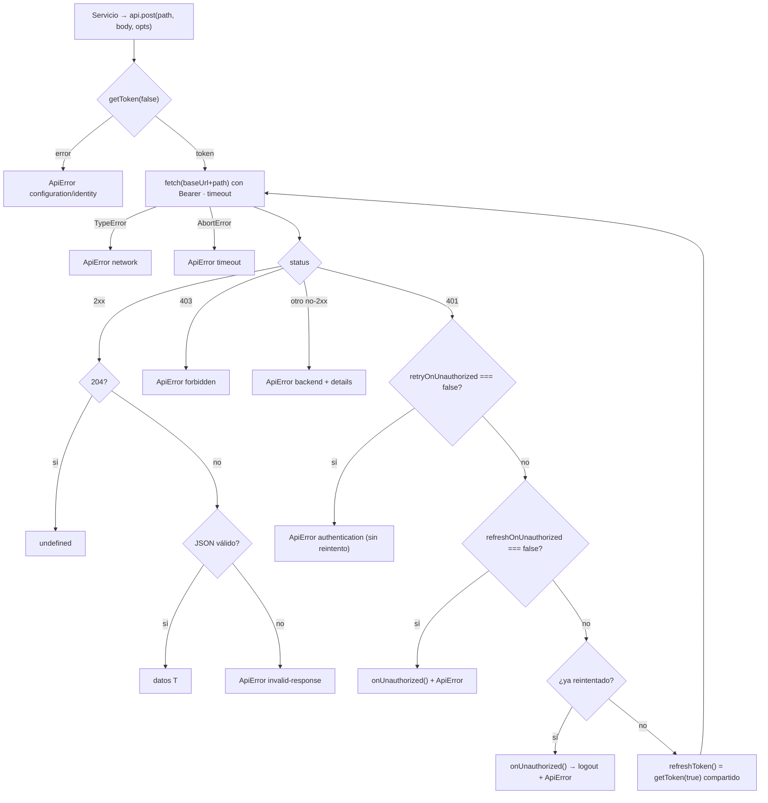

### 7.3 Errores tipados (`src/core/api/errors.ts`)

`ApiError(kind, message, status?, details?)`. Tipos posibles: `authentication`, `forbidden`, `timeout`, `network`, `backend`, `invalid-response`, `unknown`, `configuration`, `identity`.

`userErrorMessage(error)` convierte cualquier error en un texto seguro para el usuario (p. ej. `network` → "No fue posible conectar con el servicio."). Para `backend` muestra el genérico "No fue posible completar la operación." y **no expone el cuerpo del backend**.

`features/orders/mutationOutcome.ts`:

- `isAmbiguousError(e)`: `true` para timeout, error de red, respuesta inválida, cualquier 5xx o un error que no sea `ApiError`. En esos casos no se sabe si D365 aplicó la operación.
- `mutationErrorMessage(e)`: mensaje estable para registrar el fallo de una mutación.

### 7.4 Reintentos, timeouts y concurrencia

| Política | Dónde | Valor |
|---|---|---|
| Reintento de consultas | `queryClient` | 0 si `ApiError` con status < 500; hasta 2 en 5xx, red o timeout |
| Reintento de mutaciones | Cada `useMutation` | `retry: false` en todas |
| Reintento por 401 | `ApiClient` | 1, tras renovar el token |
| Timeout por defecto | `ApiClient` | 20 s |
| Timeout transaccional | Crear encabezado/líneas, PATCH/cancelar/eliminar línea, confirmar, soporte | 60 s |
| Timeout de archivos | Subir adjunto, PDF SSRS (factura y aging) | 120 s |
| Doble clic / reentrada | `useRef` de bloqueo en páginas (`locks`, `submitInFlight`, `transactionalLocks`), `SubmissionRunner.running`, `OrderSubmissionProvider.inFlight` | — |
| Cancelación al desmontar | `signal` de TanStack Query propagada a `fetch` | — |

### 7.5 Integración con TanStack Query

- Las **claves de caché** se centralizan en fábricas: `catalogKeys` (`catalogs/queryKeys.ts`), `orderKeys` (`orders/orderQueries.ts`), `billingKeys`, `attachmentKeys`, `dashboardKeys`, `vatKeys`, `addressKeys`, `productionKey`, `forecastKey`.
- **Invalidación tras mutaciones** (`useOrderMutations.invalidate`): `orderKeys.detail`, `orderKeys.lines`, `orderKeys.officialLines` y `orderKeys.all(company)` (este último invalida listados y detalles de la compañía). `AddExistingOrderLinePage` invalida las mismas claves al terminar. `useAttachmentUploader.refresh` invalida `attachmentKeys.order`.
- **`keepPreviousData`** en listados paginados (clientes, productos, inventario, pedidos) para evitar parpadeos al cambiar de página.
- **`useQueryClient().fetchQuery`** en `useOfficialOrderLine` (no se usa actualmente).

### 7.6 Contexto de compañía en las solicitudes

No hay un encabezado global de compañía: cada servicio la incluye en el cuerpo con el nombre que espera el endpoint:

| Campo en el cuerpo | Endpoints |
|---|---|
| `company` | `/company/salesGroupByUser`, `/customer/*`, `/company/products*`, `/inventory*`, `/delivery/mode`, `/company/sales_origin`, `/suppItemGroup`, `/sales`, `/custumer/invoice`, `/customer/statement`, `/production*`, `/forecastSales`, `/company/accessMenuByUser` (en mayúsculas) |
| `dataAreaId` | `/d365/sales`, `/d365/sales/line*`, adjuntos, `/d365_services/post_cancle_sales_line`, `/d365/vat_num` |
| `filters.dataAreaId` | `/d365/sales/line/query` (como arreglo), adjuntos `/query`, `/d365/vat_num/*query` |
| `DataAreaId` | `/d365_services/confirm_sales_order` |
| `Company` | `/d365_services/get_price`, `get_ssrs_report_pdf`, `get_cust_aging_ssrs_report_pdf` |
| `CustomerLegalEntityId` | `/d365/address` (alta) |

### 7.7 Inventario de endpoints

Leyenda: **Svc** = función del servicio · **UI** = componente que lo desencadena. Todas las rutas son relativas a `VITE_API_BASE_URL`.

#### Sesión — `features/session/sessionService.ts`

| Método | Ruta | Cuerpo | Respuesta → modelo | Svc | UI |
|---|---|---|---|---|---|
| POST | `/company/companies` | — | `CompanyDto[]` → `Company[]` | `getCompanies` | `CompanySelectPage` |
| POST | `/company/salesGroupByUser` | `{ company }` | `VendorDto[]` → `Vendor[]` | `getVendors` | `VendorSelectPage` |
| POST | `/user/data` | — | `UserDataDto[]` → `OperationalUser` (primer elemento) | `getUser` | `SessionProvider.completeVendorSelection` |
| POST | `/company/accessMenuByUser` | `{ company: COMPANY }` | `MenuPermissionDto[]` → `MenuPermission[]` | `getPermissions` | idem |

#### Catálogos — `features/catalogs/catalogService.ts`

| Método | Ruta | Cuerpo | Respuesta → modelo | Svc | UI |
|---|---|---|---|---|---|
| POST | `/customer/data` | `{ company, sales_group, search_text, pagination:{page,perpage} }` | `{ customers: CustomerDto[], pagination }` → `PageResult<Customer>` | `customers` | `ClientsPage` (`useCustomers`), `CreateOrderPage` (`useInfiniteCustomers`), `OrderDetailPage` (`useCustomerByAccount`), `DashboardPage` |
| POST | `/customer/address` | `{ company, account_id }` | `Json[]` → `CustomerAddress[]` | `customerAddresses` | `ClientsPage`, `CustomerAddressesPage`, `CustomerAddressSelector` |
| POST | `/company/products` | `{ company, search_text, pagination, force_registry:'true'\|'false' }` | `{ products, pagination }` → `PageResult<Product>` | `products` | `ProductsPage`, `InventoryPage`, `AddOrderLinePage`, `AddExistingOrderLinePage` |
| POST | `/company/products/variants` | `{ company, itemid, pagination, force_registry, regionid? }` | `{ variants, pagination }` → `PageResult<ProductVariant>` | `variants` | `ProductsPage`, `InventoryPage`, `AddOrderLinePage`, `AddExistingOrderLinePage` |
| POST | `/inventory` | `{ company, itemid?, multi_company:false, by_warehouse, search_text?, sales_group, pagination }` | `{ inventory, pagination }` → `PageResult<InventoryItem>` | `inventory` | `useInventory` (productos sin variante) |
| POST | `/inventory/variant` | `{ company, itemid, variantproduct, multi_company:false, by_warehouse:true, sales_group, pagination }` | idem | `variantInventory` | `useInventory` (productos con variante) |
| POST | `/inventory/locations_by_sales_group_and_company` | `{ company, sales_group, pagination }` | `{ locations, pagination }` → `PageResult<InventoryLocation>` | `inventoryLocations` | `OrderDetailPage` (cambio de almacén) |
| POST | `/d365_services/get_price` | `{ Company, Currencycode, ItemId, CustAccount, ConfigId, InventColorId, InventSizeId, InventStyleId, InventVersionId }` | `Json` → `Price` | `getPrice` | `AddOrderLinePage`, `AddExistingOrderLinePage` |
| POST | `/delivery/mode` | `{ company, pagination(1,100) }` | `{ mode }` → `DeliveryMode[]` | `deliveryModes` | `CreateOrderPage` |
| POST | `/company/sales_origin` | `{ company }` | `Json[]` → `SalesOrigin[]` | `salesOrigins` | `CreateOrderPage` |
| POST | `/customer/agreement` | `{ company, account_id, pagination(1,100) }` | `{ agreement }` → `PageResult<Agreement>` | `agreements` | `CreateOrderPage` |
| POST | `/customer/agreement/details` | `{ recid, pagination }` | `Json` | `agreementDetails` | **⚠ No se usa** |
| POST | `/customer/agreement/parcial_lines` | `{ company, account_id, recid }` | arreglo o `{ parcial_lines \| parcialLines \| lines }` → `AgreementLine[]` | `partialAgreementLines` | `AddOrderLinePage` |
| POST | `/suppItemGroup` | `{ company, pagination(1,100) }` | `{ suppitemgroup }` → `PromotionGroup[]` | `promotions` | `AddOrderLinePage`, `AddExistingOrderLinePage`, `CatalogsPage` |
| POST | `/d365/address/country_regions` | `{ filters:{}, search_text?, page, perpage }` | `{ '@odata': [...] }` → `Country[]` | `countries` / `addressService.geography` | `GeographySelector` (`CatalogsPage`), `NewAddressForm` |
| POST | `/d365/address/states` | `{ filters:{ CountryRegionId:[id] }, page, perpage }` | → `State[]` | `states` / `geography` | idem |
| POST | `/d365/address/counties` | `{ filters:{ CountryRegionId, StateId }, … }` | → `County[]` | `counties` / `geography` | idem |
| POST | `/d365/address/cities` | `{ filters:{ CountryRegionId, StateId, CountyId }, … }` | → `City[]` | `cities` / `geography` | idem |
| POST | `/d365/address/zip_codes` | `{ filters:{ CountryRegionId, State, County, City } }` | → `ZipCode[]` | `zipCodes` / `geography` | idem |
| POST | `/d365/vat_num/query` | `{ filters:{ Name, dataAreaId, CountryRegionId }, sort, page, perpage:25 }` | `{ '@odata', pagination }` → `PageResult<VatNumber>` | `vatNumbers` / `vatService.query` | `CatalogsPage`, `VatSelector` |
| POST | `/d365/vat_num/document_type/query` | `{ filters:{ dataAreaId, CountryRegionId } }` | `{ '@odata': { DocType, FelPA, FelSV } }` → `DocumentTypes` | `documentTypes` / `vatService.documentTypes` | `CatalogsPage`, `VatSelector` |
| POST | `/d365/vat_num` | `{ dataAreaId, CountryRegionId, VATNum, Name, DocumentTypeIdentificationId, CS_FEL_TaxpayerType_PA, CS_FEL_PersonType_SV }` | → `VatNumber` | `vatService.create` | `VatSelector` |

#### Direcciones — `features/addresses/addressService.ts`

| Método | Ruta | Cuerpo | Respuesta | Svc | UI |
|---|---|---|---|---|---|
| POST | `/d365/address` | `mapCreateAddress(company, form)`: `{ CustomerLegalEntityId, CustomerAccountNumber, AddressCountryRegionId, AddressState?, AddressCountyId?, AddressCity?, AddressZipCode?, AddressDescription, AddressStreet }` | Entidad → `CustomerAddress` (exige `AddressLocationId`) | `create` | `NewAddressForm` (en `CreateOrderPage`, `ClientsPage`, `NewCustomerAddressPage`) |

#### Pedidos — consulta y mantenimiento — `features/orders/orderQueryService.ts`

| Método | Ruta | Cuerpo | Respuesta → modelo | Svc | UI |
|---|---|---|---|---|---|
| POST | `/sales` | `{ company, cust_id?, sales_group, from_date?, to_date?, sales_status?, credit_control?, pagination:{perpage,page} }` | `{ sales_orders, pagination }` o arreglo → `OrdersResult` | `list` | `OrdersPage`, `DashboardPage` |
| POST | `/sales` | `{ company, sales_id, pagination:{1,1} }` | → `ExistingOrder \| null` | `header` | `OrderDetailPage`, `AddExistingOrderLinePage` (`useOrderDetail`) |
| POST | `/d365/sales/line/query` | `{ filters:{ dataAreaId:[c], SalesOrderNumber:[n] }, cross_company:true, page:1, perpage:1000 }` | arreglo → `OfficialSalesOrderLine[]` | `lines` | idem |
| POST | `/d365/sales/line/query` | idem + `LineNumber` | → una línea (valida coincidencia única) | `officialLine` | `useOfficialOrderLine` (**no usado**) |
| PATCH | `/d365/sales/line` | `{ key:{ dataAreaId, InventoryLotId }, payload:{ OrderedSalesQuantity?, SalesPrice?, ShippingWarehouseId? } }` | `unknown` | `updateLine` | `OrderDetailPage` (editar línea) |
| POST | `/d365_services/post_cancle_sales_line` | `{ dataAreaId, InventoryLotId }` | → `CancelResult` | `cancelLine` (sin reintento por 401) | `OrderDetailPage` |
| DELETE | `/d365/sales/line` | `{ key:{ dataAreaId, InventoryLotId } }` | `unknown` | `deleteLine` (sin reintento por 401) | `OrderDetailPage` |
| POST | `/d365_services/confirm_sales_order` | `{ DataAreaId, SalesId }` | → `ConfirmationResult` | `confirm` | `OrderDetailPage` |

#### Pedidos — creación — `features/orders/orderSubmissionService.ts`

| Método | Ruta | Encabezados | Cuerpo | Respuesta | Svc | UI |
|---|---|---|---|---|---|---|
| POST | `/d365/sales` | `Idempotency-Key` | `SalesHeaderRequest` (`mapHeaderRequest`) | arreglo → `SalesHeaderResponse` (exige `SalesOrderNumber`) | `createHeader` | `SubmissionRunner` (`OrderDraftReviewPage`) |
| POST | `/d365/sales/line` | `Idempotency-Key` | `SalesLineRequest` (`mapNormalLineRequest`) | → `ExistingSalesLine[]` | `createNormalLine` | `SubmissionRunner`, `AddExistingOrderLinePage` |
| POST | `/d365/sales/line/agreement` | `Idempotency-Key` | `AgreementLineRequest` (`mapAgreementLineRequest`) | → `ExistingSalesLine[]` | `createAgreementLine` | idem |
| POST | `/d365/sales/line/query` | — | `{ filters:{dataAreaId:[c],SalesOrderNumber:[n]}, cross_company:true, page:1, perpage:1000 }` | → `ExistingSalesLine[]` | `getExistingLines` | Verificación complementaria de líneas (`SubmissionRunner.lineExists`) |
| GET | `/d365/idempotency/{key}` | Comunes; sin Idempotency-Key | Sin body; `key` codificada en ruta y `dataAreaId` en query | `IdempotencyStatusView` (§15.3) | `getIdempotencyStatus` | `assessNewRequest`, antes de autorizar otra clave |

**Límite real:** `getExistingLines` solicita la primera página con `perpage: 1000`; no implementa paginación completa. La página de alta sobre pedido existente consulta directamente el POST original en modo `verify`.

#### Adjuntos — `features/attachments/attachmentService.ts`

| Método | Ruta | Cuerpo | Respuesta | UI |
|---|---|---|---|---|
| POST | `/d365/sales_header_documents_atachments/query` | `{ filters:{ dataAreaId, SalesOrderNumber }, cross_company:true, page:1, perpage:20 }` | arreglo o `@odata` → `OrderAttachment[]` | `OrderAttachmentsPage`, `OrderDetailPage`, `AddExistingOrderLinePage`, `SubmissionRunner` |
| POST | `/d365/sales_header_documents_atachments` | `{ dataAreaId, AttachmentDescription, SalesOrderNumber, FileType, DocumentAttachmentTypeCode:'Imagen'\|'Archivo', FileName, Attachment(Base64) }` | → `OrderAttachment` | `OrderAttachmentsPage`, `SubmissionRunner` |

#### Facturación — `features/billing/billingService.ts`

| Método | Ruta | Cuerpo | Respuesta | UI |
|---|---|---|---|---|
| POST | `/custumer/invoice` *(sic)* | `{ company, cust_id, sales_group, has_pending_balance, pagination:{perpage:10,page}, from_date?, to_date? }` | `{ invoices, pagination }` → `InvoiceResult` | `InvoicesPage` |
| GET | `/custumer/invoice/time_period` | — | `{ success, data[] }` | **⚠ No se usa** |
| POST | `/customer/statement` | `{ company, account_id, multi_company }` | arreglo o `{ data \| statement }` → `StatementSummary` (`buildStatementSummary`) | `AccountStatementPage`, `AgingPage`, `FinancialDocumentPage` |
| POST | `/d365_services/get_ssrs_report_pdf` | `{ Company, DocumentId, DocumentType:1 }` | `{ FileName, FileBase64 }` → `PdfReport` | `InvoicesPage`, `FinancialDocumentPage` |
| POST | `/d365_services/get_cust_aging_ssrs_report_pdf` | `{ Company, CustomerAccount }` | idem | `AccountStatementPage` |

#### Producción, pronóstico y soporte

| Método | Ruta | Cuerpo | Respuesta | UI |
|---|---|---|---|---|
| POST | `/production` | `{ company, cust_id, item_id, sales_group, from_date, to_date, sales_status, deliverydate, pagination:{perpage:20,page} }` (las fechas vacías se envían como `1990-01-01` y el estado vacío como `None`) | `{ production, pagination }` → `SalesProduction[]` | `ProductionPage` (modo `orders`) |
| POST | `/production/daily` | idem | → `DailyProduction[]` | `ProductionPage` (modo `daily`) |
| POST | `/forecastSales` | `{ company, salesgroup, from_date, to_date, itemid, variant, customerid, view_result_by, pagination }` | `{ forecastsales, pagination }` → `ForecastRow[]` | `ForecastPage` |
| POST | `/support/send_email` | `{ to:'soporte@foragro.com', cc:<correo usuario>, from_email:'dynamics@foragro.com', subject:'Sales4App', body, attachments?[{file_name,file_content}] }` | `{ Success, DebugMessage, ErrorMessage }` → `SupportResponse` | `SupportPage` |

**⚠ Observaciones de contrato:**

- `/custumer/invoice` está escrito así en el backend; no debe "corregirse" en el frontend.
- El comentario de `forecastService` menciona `POST /forecast`, pero el código usa `/forecastSales`.
- `post_cancle_sales_line` (sic) es el nombre real del servicio D365.

**Total:** 48 combinaciones únicas método + ruta declaradas en servicios: 46 con consumidores en el flujo Web y 2 sin consumo de UI (`agreementDetails` y `periods`). Se deduplican rutas compartidas; los métodos se cuentan por separado y los módulos detrás de flags se incluyen.

### 7.8 Encabezados, errores y evidencia de los contratos

Todas las filas de §7.7 heredan `Accept: application/json`, `Content-Type: application/json` y `Authorization: Bearer <token>` de `src/core/api/apiClient.ts`. Solo los tres POST de creación agregan `Idempotency-Key`. Los títulos de cada grupo identifican servicio y archivo bajo `src/`; la columna de cuerpo documenta los parámetros serializados. El GET complementario tiene `key` en ruta y `dataAreaId` en query, sin cuerpo.

Las respuestas de las tablas describen lo que el cliente tipa o acepta mediante sus mappers, no una captura real del Backend. Campos completos, obligatoriedad remota, límites y garantías de efectos requieren confirmar el Backend desplegado. Declarar una ruta no prueba su operación en producción.

| Condición común a todos los endpoints | Tratamiento del cliente |
|---|---|
| 401 | Una renovación y repetición conservando método, body y headers; si el retry está deshabilitado no se repite; persistencia del 401 activa `onUnauthorized` |
| 403 | `ApiError('forbidden')` |
| Otros HTTP no 2xx | `ApiError('backend', …, status, safeBody)` |
| 204 | `undefined`; el consumidor debe admitirlo |
| JSON inválido en 2xx | `ApiError('invalid-response')` |
| Abort/timeout, red, otro error | `timeout`, `network`, `unknown`; no demuestra ausencia de efectos remotos |
| Mapeo inválido | Excepción o defaults según mapper; cabecera sin número y estado de idempotencia incompleto producen error |

Creación utiliza `classifyCreationError` (§15). Consultas usan `ErrorState` y la política Query (§6.5). Mantenimiento utiliza `mutationOutcome.ts`; adjuntos verifican existencia, PDF valida Base64/firma y soporte interpreta también `Success/ErrorMessage`. Las particularidades se detallan en §8 y §12. Estas reglas comunes forman parte del contrato documentado de cada fila.

---

## Capítulo 8. Documentación funcional por módulos

Cada módulo se documenta con: objetivo, pantallas, archivos, hooks, servicios, endpoints, modelos, validaciones, estados, errores, contextos, persistencia y flujo. Los endpoints se detallan en §7.7.

### 8.1 Inicio de sesión

| Elemento | Detalle |
|---|---|
| Objetivo | Autenticar al usuario corporativo |
| Pantalla | `/login` → `LoginPage` (`src/features/auth/LoginPage.tsx`) |
| Hooks | `useAuth()` (`mode`, `status`, `error`, `login`) |
| Validaciones | `getConfigurationErrors()`: si faltan variables, se muestra *"Configuración pendiente: …"* y se deshabilita el botón |
| Estados | `loading` → `LoadingState "Restaurando sesión..."`; `authenticated` → `Navigate /home`; `unauthenticated` → formulario |
| Errores | `error` de `AuthProvider` en `role="alert"` |
| Modo dev | Muestra "TEMPORAL · DEVELOPMENT ONLY · NOT FOR PRODUCTION" |
| Flujo | Capítulo 4 |

**Ficha técnica — `LoginPage`**

| Campo | Descripción |
|---|---|
| Nombre | `LoginPage` |
| Ubicación | `src/features/auth/LoginPage.tsx` |
| Responsabilidad | Mostrar el inicio de sesión según el modo y redirigir si ya hay sesión |
| Entradas | Contexto `useAuth()` |
| Estado | Ninguno propio |
| Funciones | `onClick={() => void login()}` |
| Dependencias | `useAuth`, `getConfigurationErrors`, `Button`, `Card`, `Icon`, `LoadingState` |
| Salidas | `Navigate('/home')` cuando `status==='authenticated'` |
| Persistencia | Ninguna |
| Consumidores | Ruta `/login` en `App.tsx` |

### 8.2 Selección de compañía y vendedor

Documentado en el Capítulo 5. Pantallas: `/company` → `CompanySelectPage`, `/vendor` → `VendorSelectPage`.

**Ficha técnica — `CompanySelectPage`**

| Campo | Descripción |
|---|---|
| Ubicación | `src/components/pages/CompanySelectPage.tsx` |
| Responsabilidad | Listar las compañías del usuario y fijar la seleccionada |
| Entradas | `useSession()` → `api`, `context.company`, `selectCompany` |
| Estado | `companies: Company[]`, `selected: string`, `loading`, `error` |
| Funciones | `load()` (`sessionService(api).getCompanies()`), clic "Continuar" → `selectCompany(company)` + `navigate('/vendor')` |
| Dependencias | `sessionService`, `userErrorMessage`, `LoadingState`, `ErrorState` |
| Salidas | Contexto actualizado y navegación a `/vendor` |
| Persistencia | Indirecta (`SessionProvider` guarda en `sessionStorage`) |
| Consumidores | Ruta `/company` |

**Ficha técnica — `VendorSelectPage`**

| Campo | Descripción |
|---|---|
| Ubicación | `src/components/pages/VendorSelectPage.tsx` |
| Responsabilidad | Listar los grupos de ventas de la compañía y completar el contexto |
| Entradas | `useSession()` → `api`, `context`, `completeVendorSelection`, `operationError` |
| Estado | `vendors`, `selected`, `loading`, `submitting`, `error` |
| Funciones | `load()` (`getVendors`), `submit()` (`completeVendorSelection` + `navigate('/home')`) |
| Salidas | Contexto completo (vendor, user, permissions, warning) |
| Consumidores | Ruta `/vendor` (bajo `RequireCompany`) |

### 8.3 Inicio (Dashboard)

| Elemento | Detalle |
|---|---|
| Objetivo | Resumen operativo del vendedor |
| Pantalla | `/home` → `DashboardPage` (`src/components/pages/DashboardPage.tsx`) |
| Componentes | `DashboardHero`, `DashboardMetricCard` (×2), `RecentActivityCard`, `DashboardHighlightCard`, `QuickActionsCard` (`src/features/dashboard/components/`) |
| Hook | `useDashboardData()` (`src/features/dashboard/dashboardQueries.ts`) |
| Servicios | `orderQueryService.list`, `catalogService.customers` |
| Endpoints | `POST /sales` (×3), `POST /customer/data` |
| Datos | `today`: pedidos con `from=to=hoy` (`perPage:1`, se usa `pagination.totalRecords`); `open`: `status='Orden Abierta'`; `recent`: últimos 30 días, 5 elementos; `customers`: `search:''`, `perPage:1` → total de clientes asignados |
| Estados | Cada tarjeta recibe `loading` (`isPending`) y `error` (`isError`) |
| Contexto | `context.user.name` (saludo), `company`/`vendor` en las claves `dashboardKeys.*` |
| Navegación | Nuevo pedido → `/crear-pedido`; pedidos → `/pedidos`; pedido → `/pedidos/:n`; clientes → `/clientes`; acciones rápidas (`QUICK_ACTIONS`) |

La fecha local se calcula con `localDate()` corrigiendo el desfase horario (`getTimezoneOffset`).

### 8.4 Clientes

| Elemento | Detalle |
|---|---|
| Objetivo | Consultar los clientes asignados al vendedor, su crédito, direcciones y NIF, y acceder al estado de cuenta |
| Pantallas | `/clientes` → `ClientsPage` (con *drawer* `CustomerDetail`); `/clientes/:customerAccount/direcciones` → `CustomerAddressesPage`; `/clientes/:customerAccount/direcciones/nueva` → `NewCustomerAddressPage` |
| Componentes | `CustomerDetail` (interno de `ClientsPage`), `NewAddressForm`, `VatSelector`, `Badge` ACTIVO/BLOQUEADO |
| Hooks | `useCustomers(debounced, page)`, `useCustomerAddresses(account)`, `useDebouncedValue` (1 s) |
| Servicios / endpoints | `catalogService.customers` (`/customer/data`), `customerAddresses` (`/customer/address`), `addressService.create` (`/d365/address`), `vatService.*` (`/d365/vat_num*`) |
| Modelos | `Customer`, `CustomerAddress`, `VatNumber` |
| URL | `?search=&page=`, sincronizada con `setParams` |
| Reglas | El NIF solo se muestra para la cuenta de contado `MOST-000001`. El estado se calcula con `customer.blocked !== 0` |
| Persistencia | Ninguna (solo URL y caché de Query) |
| Integración | "Estado de cuenta" → `onEstadoCuenta(account)` → `navigate('/estado-cuenta?customer=…')` (definido en `App.tsx`) |
| Tras crear una dirección | `queryClient.invalidateQueries({ queryKey: catalogKeys.addresses(company, account) })` |

`useCustomers` solo consulta con 1 o más caracteres de búsqueda (`enabled: search.trim().length >= 1`).

**Ficha técnica — `ClientsPage`**

| Campo | Descripción |
|---|---|
| Ubicación | `src/components/pages/ClientsPage.tsx` |
| Entradas | Prop `onEstadoCuenta(customerAccount)`; URL `search`, `page` |
| Estado | `search`, `selected: Customer \| null`; en `CustomerDetail`: `showNewAddress`, `nifAddressLocationId`, `selectedNif` |
| Funciones | `update(search, page)`, `changePage(n)` (acotada a `totalPages`) |
| Dependencias | `useCustomers`, `useCustomerAddresses`, `NewAddressForm`, `VatSelector`, `catalogKeys` |
| Salidas | Navegación a estado de cuenta; invalidación de direcciones |
| Consumidores | Ruta `/clientes` |

### 8.5 Productos e inventario

| Elemento | Detalle |
|---|---|
| Pantallas | `/inventario` → `InventoryPage` (en el menú); `/productos` → `ProductsPage` (**solo por URL**, no está en el menú) |
| Hooks | `InventoryPage`: `useInfiniteProducts(debounced, true)` (consulta el registro forzado), `useVariants(product)`, `useInventory(product, variant, page)`. `ProductsPage`: `useProducts(debounced, page)`, `useVariants(selected)` |
| Endpoints | `/company/products`, `/company/products/variants`, `/inventory` o `/inventory/variant` |
| Regla | Si `product.requiresVariant` (calculado en `mappers.product`), el inventario exige seleccionar variante y usa `/inventory/variant` |
| Visualización | `Badge` success/blocked según `totalAvailable > 0` |
| Persistencia | Ninguna |

### 8.6 Pedidos de venta (consulta)

| Elemento | Detalle |
|---|---|
| Pantallas | `/pedidos` → `OrdersPage`; `/pedidos/:salesOrderNumber` → `OrderDetailPage` |
| Hooks | `useOrders(filters, hasAppliedFilters)`, `useOrderDetail(n)` (encabezado + líneas), `useOrderMutations(n)`, `useOrderAttachments(n, paymentRequired)`, `useCustomerByAccount`, `useInfiniteInventoryLocations` |
| Filtros (URL) | `customer`, `status`, `credit`, `from`, `to` (hoy por defecto), `page`, `searched=1` |
| Regla de consulta | **`OrdersPage` no consulta hasta que el usuario aplica filtros** (`searched=1`) |
| Recuperación | `OrdersPage` llama a `peekSubmission(accountId)` y muestra un aviso con enlace si existe un envío de pedido pendiente |
| Detalle | Encabezado desde `POST /sales` (`sales_id`) y líneas oficiales desde `POST /d365/sales/line/query` (`OfficialSalesOrderLine`, incluye `InventoryLotId`) |
| Estados de pedido | `statusLabel` traduce `Backorder → Orden Abierta`, `Delivered → Entregado`, `Invoiced → Facturado`, `Canceled → Cancelado` |

### 8.7 Mantenimiento de pedidos: edición, cancelación, eliminación y confirmación

Implementado en `OrderDetailPage` con las reglas de `src/features/orders/orderRules.ts`.

**Reglas**

| Regla | Función | Condición |
|---|---|---|
| Pedido abierto | `isOrderOpen` | `status` (minúsculas) ∈ {`orden abierta`, `open`, `backorder`} |
| Línea abierta | `isPersistedLineOpen` | `status === 'orden abierta'` |
| Editar línea | `canEditPersistedLine` | Pedido abierto, línea abierta, con `InventoryLotId` y **no** bonificación |
| Cancelar / eliminar línea | `canCancelPersistedLine` / `canDeletePersistedLine` | Pedido abierto, línea abierta y con `InventoryLotId` |
| Motivo de bloqueo | `persistedLineDisabledReason` | Texto para el `Tooltip` |
| Editar precio | `canEditPersistedLinePrice(permissions, isCash, isBonus)` | No es bonificación **y** (cliente de contado **o** permiso `Create Sales Orders → Price Sales Line = 'Editar'`) |
| Confirmar pedido | `canConfirmOrder` | Abierto, con líneas y sin `confirmDocumentNumber` |
| Agregar línea | `canAddOrderLine` | Pedido abierto |

**Operaciones**

| Acción | Función de la página | Mutación | Endpoint | Protección |
|---|---|---|---|---|
| Editar cantidad, precio o almacén | `beginEdit` → `save` | `mutations.update` | `PATCH /d365/sales/line` | `locks.update`; solo envía los campos modificados; cantidad > 0; precio > 0 salvo bonificación |
| Cancelar línea | `cancel(line)` | `mutations.cancel` | `POST /d365_services/post_cancle_sales_line` | `confirm()`, `transactionalLocks`, sin reintento por 401, invalida solo si `success` |
| Eliminar línea | `deleteLine(line)` | `mutations.delete` | `DELETE /d365/sales/line` | `confirm()`, `transactionalLocks`, sin reintento por 401 |
| Confirmar pedido | `confirm()` | `mutations.confirm` | `POST /d365_services/confirm_sales_order` | `confirm()`, `locks.confirm`; distingue confirmado, pendiente (`DebugMessage`) y rechazado |

Tras cada mutación se invalidan las consultas del pedido y de la compañía. Si el error es ambiguo (`isAmbiguousError`), el mensaje advierte que no se pudo verificar el resultado y **no se repite automáticamente**.

**Comprobante de pago:** para `MOST-000001`, `OrderDetailPage` consulta los adjuntos. Si no hay una imagen con descripción `pago` (`paymentBlocked`), deshabilita el botón "Agregar línea" y muestra un aviso con acceso a "Agregar comprobante".

**Ficha técnica — `OrderDetailPage`**

| Campo | Descripción |
|---|---|
| Ubicación | `src/components/pages/OrderDetailPage.tsx` |
| Entradas | `useParams().salesOrderNumber`, query string (para volver al listado), `useSession().context` (`accountId`, `permissions`, `vendor`) |
| Estado | `editing: OfficialSalesOrderLine \| null`, `quantity`, `price`, `warehouseId`, `message`, `pendingActions`, `pendingLines` (leídas de `sessionStorage`), refs `locks`, `transactionalLocks`, scroll |
| Funciones | `beginEdit`, `closeEditor`, `save`, `cancel`, `deleteLine`, `confirm` |
| Dependencias | `useOrderDetail`, `useOrderMutations`, `useOrderAttachments`, `useCustomerByAccount`, `useInfiniteInventoryLocations`, `orderRules`, `mutationOutcome`, MUI (`Tooltip`, `IconButton`, iconos) |
| Salidas | Mutaciones a D365, mensajes, navegación a adjuntos y a agregar línea |
| Persistencia | Lee `sessionStorage['sales4app.existingOrderPendingLines.v1:<cuenta>:<compañía>:<pedido>']` para mostrar líneas pendientes |
| Consumidores | Ruta `/pedidos/:salesOrderNumber` |

### 8.8 Creación de pedidos (borrador → D365)

Rutas bajo `/crear-pedido/*`, envueltas en `OrderDraftProvider` y `OrderSubmissionProvider`. `DraftEditableRoute` (`App.tsx`) redirige a `/crear-pedido/revision` si hay un envío activo, un pedido creado o un encabezado ambiguo.

#### 8.8.1 Encabezado — `CreateOrderPage` (`/crear-pedido`)

| Elemento | Detalle |
|---|---|
| Hooks | `useOrderDraft()`, `useInfiniteCustomers(debounced)`, `useReferenceCatalogs(customer, '', { promotions:false, documents:false })` (modos de entrega, orígenes, acuerdos), `useDebouncedValue` (1 s) |
| Componentes | `CustomerAddressSelector`, `NewAddressForm`, `VatSelector` (solo para `MOST-000001`), `DraftAttachments` |
| Elegir cliente | `chooseCustomer`: ignora clientes con bloqueo total (`isFullyBlockedCustomer`: `blockedDescription === 'todo'`). Si hay líneas, pide confirmación. Reinicia dirección, acuerdo, NIF y líneas; asigna moneda del cliente si la compañía la admite; `languageId` = idioma del usuario o, si no existe, el del cliente |
| Cambiar moneda | `changeCurrency`: confirma y vacía las líneas |
| Requisitos para continuar | Cliente, moneda válida, modo de entrega, dirección, fecha solicitada, `languageId`, NIF (contado) y comprobante de pago local (contado) |
| Salida | `navigate('/crear-pedido/linea')` |

#### 8.8.2 Líneas — `AddOrderLinePage` (`/crear-pedido/linea`)

| Elemento | Detalle |
|---|---|
| Hooks | `useInfiniteProducts`, `useVariants(product, { forceRegistry, regionId })`, `useInventory`, `useReferenceCatalogs` (solo promociones), `useQuery` de `partialAgreementLines` (si hay acuerdo) y de `getPrice` |
| Precio | `getPrice` con compañía, moneda, cliente, artículo y dimensiones de la variante. Si `canEditPrice(permissions)`, se permite `priceOverride`. Se reinicia al cambiar producto, variante, cliente o moneda |
| Registro forzado de variante | `draft.forceRegisterVariant` → variantes con `force_registry` y `regionid` = país de la dirección de entrega |
| Bonificación | Con promoción: `buildDraftLines` crea la línea original y una línea bonificada enlazada (`parentLineId`), con `bonusQuantity(qty, forecastDiscount)`, precio 0 e `isBonification`. Bonificación independiente: una sola línea con precio 0 |
| Acuerdo | Si se elige una línea de acuerdo: `source='agreement'`, `matchingAgreementLine` y `agreementRemainingQuantity` |
| Validación | `buildDraftLines(...).flatMap(validateDraftLine)` antes de agregar |
| Salida | `addLines(selection)`; navegación a `/crear-pedido` o `/crear-pedido/revision` |

`bonusQuantity` (`orderDraft/domain.ts`): `q × d / 100`, redondeado hacia abajo salvo que la parte decimal sea ≥ 0.99, en cuyo caso se redondea hacia arriba.

#### 8.8.3 Validaciones del borrador (`orderDraft/validation.ts`)

| Nivel | Código | Regla |
|---|---|---|
| Encabezado | `company_required`, `vendor_required`, `customer_required`, `currency_required`, `delivery_required`, `address_required`, `date_required`, `lines_required` | Campos obligatorios y al menos una línea |
| Línea | `quantity_positive` | `quantity > 0` |
| Línea | `variant_required` | `productType === 'MasterProduct'` exige `presentationCode` |
| Línea | `site_required`, `warehouse_required` | Sitio y almacén obligatorios |
| Línea | `price_positive` | `price > 0` salvo bonificación |
| Línea | `agreement_reference` | Línea de acuerdo sin `matchingAgreementLine` |
| Línea | `agreement_quantity` | Cantidad mayor que el saldo del acuerdo |
| Adjuntos | `attachments_invalid` | Extensión (pdf/jpg/jpeg/png), ≤ 5 MB, descripción de 1 a 100 caracteres; comprobante `pago` para contado |
| Mapeo | (excepción) | `mapHeaderRequest` exige `languageId` y `personnelnumber` |

#### 8.8.4 Revisión y envío — `OrderDraftReviewPage` + `SubmissionRunner`

`OrderDraftReviewPage` muestra el borrador (o el *snapshot* si ya existe un pedido), las líneas, los adjuntos y el progreso. "Crear pedido" pide confirmación (*"Se creará un pedido real en Dynamics 365…"*) y llama a `flow.submit()`.

`SubmissionRunner.submit(draft, recovery, attachments)` (`src/features/orders/submissionRunner.ts`) es una máquina de estados reanudable:

| Estado | Qué ocurre | Persistencia |
|---|---|---|
| `idle` | `initial(draft)` genera las claves iniciales de cabecera y líneas; una nueva solicitud autorizada genera otras | Antes del POST |
| `validating` | `validateOrderDraft(snapshot)` + validación de adjuntos y comprobante | No |
| `failed` (validación) | Errores concatenados en `state.error` | Solo si ya hay pedido |
| `creating-header` | `mapHeaderRequest`. Se **persiste antes del POST** y luego se llama `createHeader(request, headerIdempotencyKey)` | Sí |
| `header-created` | Guarda `salesOrderNumber` | Sí |
| `failed` (encabezado) | Conserva seguimiento y clave incluso ante 4xx; `headerAmbiguous` depende de si el seguimiento es incierto | Sí |
| `uploading-attachments` | Sube cada adjunto no confirmado. Si falla, consulta adjuntos para confirmar; si no puede confirmar → `partial-failure` **sin crear líneas** | Sí |
| (contado) | Verifica en D365 que existe un comprobante `pago` imagen; si no → `partial-failure` | Sí |
| `creating-lines` | Crea secuencialmente líneas `not-sent`; persiste antes del POST y se detiene en el primer error | Sí, por transición |
| `awaiting-confirmation` | Hay líneas sin resultado confirmado; bloquea nuevos envíos y conserva claves | Sí |
| `recovering` | Consulta manual: en líneas comprueba existencia primero; si no confirma, mismo POST/clave/payload | Sí |
| `completed` / `partial-failure` | Todas creadas, o resumen de pendientes | Sí |

Al terminar, `OrderSubmissionProvider.settle` actualiza `submission`, retira adjuntos confirmados y, si `completed`, borra el borrador (`clearDraftStorage`). `busy/inFlight` y `SubmissionRunner.exclusive` evitan comandos simultáneos en la misma instancia.

**Idempotencia** (`features/orders/idempotency.ts`):

- Encabezado `Idempotency-Key: <UUID>` en `/d365/sales`, `/d365/sales/line` y `/d365/sales/line/agreement`. El backend responde 422 si falta.
- Misma clave y mismo cuerpo Completed: respuesta original (*replay*). Processing, Failed o cuerpo distinto: conflictos interpretados por `classifyCreationError`, incluidos 500 con `detail: "409: …"`. Un 500 no reconocido es incierto.
- Ninguna clave se renueva automáticamente ni al consultar. Failed/rejected solo habilita evaluación: GET complementario debe confirmar ausencia de efectos (§15.3). Líneas del borrador requieren además comprobar que no existen. Sin evidencia se bloquea.

**Verificación anti-duplicados** (`orderSubmissionMapper.sameLine` / `isDraftLineAlreadyCreated`): compara artículo, dimensiones, precio, cantidad, sitio, almacén, grupo de promoción y bandera de bonificación. Descuenta las líneas idénticas ya confirmadas en la misma ejecución (`confirmedMatching`).

**Recuperación** (`OrderSubmissionProvider.retryPending`):

- «Consultar estado» del provider usa `verifyAndResume`: el POST original conserva clave y snapshot. El runner `verifyPending` solo consulta; el método homónimo del provider consulta y continúa si todo se confirma y no quedan errores de adjuntos ni operaciones fallidas.
- `retryPending` se bloquea ante seguimiento sin resolver. Para cabecera usa `assessHeaderRetry`; para líneas, `prepareRetry`: ambas requieren evidencia del GET complementario. CREATED recupera efectos sin crear otro documento; ausencia confirmada autoriza nueva clave por acción del usuario.
- Si no queda nada sin confirmar ni fallido, se continúa con las primeras ejecuciones pendientes. Sin clave original no hay recuperación inequívoca.

`discardRecovery()` y `createAnother()` limpian seguimiento local; no cancelan procesamiento ni eliminan efectos remotos. Detalle en §15 y en el documento de idempotencia.

#### 8.8.5 Diagrama — creación de pedidos

```mermaid
sequenceDiagram
  autonumber
  actor U as Vendedor
  participant CO as CreateOrderPage
  participant AL as AddOrderLinePage
  participant DP as OrderDraftProvider
  participant RV as OrderDraftReviewPage
  participant SP as OrderSubmissionProvider
  participant RN as SubmissionRunner
  participant GW as orderSubmissionService
  participant LS as localStorage
  participant BE as FastAPI → D365
  U->>CO: cliente, moneda, entrega, dirección, fecha, NIF, adjuntos
  CO->>DP: update(patch)
  DP->>LS: saveDraft (sales4app.orderDraft.v1)
  U->>AL: producto, variante, inventario, precio, promoción/acuerdo
  AL->>BE: get_price / variants / inventory
  AL->>DP: addLines(selection) → buildDraftLines
  U->>RV: Crear pedido (confirm)
  RV->>SP: submit()
  SP->>RN: submit(draft, null, attachments)
  RN->>RN: initial(): headerKey + lineKeys
  RN->>RN: validating (validateOrderDraft + adjuntos)
  RN->>LS: saveSubmission (creating-header) ANTES del POST
  RN->>GW: createHeader(req, headerKey)
  GW->>BE: POST /d365/sales + Idempotency-Key
  alt ok
    BE-->>RN: SalesOrderNumber → header-created
  else resultado incierto o Processing
    RN-->>SP: failed · headerAmbiguous (recuperable con la misma clave)
  else Failed o rechazo confirmado
    RN-->>SP: failed · conservar clave, evaluar efectos antes de otra solicitud
  end
  loop cada adjunto, solo si encabezado confirmado
    RN->>GW: uploadAttachment → POST adjuntos
    opt error
      RN->>GW: listAttachments (confirmar) → si no confirma: partial-failure y STOP
    end
  end
  loop cada línea not-sent, solo si encabezado y adjuntos confirmados
    RN->>LS: tracking awaiting-confirmation ANTES del POST
    RN->>GW: createNormalLine / createAgreementLine (lineKey)
    GW->>BE: POST /d365/sales/line[/agreement] + Idempotency-Key
    opt error
      RN->>LS: conservar clave y seguimiento; detener secuencia
      RN-->>RV: Consultar estado o evaluar nueva solicitud según resultado
    end
    RN->>LS: saveSubmission (cada transición)
  end
  RN-->>SP: completed | partial-failure
  SP->>LS: clearDraftStorage() si completed
  SP-->>RV: submission → resultado / reintentar pendientes
```

#### 8.8.6 Precios, descuentos y bonificaciones: límites del cálculo

`catalogService.getPrice` consulta precio por compañía, moneda, cliente, artículo y dimensiones. `baseLine` en `features/orderDraft/domain.ts` conserva `price`, `priceUnit`, `lineDiscount`, `linePercent`, `markup`, `discountPct1` y `discountPct2`. Sin embargo, `draftTotal` suma **cantidad × precio**; no resta esos descuentos ni calcula impuestos, recargos o total fiscal. Los mappers de creación envían `SalesPrice` y `OrderedSalesQuantity`, sin los campos locales de descuento. No debe presentarse el total local como importe definitivo calculado por Dynamics.

La promoción crea una línea original y una bonificada enlazadas por `parentLineId`; cantidad bonificada = cantidad × forecastDiscount / 100, redondeada hacia abajo salvo fracción ≥ 0.99. La bonificación independiente es una línea de precio cero. La línea de acuerdo conserva `MatchingAgreementLine` y valida saldo restante; `ChangeShippingWarehouseId` se envía vacío. La posibilidad de editar precio depende de reglas y permisos (§8.7); no existe un motor independiente de descuentos comerciales aplicado al total en Web.

### 8.9 Agregar líneas a un pedido existente

| Elemento | Detalle |
|---|---|
| Pantalla | `/pedidos/:salesOrderNumber/lineas/nueva` → `AddExistingOrderLinePage` |
| Particularidad | **No crea borrador ni encabezado**: cada `POST /d365/sales/line` usa el `SalesOrderNumber` existente y un `shellDraft` derivado del pedido para reutilizar los mappers |
| Hooks | `useOrderDetail`, `useOrderAttachments`, `useInfiniteProducts`, `useVariants`, `useInventory`, `useReferenceCatalogs`, `useQuery(getPrice)`, `useDebouncedValue` |
| Cola local | `pendingLines: PendingLine[]` (`OrderDraftLine` + `submissionStatus`, `submissionError`, `idempotencyKey`) en `sessionStorage['sales4app.existingOrderPendingLines.v1:<cuenta>:<compañía>:<pedido>']` |
| Envío | `submitPending` → `sendPendingLines`: verifica comprobante para contado en modo send; persiste submitting antes del POST y detiene ante error. Verify consulta ambiguous mediante el mismo POST/clave/payload. Failed exige `assessNewRequest` (GET complementario) antes de renovar; CREATED retira la línea de la cola y evidencia insuficiente bloquea. Si la consulta deja solo líneas pending, continúa con ellas |
| Final | Invalida las consultas del pedido. Si no quedan pendientes, limpia `sessionStorage` y navega al detalle |
| Reglas | `canAddOrderLine(order)`, `canEditPrice(permissions)` |

**⚠ Observación:** `useOrderMutations().addLine` (con `BonusLineFailure`) existe en `orderQueries.ts`, pero **no se usa**; `AddExistingOrderLinePage` implementa su propio envío.

### 8.10 Adjuntos

| Elemento | Detalle |
|---|---|
| Pantalla | `/pedidos/:salesOrderNumber/adjuntos` → `OrderAttachmentsPage`. También `DraftAttachments` en la creación |
| Hooks | `useOrderAttachments(n)`, `useAttachmentUploader(n)` (`upload`, `refresh`) |
| Servicio | `attachmentService.list` / `upload`; `fileToBase64` (Data URL sin prefijo) |
| Validación | `validateAttachment`: pdf/jpg/jpeg/png, ≤ 5 MB, descripción de 1 a 100 caracteres |
| Estados del archivo | `pending → encoding → uploading → (success) / verifying → ambiguous / failed` |
| Confirmación | Tras subir, vuelve a consultar y busca por nombre (con o sin extensión) y descripción. Si no lo encuentra → `ambiguous` y **no se reenvía** automáticamente |
| Apertura | `openAttachment`: crea un `Blob` con su MIME; abre pdf/imagen en una pestaña (`noopener`) o descarga el resto; revoca la URL |
| Protección | `beforeunload` mientras sube; `locks` por archivo |
| Persistencia | Ninguna (los `File` viven en memoria) |
| Regla de contado | `requiresPaymentAttachment('MOST-000001')` y `isPaymentImage(description='pago', jpg/jpeg/png)` |

### 8.11 Facturas

| Elemento | Detalle |
|---|---|
| Pantalla | `/facturas` → `InvoicesPage` |
| Filtros (URL) | `customer`, `from`, `to`, `openOnly`, `page` |
| Hooks | `useInvoices(filters)`, `useReportService()` |
| Endpoints | `/custumer/invoice`; PDF `get_ssrs_report_pdf` |
| PDF | `openPdfReport(fileName, base64, mode)` valida que sea Base64 y que empiece por `%PDF`, sanea el nombre y abre o descarga |
| Bloqueo | `locks: Set<string>` por factura para evitar solicitudes de PDF duplicadas |

### 8.12 Estado de cuenta, aging y documento financiero

| Pantalla | Ruta | Hooks | Notas |
|---|---|---|---|
| `AccountStatementPage` | `/estado-cuenta?customer=&multiCompany=` | `useStatement(account, multi)`, `useAgingReport()` | Resumen corriente/vencido (USD), *buckets* de antigüedad, PDF de aging |
| `AgingPage` | `/estado-cuenta/aging?customer=&bucket=` | `useStatement` | Documentos del bucket seleccionado |
| `FinancialDocumentPage` | `/estado-cuenta/documento/:id?customer=&bucket=` | `useStatement`, `useReportService` | Busca por `voucher` o `internalInvoice`; PDF de la factura |

`buildStatementSummary` (`billingMappers.ts`) separa los documentos `timePeriod === 'Corriente'` del resto, agrupa los vencidos por `timePeriod`, calcula `totalUsd` (con `remainamountcur_usd`) y asigna severidad (`agingSeverity`: Reciente, Atención, En riesgo, Crítico).

**⚠ Observación:** las tres pantallas usan la misma clave `billingKeys.statement(company, account, multi)`, así que comparten caché (30 s). La compañía en el PDF de `FinancialDocumentPage` se toma de `context.company` (`useReportService` ignora el primer argumento).

### 8.13 Catálogos (página técnica)

`/catalogos` → `CatalogsPage` (**solo por URL**). Muestra el `GeographySelector` (país → estado → municipio → ciudad → código postal, usando `catalogService` y la lógica de `geography.ts`), los grupos de bonificación, los tipos de documento por país y la búsqueda de NIF. Sirve para verificar contratos.

### 8.14 Producción y pronóstico (ocultos por *feature flag*)

| Módulo | Ruta | Flag | Hook | Endpoint |
|---|---|---|---|---|
| Producción | `/produccion` | `VITE_FEATURE_PRODUCTION` | `useProduction(filters)`; modos `orders` y `daily` | `/production`, `/production/daily` |
| Forecast | `/forecast` | `VITE_FEATURE_FORECAST` | `useForecast(filters)`; vista `all`, `qty`, `amount`, `volume` | `/forecastSales` |

Si el flag está apagado, la ruta redirige a `/home` y el menú no muestra la opción. Los filtros viven en la URL.

### 8.15 Soporte

| Elemento | Detalle |
|---|---|
| Pantalla | `/soporte` → `SupportPage` |
| Hook | `useSendSupport()` |
| Identidad | `cc` = `auth.account.username` o, si falta, `context.user.networkAlias` |
| Validación | `validateSupport`: mensaje ≥ 10 caracteres, solo imágenes, ≤ 5 MB cada una |
| Flujo | Confirmación → `mutateAsync` → si `success`, limpia el formulario; si no, muestra el error |
| Protección | `beforeunload` y confirmación al salir con contenido; `lock` contra doble envío |

**⚠ Observación:** los correos `to` y `from_email` están fijos en `supportService.ts`.

### 8.16 Módulos no implementados

No existen en el código: módulo de configuración o preferencias de usuario, reportes genéricos aparte de los PDF SSRS, y edición del encabezado de un pedido ya creado. La campana de notificaciones de `TopBar` es decorativa (sin lógica). Los tipos de `src/types/index.ts` (`Order`, `Client`, `Invoice`, etc.) provienen del prototipo; actualmente solo se usa `User` (en `AppLayout`, `Sidebar` y `TopBar`).

Acciones rápidas del Dashboard (`QUICK_ACTIONS` en `DashboardPage.tsx`): inventario, facturas, estado de cuenta y soporte.

---

## Capítulo 9. Persistencia y recuperación del estado

### 9.1 Inventario de datos persistidos

| Dato | Mecanismo | Clave | Quién lo guarda | Cuándo se actualiza | Cómo se recupera | Expiración | Eliminación |
|---|---|---|---|---|---|---|---|
| Cuentas, ID token, access token y refresh token de MSAL | `sessionStorage` (MSAL) | Claves internas `msal.*` | `@azure/msal-browser` | Login, `acquireToken*` | `getActiveAccount()` / `getAllAccounts()` en `AuthProvider` | Según el token; se pierde al cerrar la pestaña | `logoutPopup`, cierre de pestaña |
| Contexto operativo (cuenta, compañía, vendedor, usuario, permisos, advertencia) | `sessionStorage` | `sales4app.operational-context.v1` | `SessionProvider` (efecto → `saveOperationalContext`) | Cada cambio de `context` con `accountId` | `loadOperationalContext(accountId)` (solo si la cuenta coincide) | Cierre de pestaña | `SessionProvider.logout` → `clearOperationalContext()` |
| Borrador de pedido | `localStorage` | `sales4app.orderDraft.v1` (sobre: `schemaVersion`, `updatedAt`, `accountId`, `companyId`, `draft`) | `OrderDraftProvider` (efecto → `saveDraft`) | Cada cambio del borrador | `loadDraft(accountId, companyId)` | **7 días** desde `updatedAt` (`ORDER_DRAFT_TTL_MS`) | Logout, cambio de compañía, `reset()`, envío completado, versión/cuenta/compañía distinta o JSON corrupto |
| Ejecución de envío de pedido (snapshot, claves, seguimiento, número) | `localStorage` | `sales4app.orderSubmission.v1.<cuenta>.<compañía>` | `SubmissionRunner.publish` → `saveSubmission` | Antes de cada POST y transiciones posteriores, incluidos fallos de cabecera | `loadSubmission(accountId, companyId)`; `peekSubmission(accountId)` | No expira | `discardRecovery`, `createAnother`, nueva solicitud de cabecera autorizada tras evaluar efectos. **No** al cerrar sesión ni por un 4xx aislado |
| Líneas pendientes sobre un pedido existente | `sessionStorage` | `sales4app.existingOrderPendingLines.v1:<cuenta>:<compañía>:<pedido>` | `AddExistingOrderLinePage` (efecto y commit síncrono) | Cada cambio y antes del POST | `restorePendingLines` al montar; `OrderDetailPage` las lee | Cierre de pestaña | Cuando todas se crean (`removeItem`) |
| Datos de servidor | Memoria (TanStack Query) | Claves de Query | Hooks | `staleTime` 15 s a 5 min | Caché en memoria | Recarga de página | `queryClient.clear()` (logout, cambio de compañía) e invalidaciones |
| Adjuntos pendientes (`File`) | Memoria (estado React) | — | `OrderDraftProvider`, `OrderAttachmentsPage` | Al seleccionar archivos | No se recuperan | Recarga de página | `clearAttachments`, `reset` |
| Filtros de listados | URL (query string) | `?customer=&page=…` | Páginas (`setParams`) | Al aplicar filtros | `useSearchParams` | — | Navegación |

No se guarda manualmente ningún token, PDF ni contenido Base64.

### 9.2 Datos asociados a usuario y compañía

Todo dato local de negocio está ligado a `accountId` (y a compañía cuando corresponde):

- Contexto operativo: `accountId` dentro del JSON.
- Borrador: `accountId` + `companyId` en el sobre.
- Envíos: `accountId` + `companyId` en la clave y en el JSON.
- Pendientes de pedido existente: cuenta, compañía y pedido en la clave.

Otro usuario que inicie sesión en el mismo navegador no recupera estos datos: los `load*` comparan la cuenta y descartan lo que no coincide.

### 9.3 Diagrama — persistencia y recuperación del contexto

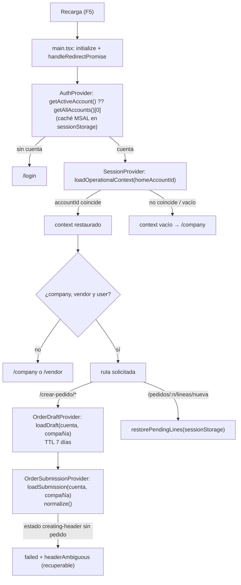

### 9.4 Normalización al recuperar envíos (`submissionStorage.normalize`)

- Si una línea no tiene `idempotencyKey`, recibe una nueva, pero las ya intentadas quedan pendientes de confirmación sin envío automático. La nueva clave no recupera la identidad histórica original.
- `headerIdempotencyKey` ausente pasa a `null`, y un encabezado ambiguo sin clave **no** se reenvía.
- Una ejecución interrumpida en `creating-header` sin número de pedido pasa a `failed` con `headerAmbiguous: true` y conserva su clave.
- Nunca reemplaza una clave existente.
- Líneas `creating` o con seguimiento incierto pasan a `unconfirmed`. Estados activos restantes se normalizan a `awaiting-confirmation` si hay líneas inciertas, o `partial-failure`.
- `uploading-attachments` pasa a `partial-failure` sin autorización de retry automático; los objetos File no se recuperan tras F5.

---

## Capítulo 10. Rutas y navegación

### 10.1 Tabla completa de rutas (`src/App.tsx`)

| Ruta | Componente | Autenticación | Compañía | Vendedor y usuario | Guards / envoltorios | Parámetros | Contextos |
|---|---|---|---|---|---|---|---|
| `/login` | `LoginPage` | No | No | No | — | — | Auth |
| `/company` | `CompanySelectPage` | Sí | No | No | `RequireAuthentication` | — | Session |
| `/vendor` | `VendorSelectPage` | Sí | Sí | No | `RequireAuthentication` → `RequireCompany` | — | Session |
| `/home` | `DashboardPage` | Sí | Sí | Sí | `RequireAuthentication` → `RequireCompleteContext` → `ProtectedLayout` | — | Session |
| `/pedidos` | `OrdersPage` | Sí | Sí | Sí | idem | `?customer,status,credit,from,to,page,searched` | Session |
| `/pedidos/:salesOrderNumber` | `OrderDetailPage` | Sí | Sí | Sí | idem | `:salesOrderNumber` + query de retorno | Session |
| `/pedidos/:salesOrderNumber/lineas/nueva` | `AddExistingOrderLinePage` | Sí | Sí | Sí | idem | `:salesOrderNumber` | Session |
| `/pedidos/:salesOrderNumber/adjuntos` | `OrderAttachmentsPage` | Sí | Sí | Sí | idem | `:salesOrderNumber` | Session |
| `/clientes` | `ClientsPage` | Sí | Sí | Sí | idem | `?search,page` | Session |
| `/clientes/:customerAccount/direcciones` | `CustomerAddressesPage` | Sí | Sí | Sí | idem | `:customerAccount` | Session |
| `/clientes/:customerAccount/direcciones/nueva` | `NewCustomerAddressPage` | Sí | Sí | Sí | idem | `:customerAccount` | Session |
| `/inventario` | `InventoryPage` | Sí | Sí | Sí | idem | — | Session |
| `/productos` | `ProductsPage` | Sí | Sí | Sí | idem (sin entrada en el menú) | `?search,page` | Session |
| `/catalogos` | `CatalogsPage` | Sí | Sí | Sí | idem (sin entrada en el menú) | — | Session |
| `/facturas` | `InvoicesPage` | Sí | Sí | Sí | idem | `?customer,from,to,openOnly,page` | Session |
| `/produccion` | `ProductionPage` o `Navigate /home` | Sí | Sí | Sí | idem + `featureProduction` | query de filtros | Session |
| `/forecast` | `ForecastPage` o `Navigate /home` | Sí | Sí | Sí | idem + `featureForecast` | query de filtros | Session |
| `/crear-pedido` | `CreateOrderPage` | Sí | Sí | Sí | idem + `OrderDraftProvider` + `OrderSubmissionProvider` + `DraftEditableRoute` | — | Session, Draft, Submission |
| `/crear-pedido/linea` | `AddOrderLinePage` | Sí | Sí | Sí | idem + `DraftEditableRoute` | — | idem |
| `/crear-pedido/revision` | `OrderDraftReviewPage` | Sí | Sí | Sí | Providers de pedido (sin `DraftEditableRoute`) | — | idem |
| `/estado-cuenta` | `AccountStatementPage` | Sí | Sí | Sí | `ProtectedLayout` | `?customer,multiCompany` | Session |
| `/estado-cuenta/aging` | `AgingPage` | Sí | Sí | Sí | idem | `?customer,bucket,multiCompany` | Session |
| `/estado-cuenta/documento/:id` | `FinancialDocumentPage` | Sí | Sí | Sí | idem | `:id` + `?customer,bucket` | Session |
| `/soporte` | `SupportPage` | Sí | Sí | Sí | idem | — | Auth, Session |
| `/` | `Navigate /home` | — | — | — | — | — | — |
| `*` | `Navigate /home` | — | — | — | Dentro de `ExistingPrototypeRoutes` y en la raíz | — | — |

Las páginas operativas se cargan con `React.lazy` y se envuelven en `<Suspense fallback={<LoadingState message="Cargando módulo..." />}>`. `LoginPage`, `CompanySelectPage` y `VendorSelectPage` se importan de forma estática.

### 10.2 Estructura de anidamiento

```
<Routes>
  /login
  <RequireAuthentication>
    /company
    <RequireCompany> /vendor </RequireCompany>
    <RequireCompleteContext>
      <ProtectedLayout>              ← AppLayout (Sidebar, TopBar, nav móvil, FAB)
        path="*" → <ExistingPrototypeRoutes>  (segundo <Routes> con las rutas operativas)
      </ProtectedLayout>
    </RequireCompleteContext>
  </RequireAuthentication>
  / → /home
  * → /home
</Routes>
```

### 10.3 Navegación global

| Origen | Destinos |
|---|---|
| `Sidebar` (`NAV_ITEMS`) | `/pedidos`, `/clientes`, `/inventario`, `/crear-pedido`, `/facturas`, `/produccion`*, `/forecast`*, `/soporte` (*según flag) |
| `Sidebar` (`BOTTOM_ITEMS`) | "Cambiar Empresa" → `changeCompany()`; "Cerrar Sesión" → `logout()`. No son rutas reales |
| Navegación inferior móvil (`AppLayout.BOTTOM_NAV`) | `/pedidos`, `/clientes`, `/inventario`, `/facturas` |
| FAB (en `/home` y `/pedidos`) | `/crear-pedido` |
| `TopBar` (móvil) | Atrás (`navigate(-1)`) fuera de `/home`, o abrir el menú |
| `ProtectedLayout.titles` | Título móvil por sección |

### 10.4 Diagrama — navegación y guards

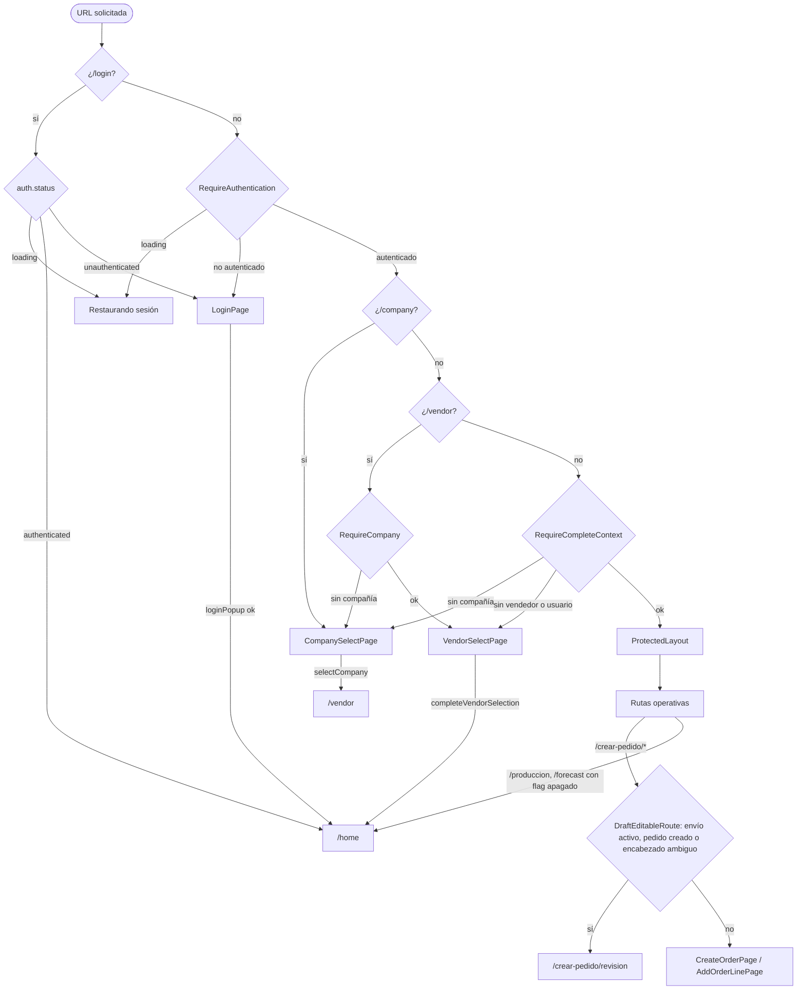

---

## Capítulo 11. Seguridad

### 11.1 Autenticación MSAL

- Cliente público SPA (sin secreto) con Authorization Code + PKCE (MSAL 5).
- `loginPopup`, con la respuesta devuelta por *redirect bridge* en `/auth/redirect.html`. La URI debe estar registrada como **SPA** en Entra ID.
- Authority específica del tenant (`VITE_AZURE_TENANT_ID`). El fallback `common` solo se aplica si falta configuración y en ese caso el login queda deshabilitado.
- Caché en `sessionStorage`: la sesión se pierde al cerrar la pestaña y no se comparte entre pestañas.

### 11.2 Autorización

| Nivel | Implementación |
|---|---|
| API | El backend valida el Bearer para el scope `VITE_AZURE_SCOPE` y decide qué compañías, vendedores, clientes y datos devuelve. **La autorización real está en el backend** |
| Rutas | Guards en el cliente: solo mejoran la experiencia y no son una barrera de seguridad |
| Compañía | El Web solo ofrece las compañías que devuelve `/company/companies` y las envía en cada petición. El backend debe validar que el usuario tenga acceso a la compañía enviada |
| Permisos de menú | `/company/accessMenuByUser` se carga, pero solo se evalúa la edición de precio (`canEditPrice`). **⚠ El resto de los menús no se filtra por permiso** |
| Reglas de negocio | `orderRules.ts` (estado de pedido y línea, bonificación, `InventoryLotId`); cliente de contado `MOST-000001` (NIF y comprobante de pago) |
| 403 | Se muestra "No tienes permiso para realizar esta operación." y no se cierra la sesión |

### 11.3 Tokens

- El access token **solo vive en la caché de MSAL**: el código no lo guarda en otro lugar, no lo muestra y no lo registra en logs. Se pide justo antes de cada `fetch`.
- `Authorization` no puede sobrescribirse con encabezados de operación.
- Renovación silenciosa, con interacción (popup) solo cuando MSAL la exige.
- Modo `dev-token`: el token queda **visible en el bundle** (`VITE_*`). Está bloqueado en build y en runtime de producción.

### 11.4 Scopes

Un único scope de API (`VITE_AZURE_SCOPE`), más los scopes OIDC que MSAL añade automáticamente. No se solicitan permisos de Microsoft Graph.

### 11.5 Gestión de sesión

- El logout limpia la caché de Query, el borrador y el contexto, y cierra la sesión en Entra ID.
- Un 401 persistente provoca el cierre de sesión (ver la observación de §4.7 sobre la limpieza parcial).
- Las recuperaciones de pedidos se conservan en `localStorage` después del logout, ligadas a la cuenta.

### 11.6 Información sensible en el navegador

| Dato | Ubicación | Sensibilidad |
|---|---|---|
| Tokens | `sessionStorage` (MSAL) | Alta: vulnerable a XSS, como en cualquier SPA |
| Contexto operativo (nombre, alias de red, número de personal, permisos) | `sessionStorage` | Media |
| Borrador y snapshot de envío (cliente, dirección, precios, NIF) | `localStorage` | Media: persiste hasta 7 días (borrador) o sin límite (recuperación) |
| Adjuntos | Solo en memoria | — |

### 11.7 Medidas defensivas en el código

- PDF: valida Base64 y la firma `%PDF`, sanea el nombre y revoca las *object URLs* (`openPdfReport`).
- Adjuntos: lista blanca de extensiones, máximo 5 MB, nombres saneados (`safeDownloadName`), `window.open(..., 'noopener')`.
- `GlobalErrorBoundary` no muestra el error ni la traza.
- `redirectBridge.ts` registra solo el `errorCode`, nunca la URL ni el código de autorización.
- `userErrorMessage` no expone cuerpos del backend.
- `vite.config.ts` (versión del último commit) desactiva los sourcemaps de producción.
- `main.tsx` aborta si se intenta usar `dev-token` en producción.

### 11.8 Riesgos técnicos identificados

| # | Riesgo | Evidencia | Recomendación |
|---|---|---|---|
| R1 | La página `auth/redirect.html` no está incluida en `vite build` | `vite.config.ts` sin `build.rollupOptions.input` | Añadir la entrada HTML antes de desplegar y registrar la URI SPA de producción |
| R2 | El permiso de menú no restringe pantallas | Solo `canEditPrice` evalúa `permissions` | Definir la política y filtrar `Sidebar` y rutas, si el negocio lo requiere |
| R3 | Verificación heurística limitada a la primera página | `getExistingLines` usa `perpage: 1000`; `sameLine` | Paginar y correlacionar con referencia de idempotencia |
| R4 | Limpieza incompleta tras un 401 persistente | `auth.unauthorized` → `AuthProvider.logout` | Delegar en `SessionProvider.logout` |
| R5 | Recuperaciones de envío sin expiración en `localStorage` | `submissionStorage` | Definir una política de retención |
| R6 | Correos fijos en soporte | `supportService.ts` | Llevarlos a configuración del backend |
| R7 | CORS y encabezados de seguridad del hosting no verificados en el repositorio | `docs/backend-contract-issues.md` BE-09 | Validar en staging |
| R8 | Textos con codificación corrupta | `orderQueryService.officialLine` ("encontró") | Corregir la codificación UTF-8 |

---

## Capítulo 12. Manejo de errores y diagnóstico

### 12.1 Capas de manejo de errores

| Capa | Mecanismo | Archivo |
|---|---|---|
| Render | `GlobalErrorBoundary` (pantalla "Sales4App no pudo continuar" con botón Recargar) | `app/errors/GlobalErrorBoundary.tsx` |
| HTTP | `ApiError` tipado | `core/api/apiClient.ts`, `errors.ts` |
| Mensajes | `userErrorMessage` | `core/api/errors.ts` |
| Mutaciones | `isAmbiguousError`, `mutationErrorMessage`, `classifyCreationError`, `assessNewRequest` | `features/orders/*` |
| Consultas | `isError` + `ErrorState` con reintento (`refetch`) | Páginas |
| Autenticación | `AuthProvider.error` (código MSAL) | `AuthProvider.tsx` |
| Carga | `LoadingState`, `isPending`/`isLoading`, `Suspense` | `components/ui/PageState.tsx` |

### 12.2 Guía de diagnóstico

| Síntoma | Dónde mirar | Causas probables y acciones |
|---|---|---|
| Popup de login en blanco o que no se cierra | DevTools del popup; `auth/redirect.html`; `redirectBridge.ts` | La página de retorno no carga el bridge (comprobar que `/auth/redirect.html` responde con su propio HTML y no con `index.html`); consola: `MSAL redirect bridge: <code>` |
| `AADSTS50011` | Parámetro `redirect_uri` de `/authorize` (pestaña Network) | URI no registrada. Usar la URI SPA registrada; no inventar rutas |
| `AADSTS9002326` | Petición `/token` | La URI está registrada como *Web* y no como *SPA* |
| `no_token_request_cache_error` | Stack en `handleRedirectPromise` | Se cargó la app completa en el popup (Redirect URI apuntando a la SPA) |
| "No fue posible iniciar sesión con Microsoft (código)" | `AuthProvider.login` (catch) | Buscar el código MSAL (`popup_window_error` = popup bloqueado, `user_cancelled`, `interaction_in_progress`…) |
| "Configuración pendiente: …" en login | `env.ts → getConfigurationErrors` | Falta alguna variable `VITE_*`; reiniciar `npm run dev` después de editar `.env` |
| "No fue posible conectar con el servicio." | Network: petición fallida sin status | `TypeError` en `fetch`: backend caído, URL base errónea o **CORS** (ver la consola: *blocked by CORS policy*). Revisar `VITE_API_BASE_URL` y el preflight `OPTIONS` |
| "El servicio tardó demasiado en responder." | `ApiClient` timeout | 20, 60 o 120 s según la operación; revisar el backend |
| Sesión cerrada inesperadamente | `ApiClient.request` rama 401 | Dos 401 seguidos (token rechazado por el backend: audiencia o scope). Revisar `VITE_AZURE_SCOPE` y la configuración del backend |
| "No tienes permiso…" | Respuesta 403 | El backend deniega el acceso; revisar roles del usuario o compañía |
| "No hay empresas disponibles" o error en `/company` | `CompanySelectPage.load` | `POST /company/companies` vacío o fallido; `mapCompany` lanza error si falta `legalentityid` o `name` |
| No avanza de `/vendor` | `completeVendorSelection` | Falló `accessMenuByUser` (`operationError`). Si falló `/user/data`, avanza con aviso y la creación de pedidos queda bloqueada por falta de `personnelnumber` |
| Datos de otra compañía o contexto inconsistente | `sessionStorage['sales4app.operational-context.v1']`; claves de Query (React Query Devtools si se añade) | Comprobar `accountId` y `company.id`; usar "Cambiar Empresa" (limpia la caché). Como último recurso, borrar `sessionStorage` y `localStorage` `sales4app.*` |
| No permite cambiar de compañía | `selectCompany`/`changeCompany` → `peekSubmission` | Hay un envío activo o una recuperación pendiente en `localStorage['sales4app.orderSubmission.v1.*']`. Resolverla en `/crear-pedido/revision` o descartarla |
| `/crear-pedido` siempre redirige a revisión | `DraftEditableRoute` | Existe una recuperación (pedido creado o encabezado ambiguo); usar "Reintentar pendientes", "Crear otro pedido" o descartar |
| Pedido ambiguo (no se sabe si se creó) | `submission.headerAmbiguous`, `headerIdempotencyKey` | Reintentar: el backend devuelve el pedido original (replay) o un 409. Con 409, verificar en D365 |
| Nueva solicitud de línea bloqueada | `SubmissionRunner.prepareRetry` / `assessNewRequest` | GET no confirma ausencia de efectos o POST de existencia no permite verificar ausencia; conservar clave y revisar pedido |
| Borrador perdido | `localStorage['sales4app.orderDraft.v1']` | TTL de 7 días, otra cuenta o compañía, cambio de compañía o logout |
| Adjuntos del borrador desaparecen tras F5 | `OrderDraftProvider.attachments` | Comportamiento esperado: los `File` no se persisten |
| PDF no abre | `openPdfReport` | Base64 inválido o contenido no PDF; bloqueador de popups |
| Datos desactualizados | `staleTime` del hook | Las mutaciones invalidan claves concretas; recargar o volver a aplicar filtros |

### 12.3 Puntos de depuración recomendados

| Punto | Archivo / función |
|---|---|
| Toda petición HTTP | `ApiClient.request` (antes del `fetch` y en el `catch`) |
| Renovación de token | `AuthProvider.getAccessToken`, `ApiClient.refreshToken` |
| Estado de autenticación | `AuthProvider.activateAccount` |
| Contexto operativo | Efectos de `SessionProvider` (carga y guardado) |
| Envío de pedido | `SubmissionRunner.publish` (cada transición) |
| Decisión de duplicado | `SubmissionRunner.verify`, `orderSubmissionMapper.sameLine` |
| Idempotencia | `idempotency.classifyCreationError`, `operationTracking.assessNewRequest`, `SubmissionRunner.verifyAndResume` |

**Recomendación:** no añadir `console.log` de tokens, cuerpos de pedidos ni URLs con `code`/`state`. El comentario de `GlobalErrorBoundary.componentDidCatch` marca el punto de integración previsto para observabilidad; hoy no hay proveedor configurado.

---

## Capítulo 13. Guía de mantenimiento

### 13.1 Principios de separación de responsabilidades (tal como los aplica el código)

1. **Las páginas no construyen payloads HTTP**: llaman a hooks o servicios.
2. **Los servicios no usan React**: reciben `ApiClient` y parámetros, y devuelven modelos mapeados.
3. **Los mappers aíslan los nombres de campo del backend** (minúsculas, PascalCase, `@odata`). El resto del código usa modelos camelCase.
4. **El contexto operativo se lee de `useSession()`**, nunca de props ni de almacenamiento directo.
5. **Las claves de caché incluyen la compañía** (y el vendedor si el backend filtra por él).
6. **Las mutaciones que crean o modifican datos en D365** usan `retry: false`, bloqueo contra doble clic, clasificación de resultado ambiguo y, cuando el backend lo exige, `Idempotency-Key` generada una sola vez por operación lógica.

### 13.2 Agregar una pantalla

1. Crear `src/components/pages/NuevaPage.tsx` con *default export*.
2. Leer el contexto con `const { context } = useSession();` y los datos con un hook de feature.
3. Usar `LoadingState`, `ErrorState` (con `onRetry={() => query.refetch()}`) y `EmptyState` para los estados.
4. Si tiene filtros, guardarlos en la URL con `useSearchParams` (patrón de `OrdersPage`/`InvoicesPage`).

### 13.3 Agregar una ruta

En `src/App.tsx`:

```tsx
const NuevaPage = lazy(() => import('./components/pages/NuevaPage'));
// dentro de ExistingPrototypeRoutes → hereda RequireAuthentication + RequireCompleteContext + ProtectedLayout
<Route path="/nueva" element={<NuevaPage />} />
```

- Para que aparezca en el menú: añadirla a `NAV_ITEMS` (`Sidebar.tsx`) y, si se quiere, a `BOTTOM_NAV` (`AppLayout.tsx`) y a `titles` (`ProtectedLayout.tsx`).
- Si va detrás de un flag: añadir la variable en `env.ts` con `flag('VITE_FEATURE_X')` y usar el patrón de `/produccion`.
- Una ruta que no requiera vendedor debe declararse fuera de `RequireCompleteContext`, como `/company` y `/vendor`.

### 13.4 Crear un componente

- Visual reutilizable: añadirlo a `src/components/ui/index.tsx` o a un archivo propio en `ui/`.
- Ligado a un dominio: `src/components/orders/` (formularios de pedido) o `src/features/<dominio>/components/` (patrón del dashboard).
- Recibir datos por props; usar `useSession()` solo si necesita el contexto operativo.

### 13.5 Crear un servicio API

Patrón (`features/<dominio>/<dominio>Service.ts`):

```ts
import type { ApiClient } from '../../core/api/apiClient';
type Json = Record<string, unknown>;
const s = (v: unknown) => (v == null ? '' : String(v));

export const mapItem = (j: Json): Item => ({ id: s(j.itemid), name: s(j.name) });

export const nuevoService = (api: ApiClient) => ({
  list: async (company: string, vendor: string, page: number, signal?: AbortSignal) => {
    const r = await api.post<Json>('/ruta', { company, sales_group: vendor, pagination: { page, perpage: 20 } }, { signal });
    return { items: Array.isArray(r.items) ? r.items.map((x) => mapItem(x as Json)) : [] };
  },
});
```

- Usar `POST` para las consultas con filtros (el navegador no envía cuerpo en `GET`).
- Indicar `timeoutMs` (60 s para transacciones, 120 s para archivos).
- Para operaciones no repetibles tras un 401, usar `retryOnUnauthorized: false`.

### 13.6 Consumir un contexto y crear el hook

```ts
export const nuevoKeys = { list: (c: string, v: string, p: number) => ['nuevo', c, v, p] as const };
export const useNuevo = (page: number) => {
  const { api, context } = useSession();
  const c = context.company?.id ?? '', v = context.vendor?.id ?? '';
  return useQuery({
    queryKey: nuevoKeys.list(c, v, page),
    queryFn: ({ signal }) => nuevoService(api).list(c, v, page, signal),
    enabled: Boolean(c && v),
    staleTime: 30_000,
  });
};
```

Para una mutación: `useMutation({ mutationFn, retry: false, onSettled: () => qc.invalidateQueries({ queryKey: … }) })`.

### 13.7 Agregar un endpoint a un servicio existente

1. Añadir el método al servicio del dominio y su mapper.
2. Añadir los tipos en `<dominio>Types.ts` o `types.ts`.
3. Añadir la clave de caché a la fábrica del dominio.
4. Si es una creación en D365 con idempotencia: generar la clave con `newIdempotencyKey()` **al crear el estado de la operación**, persistirla antes del POST y enviarla con `idempotencyHeaders(key)`. Nunca generarla dentro del método HTTP.
5. Documentarlo en §7.7 de este manual.

### 13.8 Incorporar una nueva funcionalidad (lista de verificación)

- [ ] Servicio + mappers + tipos en `src/features/<dominio>/`.
- [ ] Hook con clave de caché aislada por compañía y vendedor.
- [ ] Página con sus estados de carga, error y vacío.
- [ ] Ruta en `App.tsx` y, si procede, entrada de menú.
- [ ] Reglas de negocio puras en un archivo propio (patrón de `orderRules.ts`), con pruebas.
- [ ] Si hay persistencia local: clave versionada `sales4app.<nombre>.v1`, ligada a `accountId` y compañía, y limpieza en `SessionProvider.logout`/`changeCompany` si corresponde.
- [ ] Mensajes al usuario mediante `userErrorMessage`.
- [ ] Pruebas unitarias y de componente.

### 13.9 Agregar pruebas

| Tipo | Herramienta | Ubicación | Ejemplos existentes |
|---|---|---|---|
| Unitarias (servicios, mappers, reglas) | Vitest | `*.test.ts` junto al archivo | `features/catalogs/catalogService.test.ts`, `features/orders/submissionRunner.test.ts`, `core/api/apiClient.test.ts`, `core/session/storage.test.ts` |
| Componentes | Vitest + Testing Library + jsdom | `*.test.tsx` junto a la página | `OrderDetailPage.test.tsx`, `OrdersPage.test.tsx`, `SupportPage.test.tsx` |
| E2E smoke | Playwright (modo `e2e`, puerto 4173, API simulada) | `e2e/` | `session.smoke.spec.ts`, `mockApi.ts` |

Comandos: `npm test` (Vitest), `npm run test:e2e`, `npm run test:smoke`, `npm run lint`.

Para servicios, simular `ApiClient` con `{ post: vi.fn().mockResolvedValue(...) } as unknown as ApiClient` (patrón de `features/support/support.test.ts`). En total hay 32 archivos de prueba en `src/`.

**Estado verificado el 2026-10-13:** 179 pruebas: 170 aprobadas / 9 fallidas; 26 archivos aprobados / 6 fallidos y 2 rechazos no controlados. TypeScript y lint aprobados. El registro anterior de 11 fallos es histórico; véase §16.

---

## Capítulo 14. Anexos técnicos

### 14.1 Árbol de directorios (`src/`, sin pruebas)

```
src/
├── main.tsx · App.tsx · index.css · vite-env.d.ts
├── app/
│   ├── config/env.ts
│   ├── errors/GlobalErrorBoundary.tsx
│   ├── providers/AuthProvider.tsx · SessionProvider.tsx · queryClient.ts
│   └── router/guards.tsx · ProtectedLayout.tsx · routePolicy.ts
├── core/
│   ├── api/apiClient.ts · errors.ts
│   ├── auth/msal.ts · redirectBridge.ts · devToken.ts
│   ├── hooks/useDebouncedValue.ts
│   └── session/types.ts · mappers.ts · storage.ts · transitions.ts
├── features/
│   ├── addresses/addressService.ts · addressHooks.ts
│   ├── attachments/attachmentService.ts · attachmentQueries.ts · attachmentValidation.ts · attachmentMappers.ts · attachmentTypes.ts
│   ├── auth/LoginPage.tsx
│   ├── billing/billingService.ts · billingQueries.ts · billingMappers.ts · billingTypes.ts
│   ├── catalogs/catalogService.ts · hooks.ts · queryKeys.ts · mappers.ts · types.ts · vatService.ts · vatHooks.ts · geography.ts · GeographySelector.tsx · customerRules.ts
│   ├── dashboard/dashboardQueries.ts · components/{DashboardHero,DashboardHighlightCard,DashboardMetricCard,QuickActionsCard,RecentActivityCard}.tsx
│   ├── forecast/forecastService.ts · forecastQueries.ts · forecastTypes.ts
│   ├── orderDraft/OrderDraftProvider.tsx · domain.ts · validation.ts · storage.ts · types.ts
│   ├── orders/OrderSubmissionProvider.tsx · submissionRunner.ts · submissionStorage.ts · orderSubmissionService.ts · orderSubmissionMapper.ts · orderQueryService.ts · orderQueries.ts · orderMappers.ts · orderRules.ts · orderTypes.ts · types.ts · idempotency.ts · operationTracking.ts · mutationOutcome.ts · testFixtures.ts
│   ├── production/productionService.ts · productionQueries.ts · productionTypes.ts
│   ├── session/sessionService.ts
│   └── support/supportService.ts · supportMutation.ts · supportTypes.ts
├── components/
│   ├── layout/AppLayout.tsx · Sidebar.tsx · TopBar.tsx
│   ├── orders/CustomerAddressSelector.tsx · DraftAttachments.tsx · NewAddressForm.tsx · VatSelector.tsx
│   ├── pages/ (23 páginas, ver 14.2)
│   └── ui/index.tsx · PageState.tsx
├── types/index.ts
└── test/setup.ts
```

### 14.2 Inventario de componentes

El inventario detallado (rutas, relaciones, consumidores) está en [`INVENTARIO_COMPONENTES_SALES4APP.md`](./INVENTARIO_COMPONENTES_SALES4APP.md). Resumen:

| Categoría | Cantidad | Elementos |
|---|---|---|
| Páginas | 24 | `LoginPage` + 23 en `components/pages` |
| Layout | 3 | `AppLayout`, `Sidebar`, `TopBar` (+ `ProtectedLayout`) |
| Formularios / selectores de dominio | 5 | `CustomerAddressSelector`, `DraftAttachments`, `NewAddressForm`, `VatSelector`, `GeographySelector` |
| Dashboard | 5 | `DashboardHero`, `DashboardHighlightCard`, `DashboardMetricCard`, `QuickActionsCard`, `RecentActivityCard` |
| UI base | 15 | `Icon`, `Badge`, `Button`, `FAB`, `Card`, `Input`, `Select`, `Toggle`, `BottomSheet`, `MobileHeader`, `InfoRow`, `SectionTitle`, `EmptyState`, `LoadingState`, `ErrorState` |
| Infraestructura de app | 4 | `GlobalErrorBoundary`, `RequireAuthentication`, `RequireCompany`, `RequireCompleteContext` |

### 14.3 Inventario de Providers

| Provider | Hook | Archivo | Ámbito |
|---|---|---|---|
| `AuthProvider` | `useAuth` | `app/providers/AuthProvider.tsx` | Global |
| `SessionProvider` | `useSession` | `app/providers/SessionProvider.tsx` | Global |
| `OrderDraftProvider` | `useOrderDraft` | `features/orderDraft/OrderDraftProvider.tsx` | `/crear-pedido/*` |
| `OrderSubmissionProvider` | `useOrderSubmission` | `features/orders/OrderSubmissionProvider.tsx` | `/crear-pedido/*` |
| `QueryClientProvider` (biblioteca) | `useQueryClient` | `app/providers/queryClient.ts` | Global |

### 14.4 Inventario de hooks (34 propios)

Ver la tabla de §6.6. Por archivo:

| Archivo | Hooks |
|---|---|
| `app/providers/*` | `useAuth`, `useSession` |
| `features/orderDraft/OrderDraftProvider.tsx` | `useOrderDraft` |
| `features/orders/OrderSubmissionProvider.tsx` | `useOrderSubmission` |
| `core/hooks/useDebouncedValue.ts` | `useDebouncedValue` |
| `features/catalogs/hooks.ts` | `useCustomers`, `useCustomerAddresses`, `useProducts`, `useInfiniteCustomers`, `useCustomerByAccount`, `useInfiniteProducts`, `useVariants`, `useInventory`, `useInfiniteInventoryLocations`, `useReferenceCatalogs` |
| `features/catalogs/vatHooks.ts` | `useVatNumbers`, `useVatDocumentTypes`, `useCreateVat` |
| `features/addresses/addressHooks.ts` | `useAddressGeography`, `useCreateAddress` |
| `features/orders/orderQueries.ts` | `useOrders`, `useOrderDetail`, `useOfficialOrderLine` (sin uso), `useOrderMutations` |
| `features/attachments/attachmentQueries.ts` | `useOrderAttachments`, `useAttachmentUploader` |
| `features/billing/billingQueries.ts` | `useInvoices`, `useStatement`, `useReportService`, `useAgingReport` |
| `features/dashboard/dashboardQueries.ts` | `useDashboardData` |
| `features/production/productionQueries.ts` | `useProduction` |
| `features/forecast/forecastQueries.ts` | `useForecast` |
| `features/support/supportMutation.ts` | `useSendSupport` |

### 14.5 Inventario de servicios

| Servicio | Archivo | Endpoints |
|---|---|---|
| `ApiClient` | `core/api/apiClient.ts` | Transporte común |
| `sessionService` | `features/session/sessionService.ts` | 4 |
| `catalogService` | `features/catalogs/catalogService.ts` | 21 |
| `vatService` | `features/catalogs/vatService.ts` | 3 (2 compartidos con `catalogService`) |
| `addressService` | `features/addresses/addressService.ts` | 6 (5 geográficos compartidos) |
| `orderQueryService` | `features/orders/orderQueryService.ts` | 6 |
| `orderSubmissionService` | `features/orders/orderSubmissionService.ts` | 5 (+ 2 de adjuntos delegados) |
| `attachmentService` | `features/attachments/attachmentService.ts` | 2 |
| `billingService` | `features/billing/billingService.ts` | 5 |
| `productionService` | `features/production/productionService.ts` | 2 |
| `forecastService` | `features/forecast/forecastService.ts` | 1 |
| `supportService` | `features/support/supportService.ts` | 1 |
| `SubmissionRunner` (orquestador) | `features/orders/submissionRunner.ts` | Usa `OrderSubmissionGateway` |

### 14.6 Inventario de endpoints

Ver §7.7 (48 combinaciones únicas método + ruta: 46 con consumidores Web y 2 sin consumo de UI).

### 14.7 Inventario de modelos TypeScript

| Archivo | Modelos |
|---|---|
| `core/session/types.ts` | `CompanyDto`, `Company`, `VendorDto`, `Vendor`, `UserDataDto`, `OperationalUser`, `MenuPermissionDto`, `MenuPermission`, `OperationalContext` |
| `core/api/errors.ts` | `ApiErrorKind`, `ApiError` |
| `core/api/apiClient.ts` | `ApiClientOptions` |
| `app/config/env.ts` | `AppConfig` |
| `features/catalogs/types.ts` | `Pagination`, `Customer`, `CustomerDto`, `CustomerSearchResponseDto`, `CustomerAddress`, `Product`, `ProductVariant`, `InventoryItem`, `InventoryLocation`, `Price`, `DeliveryMode`, `SalesOrigin`, `Agreement`, `AgreementLine`, `PromotionGroup`, `Country`, `State`, `County`, `City`, `ZipCode`, `VatNumber`, `DocumentTypes`, `PageResult<T>` |
| `features/catalogs/geography.ts` | `GeographySelection` |
| `features/catalogs/vatService.ts` | `CreateVatInput` |
| `features/addresses/addressService.ts` | `AddressForm` |
| `features/orderDraft/types.ts` | `DraftDimensions`, `DraftAgreement`, `OrderDraftLine`, `OrderDraft`, `NewLineSelection` |
| `features/orderDraft/validation.ts` | `DraftError` |
| `features/orders/types.ts` | `SalesHeaderRequest`, `SalesHeaderResponse`, `SalesLineRequest`, `AgreementLineRequest`, `ExistingSalesLine`, `OperationTracking`, `IdempotencyStatusView`, `SubmissionStatus`, `SubmissionLineStatus`, `SubmissionLine`, `OrderSubmission`, `SubmissionAttachmentInput`, `SubmissionResult`, `OrderSubmissionGateway` |
| `features/orders/idempotency.ts` | `CreationOutcome` |
| `features/orders/operationTracking.ts` | `NewRequestDecision` |
| `features/orders/orderTypes.ts` | `SalesOrderStatus`, `OrderFilters`, `ExistingOrder`, `ExistingOrderLine`, `OfficialSalesOrderLine`, `OrdersResult`, `ConfirmationResult`, `CancelResult`, `UpdateLineInput` |
| `features/attachments/attachmentTypes.ts` | `AttachmentStatus`, `OrderAttachment`, `PendingAttachment`, `AttachmentUploadRequest`, `AttachmentDto` |
| `features/billing/billingTypes.ts` | `Pagination`, `InvoiceFilters`, `Invoice`, `InvoiceResult`, `StatementDocument`, `AgingBucket`, `StatementSummary`, `PdfReport` |
| `features/production/productionTypes.ts` | `ProductionMode`, `ProductionFilters`, `Pagination`, `SalesProduction`, `DailyProduction` |
| `features/forecast/forecastTypes.ts` | `ForecastView`, `ForecastFilters`, `ForecastRow` |
| `features/support/supportTypes.ts` | `SupportAttachment`, `SupportRequest`, `SupportResponse` |
| `types/index.ts` (heredado) | `User` (en uso); `NavItem`, `StatCard`, `ActivityItem`, `QuickAction`, `Order`, `OrderDetail`, `Client`, `Invoice`, etc. (sin uso) |

### 14.8 Matriz de dependencias (páginas × capacidades)

Leyenda: ● usa.

| Página | Auth | Session | Draft | Submission | catalogs | orders | attachments | billing | addresses | otros |
|---|---|---|---|---|---|---|---|---|---|---|
| LoginPage | ● | | | | | | | | | env |
| CompanySelectPage | | ● | | | | | | | | sessionService |
| VendorSelectPage | | ● | | | | | | | | sessionService |
| DashboardPage | | ● | | | ● | ● | | | | dashboard |
| ClientsPage | | ● | | | ● | | | | ● | vat |
| CustomerAddressesPage | | | | | ● | | | | | |
| NewCustomerAddressPage | | | | | | | | | ● | |
| InventoryPage | | | | | ● | | | | | |
| ProductsPage | | | | | ● | | | | | |
| CatalogsPage | | ● | | | ● | | | | | geography |
| OrdersPage | | ● | | | | ● | | | | submissionStorage |
| OrderDetailPage | | ● | | | ● | ● | ● | | | MUI |
| AddExistingOrderLinePage | | ● | | | ● | ● | ● | | | orderDraft (domain/validation) |
| OrderAttachmentsPage | | | | | | | ● | | | |
| CreateOrderPage | | ● | ● | | ● | | ● | | ● | vat |
| AddOrderLinePage | | ● | ● | | ● | ● (rules) | | | | |
| OrderDraftReviewPage | | | ● | ● | | | ● | | | |
| InvoicesPage | | | | | | | | ● | | |
| AccountStatementPage | | | | | | | | ● | | |
| AgingPage | | | | | | | | ● | | |
| FinancialDocumentPage | | | | | | | | ● | | |
| ProductionPage | | | | | | | | | | production |
| ForecastPage | | | | | | | | | | forecast |
| SupportPage | ● | ● | | | | | | | | support |

### 14.9 Índice de diagramas

| # | Diagrama | Sección |
|---|---|---|
| 1 | Dependencias principales | §1.4 |
| 2 | Arquitectura general | §2.2 |
| 3 | Flujo de datos (consulta) | §2.4 |
| 4 | Dependencias entre módulos | §2.6 |
| 5 | Inicialización | §3.4 |
| 6 | Árbol de Providers | §3.5 |
| 7 | Autenticación MSAL (secuencia) | §4.4 |
| 8 | Obtención del usuario (Entra vs D365) | §4.5 |
| 9 | Obtención y selección de compañías (secuencia) | §5.13.1 |
| 10 | Dependencias entre Providers | §6.7 |
| 11 | Flujo de solicitudes HTTP | §7.2 |
| 12 | Creación de pedidos (secuencia) | §8.8.5 |
| 13 | Persistencia y recuperación del contexto | §9.3 |
| 14 | Navegación y guards | §10.4 |

### 14.10 Glosario técnico

| Término | Significado |
|---|---|
| **Entra ID** | Servicio de identidad de Microsoft (antes Azure AD) |
| **MSAL** | Microsoft Authentication Library; aquí `@azure/msal-browser` 5 |
| **PCA** | `PublicClientApplication`, cliente MSAL sin secreto |
| **Redirect bridge** | Módulo de MSAL 5 que, en la página de retorno, reenvía la respuesta al marco principal mediante `BroadcastChannel` |
| **SPA (plataforma)** | Tipo de Redirect URI en Entra que permite canjear el código desde el navegador (CORS) |
| **homeAccountId** | Identificador de cuenta MSAL (`<oid>.<tid>`); clave de aislamiento del estado local |
| **Scope** | Permiso solicitado para el API backend (`VITE_AZURE_SCOPE`) |
| **D365 F&O** | Dynamics 365 Finance & Operations, ERP de destino |
| **dataAreaId / legalentityid** | Código de la compañía (entidad legal) en D365 |
| **Grupo de ventas / vendedor** | `groupid` / `sales_group`; agrupa clientes y pedidos del vendedor |
| **personnelnumber** | Número de personal D365 del usuario; responsable del pedido |
| **InventoryLotId** | Identificador de lote de inventario de la línea; clave para editar, cancelar o eliminar líneas |
| **Bonificación** | Línea con precio 0 derivada de una promoción (`CSFASuppItemGroupId`) o independiente (`FABonification`) |
| **Acuerdo comercial** | Convenio del cliente (`MatchingAgreement`) con líneas y saldo (`MatchingAgreementLine`) |
| **Idempotency-Key** | UUID de una operación única; el mismo POST/clave/payload recupera su respuesta o informa el estado |
| **Resultado ambiguo** | Fallo (timeout, red, 5xx, 409) tras el cual no se sabe si D365 aplicó la operación |
| **Replay** | Respuesta original devuelta por el backend al repetir una clave ya completada |
| **Snapshot** | Copia inmutable del borrador en el momento del envío (`OrderSubmission.snapshot`) |
| **Cliente de contado** | Cuenta `MOST-000001`: exige NIF y comprobante de pago (`pago`) |
| **SSRS** | SQL Server Reporting Services; genera los PDF de factura y de aging |
| **TanStack Query** | Biblioteca de caché de datos de servidor (`useQuery`, `useMutation`) |
| **staleTime** | Tiempo durante el que un dato en caché se considera fresco |
| **Feature flag** | Variable `VITE_FEATURE_*` que habilita módulos ocultos (*fail closed*) |

---

## Capítulo 15. Idempotencia

### 15.1 Regla y estados

Una clave permite ejecutar una operación una sola vez bajo el contrato esperado del Backend. No hay polling automático. No registrada: registrar Processing y ejecutar; Processing: informar pendiente; Completed: recuperar respuesta y referencia original; Failed: informar fallo sin ejecutar nuevamente; incierto: bloquear nuevas creaciones. El navegador persiste UUID y snapshot antes del POST. La garantía de unicidad depende del Backend desplegado.

### 15.2 Consulta mediante POST y continuación

«Consultar estado» utiliza el mismo POST de cabecera o línea, la misma Idempotency-Key y el mismo payload reconstruido del snapshot. En líneas de borrador comprueba primero existencia mediante POST `/d365/sales/line/query`. Completed permite recuperar el número y continuar las líneas aún no enviadas cuando no quedan errores de adjuntos, estados inciertos ni fallos. Failed, Processing, mismatch o desconocido detienen el avance. Una consulta con clave nunca registrada puede ser su primera ejecución: forma parte del contrato.

### 15.3 GET complementario: autorización de otra clave

`orderSubmissionService.getIdempotencyStatus` llama GET `/d365/idempotency/{key}?dataAreaId=…`, sin body. `mapIdempotencyStatus` exige `status` (Processing/Completed/Failed), `dynamicsEffect` (CREATED/NONE/UNKNOWN) y `newRequestAllowed` boolean; `salesOrderNumber` y `lineReference` se normalizan a texto o null.

`assessNewRequest` autoriza solo Failed + NONE + true, o el 404 específico cuyo detail contiene «No existe una operación registrada». Un 404 genérico, GET ausente, respuesta incompleta o consulta fallida bloquean. CREATED recupera efectos incluso si status=Failed; una cabecera sin número permanece bloqueada. Un 4xx del POST no basta para autorizar otra clave.

Este GET **no reemplaza** el mecanismo POST de «Consultar estado». Se usa al solicitar una operación nueva tras failed/rejected. El runner exige además ausencia de línea en la consulta heurística antes de renovar; la página de pedido existente depende de la evidencia del GET sin esa comprobación adicional.

### 15.4 Alcance y compatibilidad

Se aplica a cabecera, líneas normales y de acuerdo. Adjuntos, soporte y mantenimiento no comparten esta garantía. Web y Mobile consumen el mismo FastAPI según el contexto del proyecto. Se conserva el contrato POST esperado; no se ejecutaron pruebas reales de Mobile ni contra Dynamics. Detalle, diagramas y escenarios en [IDEMPOTENCIA_FRONTEND_SALES4APP.md](./IDEMPOTENCIA_FRONTEND_SALES4APP.md).

## Capítulo 16. Pruebas y calidad

### 16.1 Organización y herramientas

Vitest (`vite.config.ts`) usa jsdom, `src/test/setup.ts` y patrón `src/**/*.test.{ts,tsx}`. Testing Library valida componentes; `vi.fn` y fetch simulado validan servicios, runners y payloads. Hay 32 archivos de pruebas. Playwright (`playwright.config.ts`) incluye 2 smoke tests en `e2e/session.smoke.spec.ts`: contexto operativo y navegación directa, con API interceptada por `e2e/mockApi.ts`. No cubren la creación completa ni prueban Microsoft/Dynamics reales.

### 16.2 Resultado verificado el 2026-10-13

| Comando | Resultado |
|---|---|
| `npm run test` | 179 pruebas: **170 aprobadas, 9 fallidas**; 26 archivos aprobados / 6 fallidos; 2 rechazos no controlados |
| `npx tsc --noEmit` | Aprobado, sin emisión de archivos |
| `npm run lint` | Aprobado, sin warnings |
| Build, E2E, cobertura y auditoría de dependencias | No ejecutados en esta revisión documental |

El primer intento Vitest se detuvo por spawn EPERM del sandbox; la ejecución local autorizada fuera de ese límite produjo el resultado anterior. Los datos 165/9 y 174 totales del documento previo son históricos.

| Archivo fallido bajo src/ | Fallos | Evidencia |
|---|---:|---|
| `features/orders/orderManagement.test.ts` | 3 | Mapper heredado, expectativa de /sales/details frente a /line/query y opción retryOnUnauthorized=false no contemplada |
| `components/pages/OrderDetailPage.test.tsx` | 2 | Falta QueryClientProvider en el montaje |
| `components/pages/OrderAttachmentsPage.test.tsx` | 1 | Mock sin existing.refetch; también origina 2 rechazos no controlados |
| `components/pages/SupportPage.test.tsx` | 1 | Falta SessionProvider |
| `features/addresses/address.test.ts` | 1 | Espera incompatibilidad GET-body; implementación actual usa POST |
| `features/catalogs/catalogService.test.ts` | 1 | Espera GET geográfico; implementación actual usa POST |

No se corrigieron pruebas ni código por el alcance documental. Varias expectativas/mocks no corresponden al código actual; no se afirma que todos los fallos sean defectos productivos.

### 16.3 Pedidos, idempotencia y cobertura

Runner verifica primera ejecución, persistencia previa al POST, timeout, F5, referencias recuperadas, líneas secuenciales, Processing/Completed/Failed, mismatch, doble clic y aislamiento por compañía. Incluye Failed sin evidencia, CREATED parcial, ausencia de número y clave nunca registrada. Storage prueba normalización; servicios prueban payloads y endpoints; revisión prueba acciones disponibles.

No existe reporte ni umbral de cobertura configurado y no se midió porcentaje. Falta prueba dedicada del parser `mapIdempotencyStatus`, sus 404 y el flujo completo de `AddExistingOrderLinePage`.

### 16.4 CI

`.github/workflows/web-ci.yml` declara Node 22, npm ci, lint, test, build, instalación Chromium y E2E; sube reporte Playwright ante fallo. Es configuración de pipeline, no evidencia de CI aprobada actualmente. La suite observada falla en test y detendría los pasos siguientes.

## Capítulo 17. Configuración y ejecución local

### 17.1 Requisitos

Usar Node compatible con los engines del lockfile; CI fija Node 22. Requiere registro npm, API de desarrollo y registro Entra SPA autorizado. Trabajar en la raíz `Sales_Web_App`. El lockfile determina versiones instaladas; los rangos de package.json no son versiones exactas.

### 17.2 Variables públicas

| Variable | Uso real |
|---|---|
| `VITE_API_BASE_URL` | URL base API sin slash final; servicios concatenan rutas |
| `VITE_AUTH_MODE` | msal por defecto; dev-token solo desarrollo |
| `VITE_AZURE_TENANT_ID`, `VITE_AZURE_CLIENT_ID`, `VITE_AZURE_SCOPE` | Tenant, public client SPA y scope delegado en modo msal |
| `VITE_DEV_ACCESS_TOKEN` | Token temporal sensible para dev-token; nunca documentar su valor ni incluir en bundle productivo |
| `VITE_FEATURE_PRODUCTION`, `VITE_FEATURE_FORECAST` | Solo el literal true habilita cada módulo |

Copiar `.env.example` a `.env` local ignorado y completar valores del entorno autorizado, sin client secret. No se leyeron ni copiaron valores de `.env` en esta revisión. `getConfigurationErrors` informa variables obligatorias ausentes; Vite sustituye VITE_* en el bundle, por lo que no protegen secretos.

### 17.3 Procedimiento

```powershell
npm ci
# Copiar solo si todavía no existe .env.
Copy-Item .env.example .env
# Completar los valores locales autorizados antes de iniciar.
npm run dev
```

Abrir el origen/puerto informado por Vite y registrar ese origen exacto con `/auth/redirect.html` como SPA en Entra. Seleccionar compañía y vendedor; si faltan idioma o número de personal, el mapeo de cabecera bloquea la creación.

Diagnóstico: `npx tsc --noEmit`, `npm run lint`, `npm run test`. E2E mock: `npm run test:e2e` o `npm run test:smoke`, previa instalación de Chromium; Playwright arranca Vite en modo e2e/puerto 4173. E2E no se ejecutó en esta revisión.

## Capítulo 18. Consideraciones de despliegue

### 18.1 Artefacto y autenticación

El script build combina tsc y vite build; preview sirve el artefacto para inspección local. **No se ejecutó build ni despliegue** en esta tarea. Producción rechaza dev-token y modo e2e; sourcemaps desactivados. Las variables públicas se resuelven al construir.

`auth/redirect.html` está fuera de public/ y la configuración no declara entrada HTML adicional. Debe verificarse/corregirse el empaquetado del bridge antes de desplegar; el hallazgo proviene de lectura, sin inspección de un build nuevo. Servir el bridge como HTML propio, sin fallback al index de React.

### 18.2 Hosting y CORS: recomendaciones pendientes

Definir hosting/origen HTTPS, redirect/logout SPA y scope por entorno. Fallback SPA hacia index.html para rutas profundas, excepto assets y bridge. Cache largo para assets con hash y revalidación para HTML; no cache compartida para respuestas autenticadas.

Preflight debe permitir orígenes autorizados, GET/POST/PATCH/DELETE/OPTIONS y headers Authorization, Content-Type, **Idempotency-Key**. Configurar y validar CSP, HSTS, nosniff, referrer policy y frame policy con MSAL y Blob/PDF. No se verificaron infraestructura, CORS ni headers publicados.

### 18.3 Criterios de liberación

Resolver fallos de suite, validar bridge publicado, contratos POST de consulta y GET de evidencia, unicidad/replay/conciliación del Backend y smoke con datos de prueba autorizados. Verificar timeout real, ausencia de duplicados, F5, cambio de compañía y logout. Resultados unitarios no prueban readiness; `production-readiness.md` contiene evidencia histórica.

## Capítulo 19. Limitaciones conocidas

### 19.1 Implementación confirmada

- No hay edición de encabezado persistido, configuración de usuario ni notificaciones funcionales; producción/forecast existen detrás de flags.
- Los permisos no protegen todas las rutas por menú; guards verifican contexto. La autorización efectiva requiere Backend.
- Bloqueos por pestaña/instancia, sin coordinación multi-tab; storage local mutable y sin cifrado.
- Recuperación de envío sin TTL; pendientes de pedido existente se pierden al cerrar pestaña. File no sobrevive F5.
- Consulta de líneas limitada a primera página de 1000; adjuntos a 20. Ambas verificaciones son heurísticas.
- Descartar seguimiento no cancela procesamiento remoto. Legacy sin clave original no tiene recuperación inequívoca.
- Textos de conflicto, errores envueltos en 500 y GET complementario ausente/incompleto pueden mantener bloqueo. Failed no prueba ausencia de efectos.
- No hay integración de observabilidad ni reporte de cobertura; la suite completa falla.

### 19.2 Verificación externa pendiente

Backend desplegado compatible con contratos actuales, cantidades decimales, InventoryLotId, efectos parciales, CORS, TLS, bridge, accesibilidad/navegadores y smoke real. No se probaron Mobile, Dynamics ni producción; no se presume conciliador remoto operativo.

## Capítulo 20. Trazabilidad de la revisión

### 20.1 Continuidad del trabajo existente

Antes de editar se revisaron git status, git diff -- docs/, los tres documentos prioritarios y todas las guías previas. Los tres estaban sin seguimiento en Git; por eso diff -- docs/ no mostraba su contenido. Fechas del filesystem del 2026-10-13: manual/inventario alrededor de 12:00, idempotencia 12:47; no prueban autoría.

Arquitectura, módulos, rutas, autenticación y anexos contenían base válida que se conservó. Había reglas antiguas en envío/recuperación y faltaban secciones explícitas de calidad, ejecución, despliegue y limitaciones. Se actualizaron símbolos eliminados, límite 25→1000, Failed/rejected, POST de estado, GET complementario, persistencia y resultados actuales. Se retiró del documento operativo la propuesta de sustituir «Consultar estado» por GET.

### 20.2 Fuentes y alcance de validación

Fuentes: `src/App.tsx`, `src/main.tsx`, providers, guards, servicios, mappers, tipos, runner, operationTracking, storage, pruebas, package.json, vite.config.ts, playwright.config.ts y workflow CI. Solo se editaron Markdown dentro de docs/. No se alteraron código, configuración, dependencias ni pruebas; no hubo build, despliegue ni commit. Las guías previas se identifican como históricas donde contradicen este análisis.

Validación documental: referencias de archivos existentes, vínculos locales, recuentos, ausencia de encabezados duplicados y fences balanceados. Se revisaron estructuralmente 19 bloques Mermaid (14 del manual, 1 del inventario y 4 de idempotencia), incluidos arquitectura/módulos, autenticación, integración, creación secuencial, estados y timeout. No se generaron imágenes ni se ejecutó un parser Mermaid; esa revisión no equivale a una renderización automatizada.
